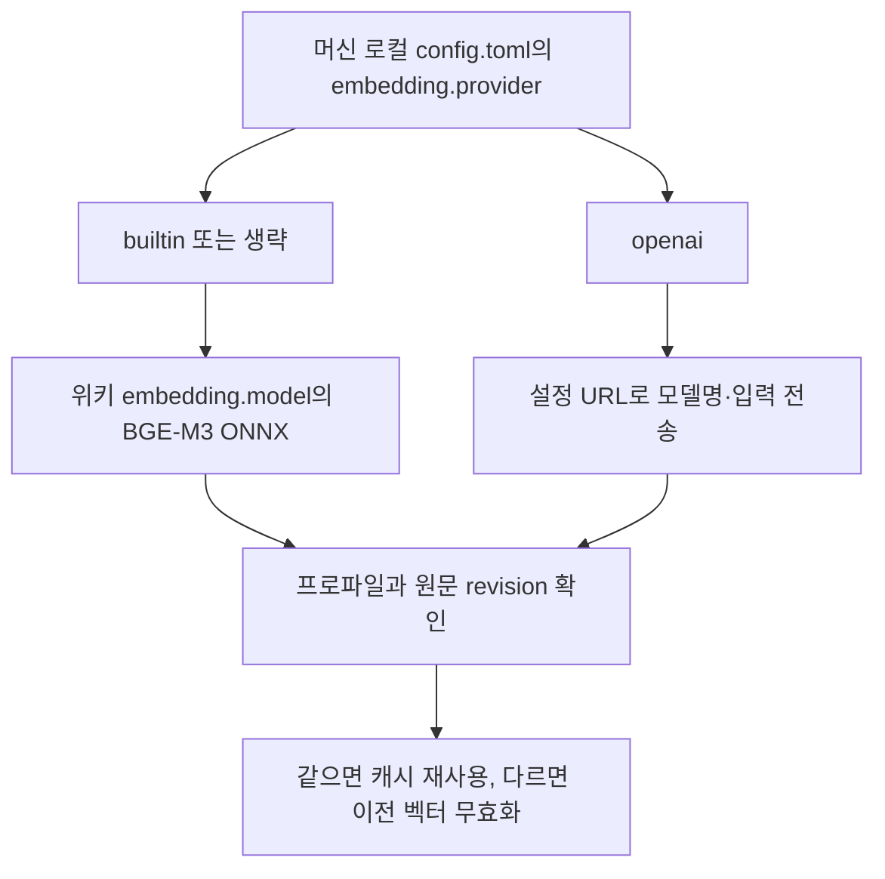

# 임베딩 제공자와 벡터 호환성

기본은 기존 내장 BGE-M3 ONNX 엔진이다. 선택적인 OpenAI 호환 API 제공자는
BGE-M3·EmbeddingGemma 2 등 서버가 제공하는 텍스트 임베딩 모델을 호출한다.
EmbeddingGemma 2를 내장 ONNX 엔진으로 실행하는 기능은 포함하지 않는다.
외부 제공자는 lite 빌드에서도 동작하며 ORT나 모델 파일을 확인·로딩하지 않는다.



## 설정 경계

`$XDG_CONFIG_HOME/canopy/config.toml` (기본 `~/.config/canopy/config.toml`)의
`[embedding]`만 외부 접속 설정을 읽는다. 위키 `canopy.toml`의 기존 `[embedding]`은
내장 모델 설정으로 유지한다. 비밀을 위키에 저장하거나 복사하지 않는다.
기존 머신 설정은 그대로 유효한 additive 변경이므로 데이터 마이그레이션 rung은
필요 없다. DB 레이아웃도 같으므로 캐시 스키마 번호를 올리지 않는다.

```toml
[embedding]
provider = "openai"
url = "https://example.com/v1/embeddings"
token = ""
model = "embeddinggemma-2"
dimension = 768
input_format = "auto"
revision = ""
```

- `url`: 전체 embeddings endpoint. `/v1`을 자동으로 붙이지 않는다. URL의 인증정보·쿼리·fragment는 거부한다.
- `token`: 선택적 Bearer 인증. 인증이 없는 로컬 서비스라면 빈 문자열을 유지한다.
- `model`: 서버가 받는 정확한 이름. `bge-m3`의 기본 차원은 1024,
  `embeddinggemma` 계열은 768이다. 다른 이름이나 축소 차원은 `dimension`으로 지정한다.
- `dimension`: 예상 응답 차원이다. 서버에 차원 축소를 요청하지 않는다.
- `input_format`: `auto`는 이름에 `embeddinggemma`가 있으면 query/document
  접두사를 붙이고 나머지는 원문을 전송한다. 명시적 `embeddinggemma`와 `plain`도 지원한다.
  서버가 이미 접두사를 처리한다면 `plain`으로 두어 중복을 피한다.
- `revision`: 서버가 같은 모델명으로 가중치·풀링·전처리를 바꾸면 함께 변경한다.
  클라이언트는 서버 내부 가중치 변경을 자동으로 알 수 없다.
- `provider = "builtin"`으로 바꾸면 위키의 내장 모델 설정을 다시 사용한다.

EmbeddingGemma의 접두사는 [공식 모델 설정](https://huggingface.co/google/embeddinggemma-2/blob/main/config_sentence_transformers.json)의
query (`task: search result | query: `)와 document (`title: none | text: `)를 따른다.
기존 chunk 입력에 제목이 들어 있으므로 document 접두사 뒤에도 제목과 본문을 보존한다.
외부 API를 선택하면 인덱싱할 문서와 검색어가 해당 서버에 전송된다.
설정 변경 후 실행 중인 `serve`는 재시작해야 한다.

## 재인덱싱과 실패

프로파일은 제공자·URL·모델·차원·입력 형식·revision·chunker/정규화 버전을 포함하며
토큰은 제외한다. 같은 차원의 다른 모델도 다른 벡터 공간이다. 인증 토큰 교체만으로는
재인덱싱하지 않는다. 원격 프로파일은 해시만 기록한다.

```bash
canopy model status --json
canopy reindex --check --json
canopy reindex
```

`model status`는 설정 유효성만 확인하고 API에 접속하지 않는다.
`reindex --check`는 추론 없이 현재 원문·설정을 대조하고 `needs_reindex` 페이지 수,
`profile`, `semantic_ready`를 보고한다. 이 점검은 파생 키워드 캐시를 갱신하고
호환되지 않는 벡터를 제거하므로 완전한 읽기 전용 명령은 아니다.
일반 reindex·semantic 검색은 필요한 문서 벡터를 생성한다. 웹은 기존 백그라운드
갱신 경로를 사용한다. API 실패 때 내장 모델로 자동 전환하지 않는다.
설정 오류 때 hybrid는 keyword로 강등하고, API 호출 중 오류는 명령 실패로 보고한다.
서버가 중단돼도 명시적인 `search --mode keyword`는 API 호출 없이 동작한다.

요청은 최대 16개 입력, 60초 timeout, context 취소를 사용하며 redirect를 따르지 않는다.
응답은 최대 32 MiB이고 index·개수·차원·수치를 검증한 뒤 L2 정규화한다.
서버 응답 본문과 URL·토큰을 전송 오류에 포함하지 않는다.

점검: `go test ./internal/config/ ./internal/embed/ ./internal/indexer/ ./cmd/canopy/`.
수용 불변식은 [invariants W](invariants.md#w-선택-가능한-임베딩-제공자).
