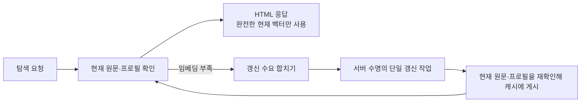

# Overview·Discover 응답 지연 수정

`v0.11.0`의 실제 서비스에서 `/browse`는 약 0.09초에 응답했지만
`/special/discover`는 30.09초를 기다린 뒤 200을 반환했다. `/`도 5초 요청
예산을 넘겼다. 메뉴의 링크와 라우트는 정상이다. 두 화면이 응답을 만들기 전에
전체 위키의 임베딩을 동기 갱신해, 캐시가 덜 준비된 설치에서 이동이 멈춘 것처럼
보였다. 이전 배포의 Browse·정적 자산 확인은 이 조건을 검증하지 못했다.

수정은 앱의 패치 버전 `v0.11.1`로 배포한다. 데이터·캐시 스키마는 바꾸지 않는다.
릴리스 코드 커밋은 `3844d1faf1cb29c71970a41b16be0f65f880ece2`다.

## 응답과 갱신의 경계

HTML은 추론 없이 원문 revision과 모델 프로필을 확인한다. 완전한 현재 벡터가
없으면 일반 탐색 정보와 의미 추천 불가 상태를 먼저 표시하고, 서버가 갱신 작업을
하나만 수행한다. 탐색 요청이 끝나도 갱신을 유지한다. 검색 중 들어온 갱신 수요는
검색 종료 후 이어받으며, 백그라운드 작업 중 검색은 현재 keyword 근거로 응답한다.

## 독립 적대적 리뷰와 보완

별도 리뷰 에이전트가 설계와 최종 diff를 읽고 반례를 제시했다. 아래 경계를 보완한
뒤 최종 리뷰에서 배포 차단 사유가 없음을 확인했다.

| 반례 | 보완 | 회귀 점검 |
|---|---|---|
| 갱신 작업이 검색 슬롯을 오래 점유하거나, 비어 있는 corpus를 완전하다고 보고 query 추론을 시작함 | 갱신 중 검색은 query 추론을 금지하고 keyword로 응답 | `TestBackgroundSearchStaysKeywordWhenCorpusBecomesEmpty` |
| 활성 검색이 취소되면 탐색에서 요청한 갱신도 사라짐 | 갱신 수요를 남기고 마지막 검색 종료 시 서버 작업으로 이어받음 | `TestBackgroundRefreshSurvivesCanceledActiveSearch` |
| 검사와 벡터 조회 사이 다른 요청이 원문·캐시를 교체함 | 응답 스캔의 revision별 벡터 조회와 전체 coverage 재검사 | `TestPageVectorsForBindsObservedSource`, `TestNavigationRejectsChangedCachedEvidence` |
| 콜드 홈에서 비어 있던 오늘의 연결 카드가 같은 날 계속 비어 있음 | 캐시가 준비된 첫 재방문에 연결 카드만 한 번 채움 | `TestNavigationDoesNotWaitForEmbedding` — 읽을 거리 시각·재방문 파일 바이트 대조 |
| 종료 시 갱신·검색이 사용하는 엔진을 먼저 닫음 | 서버 종료가 모든 엔진 소비 작업을 취소·join한 뒤 호출자가 엔진을 닫음 | `TestBackgroundCloseWaitsForEngineConsumers` |

## 검증

- 수정 전 `TestNavigationDoesNotWaitForEmbedding`이 멈춘 엔진 앞에서 실패했다.
  수정 후에는 같은 엔진을 풀기 전에 Overview·Discover·페이지·관심 목록이 응답한다.
- `make test test-ui test-cli test-assets i18n-check`, `go vet ./...`, `gofmt -l .`,
  `git diff --check`, 공식 `make release-check`가 통과했다. UI 37개, CLI 37개 검사에
  실제 lite hybrid→keyword 강등도 포함된다.
- webui·indexer·store의 `-race -count=3` 검사가 통과했다.
- 임시 HOME/XDG와 12개 합성 페이지에서 실제 ONNX 엔진의 콜드 HTTP 경로를 검사했다.
  RC 바이너리의 첫 Overview는 0.005초, Discover는 0.003초였다. 동시 탐색,
  갱신 중 keyword 검색, 완료 후 hybrid 검색, SIGTERM 종료까지 통과했다.
  별도 sandbox로 사용자 위키 접근과 모델·모듈 캐시 쓰기를 차단했다.
- 실제 브라우저의 클릭·페인트·접근성 검사를 수행한 것으로 세지 않는다.
  이 수정의 회귀 검사는 HTTP 응답과 서버의 추론·캐시·종료 경계를 확인한다.

불변식과 재실행 명령은 [V16](../../invariants.md)과
[웹 작업 공간 계약](../../web-contract.md)에 연결한다.

## 실제 배포 확인

[v0.11.1 릴리스](https://github.com/neutrospec/canopy/releases/tag/v0.11.1)와
[배포 Actions](https://github.com/neutrospec/canopy/actions/runs/37982643367)의
release·publish-tap 작업이 모두 성공했다. 게시된 네 플랫폼 lite 아카이브를
다운로드해 checksums.txt와 내장 자산·고지를 확인했다.

Homebrew 탭 커밋은 `805d5eb1f222180ca5f453aaf2aad0ea6acc593a`이며, 소스
아카이브 SHA-256은 `57c5511a183928f1478f3ce2ecd29ce161d5be13baf497f77b8898c3c055925d`다.
`brew upgrade neutrospec/tap/canopy`와 `brew test neutrospec/tap/canopy`가 통과했다.
설치된 full 바이너리는 `/opt/homebrew/Cellar/canopy/0.11.1/bin/canopy`이며,
SHA-256은 `54addef46752f759ceb2a523435e2f44fdd4c5576c6c07b0aafc7d1bfe486eba`다.
이 바이너리로도 별도 12페이지 콜드 위키의 HTTP·검색·정상 종료 검사를 통과했다.
첫 Overview 응답은 0.006초였다.

`brew services restart neutrospec/tap/canopy` 뒤 PID가 92180에서 86333으로 바뀌었고,
프로세스의 실행 파일이 위 `0.11.1` 바이너리임을 확인했다. 주소는 기존의
`http://localhost:8737`이다. 실제 위키의 동시 요청 결과는 아래와 같다. 인덱스가
준비되는 동안 의미 추천 불가 상태를 표시했으며 모든 응답의 선택 메뉴가 정확했다.
이 수치는 해당 확인의 관측값이며 응답 시간 보장은 아니다.

| 경로 | HTTP | 관측 응답 시간 |
|---|---|---|
| `/` — Overview | 200 | 0.428–1.001초 |
| `/special/discover` — Discover | 200 | 0.620–1.418초 |
| `/browse` | 200 | 0.038–0.067초 |

실제 위키의 본문·제목은 배포 영수증에 포함하지 않았다. 원문 위키를 테스트 fixture로
사용하지 않았으며, 위 실제 서비스 검사는 사용자에게 제공하는 탐색 응답만 확인했다.
