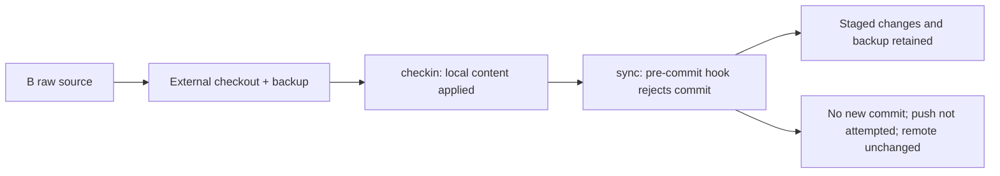

# Independent blind forward-use and documentation review — 2026-10-10

The forward-use exercise applied the requested knowledge and provenance to **named wiki B**, preserved default wiki A and the raw note, and correctly stopped with **remote sync incomplete**. The rejecting fixture hook prevented a new commit; push was not attempted. This report evaluates one actual execution, then independently reviews the current prose against help, outputs and implementation.

## Evidence and independence

| Artifact | Contents |
|---|---|
| [docs-adversarial-forward.json](docs-adversarial-forward.json) | Immutable initial run: instructions, environment, preparation, initial hashes, decision summaries, exact argv/stdin/stdout/stderr/exits, observed file contents, final hashes and the actual Korean answer. Events F1–F115. |
| [docs-adversarial-reproduce.py.txt](docs-adversarial-reproduce.py.txt) | Inert, explicitly opted-in replay of the actual preparation and forward-use commands in a new private temporary directory. |
| [docs-adversarial-review.json](docs-adversarial-review.json) | Separate subsequent review: initial prose snapshots and hashes, targeted implementation reads, raw probe results, within-session corrections and final cleanup receipt. Events R1 onward; executed review script text is included. |

The forward record was frozen at **2026-10-10 03:08:09 KST**, before public-document or implementation review began. Its SHA-256 is `25c929264e8b279e26e0b2b846c892fc9e98d31d915637d3c9ad520848854644`. A first independent usability assessment was recorded immediately afterward and before the document reads (R1). No existing `docs/review` or implementation report was consulted, including after that boundary, and no other worker was used.

Only AGENTS.md, the two operational embedded skills, the build entrypoint and actual CLI help informed forward use. The existing worktree was already dirty; build metadata identifies revision `ede67e302a8487aecbb4d59587a8686292018cf6`, Go `go1.27.1`, darwin/arm64 and `CGO_ENABLED=0` (R102). The private binary SHA-256 is `72ccc188a47694d858226eb37517dd72903d3db6ea76245fc5cb7a2077f97f28`.

All fixtures, Git repositories, HOME/XDG/TMPDIR and subprocess working files were under `/private/tmp/canopy-docs-blind-20261010-3ifvhdsi`. The build used `GOTELEMETRY=off`, `GOPROXY=off`, `GOSUMDB=off`, `GOTOOLCHAIN=local`, `GOFLAGS=-mod=readonly`, `GOMODCACHE=/Users/nobocop/go/pkg/mod` as the existing dependency cache, and the requested `GOCACHE=/private/tmp/canopy-improve-20261010/go-build`. `GIT_ALLOW_PROTOCOL=file` restricted remotes; there was no external download, push or network access. Later HTTP probes used loopback only. No real wiki or user service was accessed.

**Harness limitation:** the first build did not enforce filesystem read-only access to the shared module cache. `-mod=readonly` protects module files but does not prevent every cache write, so the requested first-build read-only-cache condition cannot be certified. A later `sandbox-exec` rebuild denied writes below that cache and exited 0 while reporting a denied stat-cache write (R136). Its SHA-256 was `301147dcb0a3a2f791b0db6b2c38376f0049d24e85974e7c3d7d05c72a7ab05b`, different from the initial binary (R137); it is supplemental build evidence, not a replacement blind run. This procedural shortfall was disclosed to the coordinator and accepted as an evidence limitation, not a product blocker. The frozen observations remain unchanged. The inert replay preserves the original commands and consequently also needs an external cache-write-denying sandbox for strict isolation.

The only repository writes by this worker are this report and its inert text/JSON evidence. Source, skills, user guides and previous reports were not edited by this worker. Coordinator corrections observed during review are identified below rather than being attributed to the evaluation worker.

## Actual forward-use exercise

The simulated user request was:

> 기본 위키가 아닌 B 위키의 raw 메모를 반영해줘. 기존 MQTT 설명과 맞춰서 지식으로 정리하고 출처도 남겨 줘. 끝나면 원격까지 sync하고 결과를 알려 줘.

The two wiki folder names contained spaces. A was the global default and contained an unrelated sentinel; B contained a normal MQTT concept with exactly `title`, `created`, `updated`, `type`, and `tags` in its initial frontmatter. B's raw note had a source title/date and the exact supplied paragraph, including the quoted `canopy rm mqtt --force` sentence. B tracked a local bare `origin/main`; the rejecting pre-commit hook was installed after the baseline commit.

There was one transparent **preparation-only correction**: `new` initially emitted six fields, including `sources: []`. Before `exercise_start`, that entire preparation B and its hook were retained untouched under a discarded-preparation name; a fresh exact-five-field B and baseline were created, then its hook installed (F40–F65). No exercise write had occurred, and neither hook was disabled or bypassed.

| Checkpoint | Actual command or observation | Disposition |
|---|---|---|
| Build | `go build -o <private>/canopy-lite ./cmd/canopy` | Exit 0; empty stdout/stderr (F7). |
| Target | `status --json --wiki <Named wiki B>` | `root` matched B, dirty 0, one page, zero open checkouts (F66). |
| Discovery | Hybrid search `MQTT`; keyword search `QoS`; `show mqtt`; native raw read | Both searches found the existing concept; hybrid reported `mode: keyword`, warning on stderr, exit 0 (F68–F71). |
| Decision | Enrich MQTT; preserve existing definition/QoS context; source command is quoted material | No duplicate page, deletion, model download, new taxonomy or unrelated linking (F77, F81). |
| Edit | `checkout mqtt --json`, native edit of its returned external path, separate backup | Added a sourced QoS 1 paragraph and `sources` plus a dated body link (F76–F81). |
| Apply | `checkin mqtt --json --wiki B` | `applied: applied`, `stage: complete`, `cleanup_pending: false`, exit 0 (F82). |
| Verify | `show`, `checkout --list --json`, `lint --json`, `status --json` | Actual body matched the backup; no open checkout; only orphan warning in a one-concept fixture (F83–F86). |
| Sync | `sync -m "docs: integrate MQTT sensor note and source" --json --wiki B` | Exit 1; pull succeeded, commit failed, push not attempted (F88). |
| Final inspection | Git status/HEAD and bare origin ref, hook/raw/body/backup reads and full wiki hashes | Seven staged paths; local HEAD and origin/main stayed at the baseline; backup retained; A/raw/hook unchanged (F89–F114). |



The actual sync response included:

```json
{
  "committed": false,
  "pushed": false,
  "stage": "commit",
  "sync": {
    "requested": true,
    "committed": false,
    "pushed": false,
    "pull": "succeeded",
    "commit": "failed",
    "push": "not_attempted",
    "stage": "commit"
  }
}
```

Its error was `git commit -m docs: integrate MQTT sensor note and source: exit status 1: fixture pre-commit: commit rejected`; stderr reported the same error. The intentionally installed hook is the exercise blocker, **not a product regression**. It was reported to the coordinator before continuing review.

| Preserved fact | SHA-256 / Git object |
|---|---|
| Baseline, final local HEAD and final bare origin/main | `272e3175521fc086fb7c25a2e17b3b864c1fc8db` |
| Initial MQTT page, five frontmatter fields | `e68d70804419f28f86c33400e0da16abad20d944b698a9984176ac13849665d6` |
| Final MQTT page and retained edit backup | `962c9083faf8ba3dedf00551e202a2eb20b63f95f45ff6e72da7a8ab0d274849` |
| Raw source before/after | `00fb223dcf9bb4ee3d0c8825946b57280724115ef077a903575e90dc64698ca9` |
| Rejecting hook before/after, executable mode `0755` | `c831d7ddcfc73151cfa47de7911413f43a8cd040302dfca1cc0a551934cffaca` |
| Global config before/after, still default A | `143f6e9e20bbf73faacdeef106eea919a3d80a645c2fcb0a45fc76bd4cefe13b` |
| All A wiki files | Complete seven-file manifests identical, F59/F109. |

The exact final user-facing answer at the frozen exercise boundary was (F113):

> B 위키의 [[mqtt]]를 보강했습니다. 기존 설명에 QoS 1의 중복 수신 가능성과 안정적인 측정 식별자 기반 중복 제거 권고를 연결하고, raw/articles/mqtt-sensor-field-note-2026.md를 sources와 날짜가 있는 본문 출처에 남겼습니다. 원문과 기본 위키 A는 그대로입니다. 본문을 대조했고 lint에는 기존 단일 페이지의 orphan 경고만 남았으며 열린 편집 사본은 없습니다.
>
> 원격 sync는 완료하지 못했습니다. pre-commit hook이 커밋을 거부해 새 로컬 커밋이 없고 push도 실행되지 않았습니다. 수정본은 B에 staged 상태로 남아 있으며, 편집 백업은 /private/tmp/canopy-docs-blind-20261010-3ifvhdsi/tmp/mqtt-before-checkin-backup.md에 보존했습니다. 훅의 거부 원인을 해결한 뒤 같은 B 위키에서 sync를 다시 실행해야 합니다.

This is a historical answer at freeze time: after evidence preservation, disposable fixture files and that backup are removed; the durable JSON retains their exact text and hashes.

## Independent usability assessment

Explicit target selection, checking `status.root`, consistent `--wiki`, search-before-write, preserving raw, and backup-before-checkin were actionable in this run. JSON, stderr and exits together made the partial sync outcome clear. The task did not need an extra approval, model, arbitrary link, taxonomy extension or cleanup of unrelated warnings.

Two small skill clarifications would improve recovery guidance. `canopy_wiki.md:281–283` explicitly explains push failure but could also say “commit 단계 실패는 새 커밋 없이 staged 변경이 남을 수 있다; `sync.commit/push`를 확인하고 훅을 자동으로 우회하지 않는다.” `canopy_wiki.md:155–158` and `canopy_ingest.md:53–55` conservatively warn that the copy may be gone; current help/implementation also preserve a `cleanup_pending` copy after local postprocessing failure and permit a matching recorded application to resume. Suggested addition: “`cleanup_pending`이면 사본을 보존하고 `repair`와 `checkout --list`에 따라 같은 적용의 미완료 단계를 복구한다. 선택한 sync만 실패했다면 로컬 checkin은 이미 완료됐을 수 있다.” These are nonblocking clarity suggestions; the existing instruction to inspect results prevented an incorrect repeat in this exercise (R32/R37).

The ingest instruction to verify installation commands/APIs against official documentation (`canopy_ingest.md:68–70`) should be read in the context of claims being incorporated. An irrelevant quoted command in source material does not need to become an execution or verification gate. This run treated it that way. Suggested wording: “위키에 사실이나 실행 지침으로 채택하는 명령·API·경로는 해당 버전 공식 문서로 확인한다.”

This was **one controlled agent execution** with a deliberately rejecting hook and a tiny wiki. It does not estimate general LLM efficacy, safety rates, factual accuracy, other models' behavior or skill success rates. Semantic retrieval quality, int8 quality/performance, real browser behavior, actual Homebrew installation and external deployment were not evaluated. No-model empty recommendations cannot certify recommendation quality.

## Prioritized documentation findings

Locations below refer to the initial review snapshots in R3–R21 unless a subsequent correction is explicitly stated. The snapshots remain available even when coordinator edits shift current line numbers. P1 means a deployment boundary should be corrected before relying on the recipe; P2 means an operational or instruction-contract correction; P3 means a lower-impact clarity issue.

### AD-01 — P1: proxy recipe omitted Host acceptance and overstated authentication coverage

**Location:** `docs/troubleshooting.md:51–52`, English `:54–55`; `docs/philosophy.md:173–178`.

**Proof:** Actual `serve --help` exposes `--allow-host` and says forwarded headers are ignored (R70). On two loopback-only fixture servers, the same domain authority returned 403 without the option and 200 with it; the latter had no authentication redirect (R75–R82). `cmd/canopy/serve.go:51–58` enables authentication from the listener bind, independently of extra Host authorities. Localhost remained accepted after adding the trusted domain (R80).

**Consequence:** Following the Caddy/nginx recommendation with a preserved domain Host produces a 403 until configured. Allowing that Host does not add authentication to a publicly proxied loopback backend. The original claim that a public-but-unprotected configuration mistake is impossible exceeds this implementation's boundary.

**Suggested wording:** “프록시가 전달하는 Host authority를 `--allow-host`로 기본 허용 Host에 추가한다. 이 옵션은 인증·TLS를 활성화하지 않는다. 외부 바인딩 인증 보장은 listener에 적용되며, 공개 프록시 뒤 loopback backend는 프록시 인증 또는 인증되는 backend 구성이 필요하다.”

**Follow-up:** Coordinator corrected both troubleshooting mirrors and narrowed philosophy's guarantee during this review (R132–R134). The unchanged probe evidence supports that correction. The separately reported additive-Host precision was also corrected in R162: “기본 허용 Host에 명시한 authority를 추가.” No external listener or new auth mechanism was tested or requested.

### AD-02 — P2: runnable audit examples fail or exercise the wrong refusal

| Location | Actual proof | Practical consequence and suggested correction |
|---|---|---|
| `docs/invariants.md:101`, G7 | Successful `new --json` places `related` under `result`; `jq '.related[].score'` exits 5, `Cannot iterate over null` (R42–R44). | Audit cannot inspect current output. Use `.result.related[].score`, an executable command with title/type/slug/wiki, and require a populated model-backed related-page fixture. **Coordinator fixed; corrected selector rechecked against the unchanged saved object, exit 0 (R84–R85).** Empty output proves selector compatibility only. |
| `docs/invariants.md:176`, M1 | macOS `/usr/bin/grep -lP ...` exits 2, `invalid option -- P`; equivalent Unicode `rg -l '[가-힣]' ...` reports no matches with exit 1 (R60–R61). | A documented macOS audit errors before inspection. Use the existing Go test or `rg`, and distinguish its no-match exit 1 from execution error exit 2. |
| `docs/philosophy.md:32–33` | The Korean-only title without `--slug` fails filename derivation, not missing-link validation (R123). Adding an explicit slug reaches the intended `--links target ... does not exist` error (R124). | “Any error” can falsely certify the link gate. Supply `--slug link-probe --wiki "$W"` and assert the intended diagnostic plus unchanged files. |
| `docs/philosophy.md:84` | `search --mode semantic` without a query exits 1 at argument validation (R27). | It cannot test offline semantic search. Include a quoted query and explicit wiki, with ORT/model/index prerequisites; unavailable prerequisites mean unverified. |

The coordinator subsequently corrected M1, link-refusal and query examples (R162–R163). None of these original example defects establishes a defect in the actual validation implementation. The semantic prerequisite is explicitly unverified here.

### AD-03 — P2: blanket direct-file prohibition contradicts permitted raw/schema operations

**Location:** `README.md:183–184`, English `:200–202`; getting-started Korean `:179–180`, English `:187–188`; compare `canopy_ingest.md:46–51` and `canopy_wiki.md:129–134,168–170`.

**Proof:** The public prose says all agent wiki-file edits must always pass through canopy. The operational skills explicitly require saving new raw source files and adding demand-backed topics to `canopy.toml`; the root CLI has no raw-import or taxonomy-write verb (F8). The more precise skill wording restricts page/index/log/state writes and separately permits ingest storage.

**Consequence:** A literal agent can refuse authorized source preservation or schema maintenance, or invent a nonexistent CLI command. The task's existing raw source avoided this ambiguity; that is not proof a new-source ingest would work.

**Suggested wording:** “페이지 Markdown과 자동 생성 인덱스·로그·상태의 변경은 canopy 명령을 사용한다. 새 raw 원문 저장과 `canopy.toml` 스키마 편집은 해당 절차에 따라 수행하며 기존 raw는 보존한다.” Apply the same scoped exception in English.

### AD-04 — P2: current authoring policy leaves out the supported human CLI route

**Location:** `docs/philosophy.md:137–151`; compare getting-started `:149–158` and optional-agent prerequisites `:49`.

**Proof:** The current grade table's main route is LLM-agent-only, and substantial writing/restructuring is required to use that route. The tutorial explicitly supports solo human authoring through the same checkout/checkin/lint/sync commands. `writeops` does not depend on whether a human or LLM invoked the CLI. The same principle acknowledges that agent use does not prove semantic accuracy (`:135`).

**Consequence:** The prose creates an extra LLM prerequisite for work the product and tutorial support without one. This is an instruction/design inconsistency, not a measured claim that either humans or LLMs are more effective.

**Suggested wording:** “본격적인 작성·개편은 명령별 검증과 콘텐츠 검토를 거친다. 사람과 스킬을 사용하는 에이전트 모두 이 경로를 사용할 수 있다.” Include human CLI use in the main-route table; keep unreviewed direct edits and reviewed pipeline writes distinct.

### AD-05 — P2: int8 recipe omits selecting the converted model and rebuilding embeddings

**Location:** `README.md:218–219`, English `:237–239`; getting-started `:120–123`, English `:127–131`.

**Proof:** The documented converter defaults to a separate `bge-m3-int8` destination (actual `--print-paths`, R67; source `scripts/quantize-model.py:16–19`). The initial wiki remains configured for `bge-m3`; `loadWiki` selects exactly `embedding.model`, and `DefaultModelPath` follows that name (R101/R106–R108). The config source explicitly says converter users must set the field to `bge-m3-int8`.

**Consequence:** Running the one-time converter alone leaves inference on fp32, despite the nearby int8 performance claims.

**Suggested wording:** “변환 후 대상 위키의 `[embedding].model`을 `bge-m3-int8`로 바꾸고, 같은 `--wiki`로 model status를 확인한 뒤 reindex한다.” State required conversion dependencies or direct readers to the converter's help. The review did not download, convert or benchmark a model.

### AD-06 — P2: deterministic candidate wording is false for resurface's default/random selection

**Location:** `README.md:143`, English `:156`; `docs/philosophy.md:100–106`.

**Proof:** `resurface --help` describes auto as 70% random/30% hub (R91); the CLI seeds RNG from current nanoseconds (`cmd/canopy/resurface.go:47–48`, R64), and selection uses the RNG (`internal/resurface/pick.go:109–158`, R59). Six `random --peek` calls against identical wiki-file hashes produced beta, delta, alpha, gamma, delta, gamma (R92–R100).

**Consequence:** Reviewers can mistake intentionally changing samples for a failure of reproducibility, or rely on `--peek` as a stable selection rather than a non-writing preview.

**Suggested wording:** “코드가 날짜·연결·상태에 따라 후보를 고른다. bridge와 hub 순위는 조건을 고정해 비교할 수 있으며 resurface의 random/auto 선택은 실행마다 달라질 수 있다. `--peek`는 상태 기록을 하지 않는다.” This does not estimate any selection-quality rate.

### AD-07 — P2: port-conflict advice terminates unrelated instances

**Location:** `docs/troubleshooting.md:54–55`, English `:57–58` (shifted downward by the proxy clarification).

**Proof:** The recommendation is global `pkill -f "canopy serve"`. A read-only, parent-restricted `pgrep -fl` using that same pattern matched both inert fixture process command lines (R125–R131). Neither was a listener; this illustrates the full-command-line matcher, not a failure of canopy. No `pkill` was executed and no user process was enumerated or signaled.

**Consequence:** Resolving one occupied port can stop other wiki instances or unrelated commands whose arguments contain the pattern.

**Suggested wording:** “해당 포트를 점유한 PID와 명령을 확인하고 자신이 시작한 대상 프로세스만 종료하거나 다른 `--addr` 포트를 사용한다.” Avoid a global pattern kill as the default recovery recipe.

### AD-08 — P2: the tutorial opens a different folder in Obsidian

**Location:** getting-started Korean `:64,139`; English `:69,147`.

**Proof:** The tutorial creates `$HOME/canopy-demo`, then tells the reader to select `~/wiki`. These are different literal paths (R7/R9/R105).

**Consequence:** A newcomer can create/open a second vault or view the wrong wiki, then conclude canopy's generated page is missing.

**Suggested wording:** “Open folder as vault에서 위에서 만든 `$wiki` 폴더(이 예에서는 `~/canopy-demo`)를 선택한다.” Mirror the same actual path in English.

### AD-09 — P3: migration checks are described as proof of losslessness

**Location:** `docs/upgrading.md:33–35,80–86,91`; English `:36–39,87–93,98`.

**Proof:** The checks compare `model_path`, `.pages` and an HTTP status. They do not compare page/raw/log/state contents. Equal paths/counts can coexist with different bytes; current before/after probe updates preserve one page while changing its content hash (R42/R54). No actual upgrade data loss is alleged (R122).

**Consequence:** A basic installation/routing check is presented as a complete preservation proof, and can falsely reassure a reviewer about unrelated state or source changes.

**Suggested wording:** “동일 HOME/XDG에서는 바이너리 위치를 바꿔도 데이터 경로를 재사용한다. 아래는 경로·개수·서비스 기동 확인이며 전체 데이터 보존의 증명은 아니다.” For stronger assurance refer to backup/content comparison while accounting for intended migrations; do not add an unrelated mandatory audit gate.

### AD-10 — P3: remaining precise-writing issues

| Location | Proof and consequence | Suggested wording |
|---|---|---|
| README Korean `:141`, English `:154` | It places all index refresh after push; actual sync regenerates Markdown indexes before commit and refreshes the derived search cache afterward (`cmd/canopy/write.go:823–903`, R58). Readers cannot tell which index travels in the commit. | “pull → Markdown 인덱스 재생성 → commit → push → 검색 캐시 갱신.” |
| Getting-started Korean glossary `:39`, English `:44` | “AI model embedded in canopy” conflicts with external, separately downloaded model files (F13, R24/R106). | “내장 추론 코드와 별도로 설치한 로컬 bge-m3 모델”; clarify offline use after preparation. |
| Troubleshooting Korean `:9–10` | “다음 세 경우” introduces only two cases. English already says “these cases.” | “다음 경우.” |

## Corrections observed during this review

The coordinator applied changes while this worker retained read-only ownership of the reviewed material. These are observed prose corrections, not a second blind evaluation or independent certification of the whole release.

| Finding | Observed correction and evidence |
|---|---|
| AD-01 | Host/proxy/auth scope and additive wording clarified (R158–R159/R162). |
| AD-02 | G7 outer selector and model prerequisite corrected; M1 uses the existing named Go test; link check has an explicit slug; offline semantic check includes a query and preparation conditions (R162–R163). Only the corrected JSON selector was rerun against saved output. |
| AD-03/AD-04 | Page writes are scoped separately from raw/config handling, and the main authoring route includes humans using canopy (R154–R157/R162). |
| AD-05 | Both README and tutorial now select `bge-m3-int8`, check the selected model and rebuild embeddings (R154–R157). No conversion or benchmark was run. |
| AD-06 | Random/auto sampling is distinguished from ranking under fixed inputs (R154–R155/R162). |
| AD-07/AD-08 | Port recovery targets the intended process; Obsidian opens the tutorial's actual wiki (R156–R159). |
| AD-09 | Upgrade checks are limited to paths/counts/startup, and rollback compatibility is explicit (R160–R161). |
| AD-10 | Sync index ordering, separately installed model wording and the two-case introduction were corrected (R154–R158). |

The skill recovery and adopted-claim verification clarifications were also observed in the coordinator's final skill sources (R167–R168). They were compared with the frozen operational source, not substituted into the completed exercise. All AD-01–AD-10 prose corrections were observed; model-dependent behavior and recommendation quality remain outside this evaluation.

## Checks that did agree, and limits

Initial and subsequent `make i18n-check` runs passed (R33/R121/R138); this does not certify prose accuracy. A check during the coordinator's later edits reported four stale translation markers (R166); the final recheck passed for all four mirrors (R169). Korean inside identical command fences was deliberately **not** treated as a translation bug, and design records were not required to have English mirrors.

The actual CLI's `model_path`, `list.count`, taxonomy keys and version/cache fields matched the guides where checked (R23–R26). A separate local bare-remote fixture with no upstream confirmed that remote steps were skipped and a local commit succeeded, so the guide's no-upstream claim was **not** reported as a defect (R46–R57). Successful checkin reclaimed its copy and an optional sync can fail after that point; the conservative backup advice is justified. The JSON/stderr/exit contract exposed the hook failure accurately.

No broad Go/ORT/browser suite was claimed to have run for this read-only review. Read-only code comparisons, private CLI/HTTP probes and document synchronization checks are the verification performed. The frozen exercise record is not rewritten to incorporate later fixes. Final evidence includes confirmation of its hash and deletion of disposable fixture directories; only text, hashes and inert replay material are retained.
