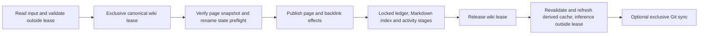

# Preservation implementation — 2026-10-10

Accepted PLAN-03/04/05/06 and the six-verb mutation JSON portion of PLAN-08 are
implemented. This is implementation evidence, not a modification of the
2026-10-09 historical audit. V1–V4/V8 were documented in `docs/invariants.md`
before implementation; the public JSON contract was written in
[mutation-results.md](../../../mutation-results.md) before the command rewrite.
No repository commits, release tags or external pushes were made. Git pushes in
the tests target disposable local bare repositories only.

## Changes and preservation boundaries

| Plan | Implemented behavior | Evidence |
|---|---|---|
| PLAN-03 | Pull checks unmerged index/in-progress Git state before and after autostash; commit checks before add and again before commit; push also refuses unsafe state. Successful sync regenerates Markdown indexes from the pulled tree before committing. | `internal/gitops/gitops_test.go`; binary autostash and sync-boundary cases. |
| PLAN-04 | Completed same-directory temp publication; exclusive completed-file create; no-replace archive/move; existing permission bits preserved; symlink/special targets refused. Shared canonical wiki locks and per-file locks work across processes; exclusive writers clean reserved abandoned scratch before staging. | safefile publication-fault, complete-reader, killed-writer and cleanup tests; wikilock alias/process/RMW tests; binary concurrent create and blocked-sync cases. |
| PLAN-05 | Errors distinguish no page publication, applied page, partial multi-file effects and unobservable state. Checkout metadata errors expose an orphan without overwriting its copy. Checkin retains pending/applied hashes and the copy until postprocessing/cleanup complete; matching resumptions do not reapply the page. | checkout preservation tests; writeops stage tests; six-verb command/binary fault matrix. |
| PLAN-06 | Extraction/rewrites share CommonMark code boundaries; frontmatter/code are preserved; path/extension/alias/anchor/self links and type-only moves work. Flat scan/lookup reject ambiguity, retain lawful dotted/underscore slugs and diagnose nested paths as unsupported. YAML unknown fields/comments stay verbatim; unsupported targeted scalar forms reject before writing. | wiki preservation tests; command move/backlink/state tests. |
| PLAN-08 JSON | One outer JSON object for new/update/mv/archive/rm/checkin, basic and sync, including known failures. Actual commit/push results and compatibility fields remain available. An unobservable push is explicitly unknown. | six-verb command matrix, observed/unknown push-ack tests, real binary whole-stdout parsing. |

`safefile.WriteFile` replaces a regular destination with a completed temp;
`CreateFile` publishes by linking the completed temp only when the destination is
absent; `MoveNoReplace` links the complete source before removing it. File sync,
close and publication are ordered, and a failure after publication has a typed
`PublishError`. Ordinary failure removes scratch. `.canopy-tmp-` is reserved,
never ends in `.md`, is excluded from canopy staging, and is removed by the next
exclusive mutation/sync. Cleanup preserves Markdown files, symlinks and Git
internals. A killed process therefore leaves a complete old or new page, rather
than a truncated page or a partially written destination.

## Lock protocol and integration

`wikilock.Acquire(ctx, root)` obtains the exclusive wiki lease;
`AcquireShared(ctx, root)` obtains a shared lease; `AcquireFile(ctx, path)` obtains
an exclusive resource lock. Symlink resolution through the nearest existing
ancestor produces a common lock key. Lock files live under the configured XDG
cache outside the wiki and survive process death without retaining the OS lock.



Standalone metadata RMW uses a shared wiki lease and then its per-file lock.
Already leased page/sync callers use explicit `Locked` metadata entrypoints.
The order is always wiki then file; no code reacquires an exclusive wiki lease
from a callback already holding it. `writeops.RunLocked` performs only short
ledger/scan/Markdown-index/log stages. `writeops.Refresh` runs afterward and uses
the indexer's revalidated publication protocol. `relatedAfterCreate` also runs
outside the exclusive lease, uses `EmbedContext`, and refreshes source/profile
state before searching; failed optional recommendations return no evidence.

Sync owns the exclusive lease through Git pull/status/add/commit/push. Input and
model work do not hold it. A Git hook or network operation can delay another
cooperating writer while sync is running; this is deliberate serialization of
the Git publication boundary, not a model-wide lock. The binary precommit FIFO
test confirms a second writer waits, then succeeds locally without being
included in the earlier remote commit.

Root integration points are `reconcile.RecordLocked`,
`reads.CanRenameInWiki` before publication, and `reads.RenameInWiki` afterward.
Known corrupt/extended read state or a populated conflicting agent destination
refuses the rename while the old page hash still exists. Agent-only history
migrates; the root-owned read policy refuses an agent destination whose distinct
days cannot be reconstructed from aggregate counts. Unexpected state-save I/O
failure after publication is reported as applied, with the actual page hash.
Task/request/cooldown history policy remains owned by the root state changes;
this worker does not rewrite historical proposal prose.

## Recovery and validation scope

An orphan is an existing copy whose metadata is missing, corrupt, unreadable,
future/unsupported, or incomplete. `checkout --list` includes its status,
diagnostic, copy path and rescue instruction. Checkout refuses to overwrite it.
The user can copy the draft to a safe location, inspect the current page, then
explicitly discard the unusable checkout. Normal checkin validation failures
also keep the draft.

Checkin saves its intended publication hash before publishing, then records the
applied hash before cleanup. A retained exact match can repeat postprocessing
and cleanup without rewriting the page. A stable operation ID deduplicates
activity across months, including a failure after activity but before cache or
cleanup completion. Metadata-only cleanup after an unchanged checkin resumes
as a no-op. New external page/copy changes refuse resumption and remain intact.

Known failure stages include target publication, backlinks, state preflight or
save, ledger, Markdown index, activity log, derived DB and cleanup. Each failure
keeps nonzero exit and the actual publication state; the JSON object does not
turn a successfully published page into a claim of no changes. Non-checkin
multi-file partial effects require inspection and repair, not blind replay.
`canopy reindex` repairs the search cache; safe `canopy sync` regenerates the
Markdown indexes and commits all wiki changes.

The five-key frontmatter presence rule remains a lint diagnostic. Existing
update/mv tolerate legacy missing/null/scalar/unknown tags. New pages validate
explicit type/tags and generate valid YAML; checkin retains its established
title/type/created/taxonomy/Mermaid gates. Targeted multiline/block scalars,
aliases, anchors and complex values are rejected before writing. Unrelated
unknown YAML, large numbers, nested values and comments are preserved exactly.
Backslash/quote/newline titles round-trip through generated YAML.

Scan and lookup retain the flat governed namespace; nested pages are not newly
made addressable. Duplicate slugs produce both paths in the diagnostic instead
of a last-file-wins map. A lawful `foo.md.md` (slug `foo.md`) may coexist with
`foo.md` (slug `foo`): the ambiguous bare spelling requires an explicit governed
path, and link edits retain the correct target using `.md.md` when needed.

## Executed checks

Environment: Darwin arm64, Go 1.27.1. Every Go/canopy/Git child was started with
disposable HOME, XDG config/cache/data/state and TMPDIR, `GOTELEMETRY=off`,
`GOPROXY=off`, `GOSUMDB=off`, and the permitted existing
`GOMODCACHE=/Users/nobocop/go/pkg/mod`. No actual user wiki was opened. The binary
driver builds with `CGO_ENABLED=0`, records the binary hash and owned-source
hashes, and removes its fixture tree afterward.

| Check | Result | Durable output |
|---|---|---|
| Focused normal Go tests for safefile/wikilock/gitops/wiki/checkout/writeops/genindex/logops/cmd | Pass | command matrix output and race output below; initial focused runs also passed. |
| `go test -race -count=1` for the same owned packages and cmd | Pass | [preservation-race-tests.txt](preservation-race-tests.txt). |
| Six-verb command matrix, legacy controls, partial failure and commit/push observation tests | Pass | [preservation-command-tests.txt](preservation-command-tests.txt). |
| Real lite binary, whole stdout JSON parser, stderr/exit/file/stash/remote observations | 62/62 pass | [preservation-cli-results.json](preservation-cli-results.json). |
| Killed publication before/after boundary; alias multiprocess RMW | Pass | Safefile/wikilock race checks; four RMW children preserve all 80 accepted increments. |
| Focused `gofmt -l` and `git diff --check` | Empty output / pass | Rechecked before dispatch completion. |

The binary matrix includes 36 six-verb basic/sync success/refusal/postpublication
cells, 12 commit/push rejection cells, four no-op cells, autostash conflict,
three orphan cases, two-wiki isolation, concurrent FIFO create, blocked sync,
abandoned scratch, F2 hybrid-to-keyword fallback and early parse exception.
The output records actual argv, stdout, stderr, exit, old/applied hashes, remote
tips, source recovery and cleanup, rather than treating a passing parser alone
as evidence of preservation.

| Verb | Basic + sync success | No-op | Prepublication refusal | Postpublication | Commit / push failure |
|---|---|---|---|---|---|
| new | Both | N/A: exclusive create must have a new target | Existing slug | Index fault, applied hash | Both |
| update | Both | N/A: explicitly records normalization | Unsupported targeted YAML | Index/log/DB stage, applied hash | Both |
| mv | Both | Same type/slug, both modes | Invalid destination/type; known read-state conflict | Backlink partial; unexpected read-state save failure; index fault | Both |
| archive | Both | N/A: absent page is an error | Existing archive bytes | Index fault, archived hash | Both |
| rm | Both | N/A: absent page is an error | Backlinks without force | Index fault, confirmed removal | Both |
| checkin | Both | Unchanged, both modes | Gate/base/metadata refusal | Retained applied hash, index/cache/cleanup failure and resumption | Both |

Re-run the binary matrix with no environment preparation needed:

```sh
python3 docs/implementation/2026-10-10/reports/preservation-cli.py
```

The driver constructs child environments before invoking Go. The coordinator's
final full-repository checks cover root/search/docs-owned integration; this
report's package and binary checks concern the preservation dispatch. A
temporary concurrent integration compile failure was reported to the owners
and resolved before the successful final checks.

## Limits

This is a single-file publication boundary plus explicit multi-file failure
accounting, not a general transaction/rollback framework. Process kill and
injected write/durability/cleanup faults were tested; physical power loss,
all filesystems, quota exhaustion, ACL/owner/xattr retention, hard-link identity,
Windows, actual remote credentials/networks and native ORT/model execution were
not certified. Existing permission bits are preserved, while symlink/special
destinations are refused. Cross-filesystem hard-link publication fails safely
without removing the source.

Cooperation requires the same configured XDG lock home and canonical wiki.
Noncooperating editors or external Git can still change bytes after a final
hash check; those races are outside the lock guarantee. Existing path-keyed
checkout/state namespaces are unchanged; symlink aliases share locking without
silently migrating or merging saved machine-local namespaces. Network loss can
leave push outcome unknown; a reachable remote observation establishes whether
the requested tip is present, and the JSON preserves that distinction.

No remaining implementation item is intentionally deferred within this
dispatch's selected minimum. Coordinator-owned final integration/release
decisions and the explicitly unverified environments above remain separate.
