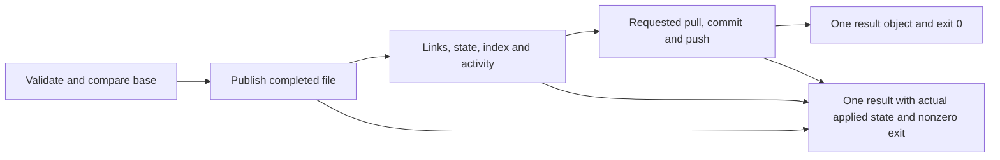

# Mutation results

This contract is defined before the PLAN-03/04/05/06/08 implementation. It applies
to `new`, `update`, `mv`, `archive`, `rm`, and `checkin`, with and without `--sync`.
Other commands retain their own JSON contracts. Historical audit reports describe
the old behavior and remain unchanged.

`--json` writes exactly one outer JSON object to stdout after command execution
starts. Diagnostics go to stderr. Exit 0 means every requested step completed
(including an explicitly requested sync); a documented no-op also exits 0.
Validation, publication, postprocessing, cleanup, commit, and push failures exit
nonzero and still emit the object. Argument/flag parsing and startup/bootstrap
errors before the mutation handler starts are exceptions: stdout may be empty,
stderr explains the error, and exit is nonzero. Empty stdout does not establish
that startup had no effects.

| Field | Meaning |
|---|---|
| `schema_version` | Integer `1`; consumers must ignore additive unknown fields. |
| `command` | One of the six CLI verb names. |
| `status` | `ok`, `noop`, or `error`. |
| `applied` | `none` (no requested page publication), `applied` (all requested page effects published), `partial` (some page effects published), or `unknown` (publication could not be established). |
| `stage` | Last completed stage on success (`complete`), or failed stage: `validate`, `lock`, `publish`, `backlinks`, `state`, `ledger`, `scan`, `index`, `log`, `reindex`, `cleanup`, `pull`, `commit`, or `push`. |
| `error` | Human-readable error on failure, absent on success. |
| `repair` | Concrete next action on failure; never an instruction to blindly repeat a partially applied mutation. |
| `result` | Verb-specific result; partial results remain available on failure. |
| `sync` | When requested: `requested`, `committed`, `pushed`, `message`, and `pull`/`commit`/`push` outcomes (`not_attempted`, `skipped`, `succeeded`, `failed`, or `unknown`). |
| `committed`, `pushed`, `message` | Compatibility fields mirroring `sync`; present when sync was requested. A skipped push is `pushed:false`. |

`result` retains the original useful payload: `created`/`related` for new;
`updated` for update; `from`/`moved` for mv; `archived` for archive; `deleted`
for rm; and `rel_path`, `unchanged`, line counts, warnings, `applied_hash`,
`cleanup_pending`, and `resumed` where applicable for checkin. A discard is a
checkin no-op for page publication. `cleanup_pending` means the checkout still
needs reclamation; failures preserve diagnostic metadata and the remaining copy.
`applied_hash` identifies the bytes published by the page mutation, before any
optional Git pull/rebase. A later successful sync may merge additional upstream
changes; this hash is the application receipt, not a claim about a future tree.
`pushed:false` means no confirmed push; consult `sync.push` to distinguish a
known rejection/skip from an unobservable outcome. An observed accepted push can
be `pushed:true` even when Git returned an error (for example a lost acknowledgement).

Publication uses a completed same-directory temporary file. Before publication,
failure preserves the old file bytes. After publication, a failure reports the
actual applied state, even if a directory sync or follow-up step failed. A
multi-file rename/delete/archive can be partial; the result names the operation
and repair requires inspecting its source, destination and backlinks. No general
multi-file rollback or power-loss durability is promised.

Checkin records a pending application before publishing and records the applied
hash before cleanup. A retained checkout whose recorded applied hash equals the
current page can resume cleanup without rewriting the page or repeating its
activity record. A changed page/copy is refused and preserved for inspection;
missing or corrupt metadata never authorizes overwriting an existing copy.
`checkout --list` exposes orphan and cleanup diagnostics. Rescue is to copy the
listed working file to a safe location, inspect the current wiki page, then use
explicit `checkin --discard` to remove the unusable checkout.

Cooperating processes use a symlink-canonical wiki lock. Page read/validate/
publication and short filesystem postprocessing use an exclusive lease;
standalone metadata RMW uses a shared wiki lease and a per-file exclusive lock;
sync holds the exclusive lease through Git operations. Already leased callers
use explicit `Locked` state helpers, so nested acquisition cannot deadlock.
Input reading, model loading and inference run outside this lease. Generated
cache publication must revalidate its observed source snapshot. External editors
and Git invocations that do not take these locks are outside the cooperation
guarantee; final source-hash checks narrow, but cannot eliminate, their race.

The temporary-name prefix `.canopy-tmp-` is reserved. Ordinary failures clean
their own scratch; the next exclusive mutation/sync removes abandoned scratch
outside Git internals before staging. Scratch never ends in `.md`. Replacement
preserves permission bits; symlink and special-file targets are refused. ACLs,
ownership, extended attributes and hard-link identity are not preserved by
replacement. The lock directory uses the configured XDG cache home; cooperating
processes must share that configuration as well as the wiki path.

New pages validate explicitly supplied type/tags and generate valid YAML.
Existing update/mv reject malformed or unsupported targeted YAML and invalid
Mermaid, while retaining tolerated legacy fields and tags. The five-key presence
rule remains a lint diagnostic. Checkin retains its established title,
type/created immutability, taxonomy and Mermaid gates. Updating a block scalar,
anchored scalar, alias or complex targeted field is unsupported and is rejected
before page publication; unrelated unknown YAML and comments remain verbatim.

Existing sync consumers must read `sync` (or the compatibility fields) from this
single object. Earlier releases emitted two pretty-printed objects for some
`--json --sync` combinations; that output was not JSONL and is not preserved.

Acceptance is `go test ./internal/safefile ./internal/wikilock ./internal/gitops
./internal/wiki ./internal/checkout ./internal/writeops ./cmd/canopy` and the
disposable-environment binary checks in the implementation report. The matrix is
six verbs × basic/sync × success/no-op/refusal/postpublication/commit/push error.
No-op is N/A for new/update/rm/archive; update records normalization even when
bytes happen to be equal, and the other commands reject an absent/existing target
rather than silently claiming a page mutation. Sync failure after any applied
mutation reports `applied:applied`; a checkin no-op with requested sync still
runs sync. Prepublication failure never commits/pushes on behalf of that mutation.
