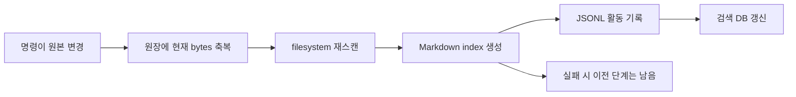

# 데이터 보존·변경 정확성 독립 리뷰

2026-10-09. 대상은 `v0.10.0`, 커밋 `ede67e302a8487aecbb4d59587a8686292018cf6`이다. 구현은 고치지 않았다. 다른 영역의 리뷰를 읽지 않았으며, 코디네이터가 제시한 추가 후보도 별도 재현으로 확인했다.

## 판단 기준과 결론

출발점은 “로컬 Markdown에 사람과 LLM이 지식을 누적하고, 근거를 다시 읽고, 다른 기기로 가져간다”는 목적이다. 검색 DB의 복구보다 **아직 커밋하지 않은 지식·제안·주의 기록이 보존되는지**, 실패를 성공으로 오인하지 않는지, 개명 후 같은 지식에 도달할 수 있는지가 먼저다. README의 원래 소개, `docs/philosophy.md`, `docs/second-brain.md`를 이 기준으로 읽었다. 문서의 `[코드]` 표기를 증명으로 사용하지 않았다.

정상적인 단일 프로세스 경로는 작고 이해하기 쉽다. 전체 재스캔, DB metadata/FTS의 SQL transaction, checkout의 사전 base 비교, opt-in reconcile, 웹 편집의 제안 접수는 실제 구현에 있다. 그러나 현재의 “한 복도”는 **변경 후 후처리 함수**이지 원자적 쓰기·동시성·공통 검증의 경계가 아니다. 실패한 명령이 원본을 이미 바꾸거나, 서로 성공한 명령이 상대의 원본을 덮거나, unresolved Git 충돌을 성공적으로 발행하는 경우를 재현했다.

가장 먼저 해결할 범위는 DATA-01~05와 DATA-07이다. DATA-10에는 원문 제안 손실도 있으므로 단순 계기판 품질 문제로 낮춰 읽으면 안 된다. 각 권고는 아래 ID에 묶었으며, 대규모 재설계나 자동 커밋 도입을 전제하지 않는다.

| ID | 분류 | 심각도·핵심 전제 | 관측한 문제 |
|---|---|---|---|
| DATA-01 | 재현 버그 | 높음: 다른 clone의 수정과 로컬 미커밋 수정이 같은 줄에서 충돌 | autostash 충돌 마커를 commit·push하고 성공 반환 |
| DATA-02 | 재현 버그·보장 공백 | 높음: 같은 위키의 동시 CLI/직접 편집 | 중복 create 덮어쓰기, stale update, checkin의 hash/write 사이 손실 |
| DATA-03 | 재현 버그 | 높음: 저장 도중 제한/오류, 이전 원문이 미커밋 | in-place truncate 후 오류로 원문 일부 소실 |
| DATA-04 | 재현 버그·문서 과장 | 높음: 후속 파일 또는 생성 index를 쓸 수 없음 | 부분 mv/rm/archive, 오류 반환 뒤 bless 완료·로그 누락·사본 회수 |
| DATA-05 | 재현 버그 | 높음: archive된 slug를 다시 사용 | 이전 보관 원문을 조용히 대체 |
| DATA-06 | 재현 버그 | 중간: 경로/확장자/공백 링크, 자기 링크, 코드 예제 | 실제 링크는 남고 코드 예제는 바뀜 |
| DATA-07 | 재현 버그 | 높음: checkout meta 누락/파손과 편집된 사본 | 재checkout이 유일한 편집본을 덮음 |
| DATA-08 | 재현 동작·문서 과장 | 중간: 직접 수정 정규화 또는 본문 링크 | update의 구조 검증 생략·자동 bless, 선언보다 약한 gate |
| DATA-09 | 재현 버그 | 중간: 역슬래시 제목 또는 유효한 YAML block scalar | 제목 해석 변경/깨진 YAML 생성, 날짜 값 손상 |
| DATA-10 | 재현 버그 | 높음(제안)/중간(집계): 중첩 저장 또는 동시 접수 | JSON 집계 lost update, 원문 제안 ID 충돌 |
| DATA-11 | 재현 버그·제품 선택 | 중간: agent-only history 또는 pending task가 있는 페이지 개명 | 주의 기록·작업 참조가 옛 slug에 고립 |
| DATA-12 | 재현 버그·보장 공백 | 중간: 직접 새 페이지 추가 후 sync | clean 상태에서도 Markdown index가 옛 수치 유지 |
| DATA-13 | 재현 버그·보장 공백 | 높음(충돌 목적지)/중간(탐색): 기존·직접 편집 위키에 중복/중첩 페이지 | 원장과 scanner의 영역 불일치, 명시 경로도 모호하며 mv가 원본 대체 |
| DATA-14 | 조건부 재현·문서 과장 | 중간: 더 새/확장된 `_meta`를 구버전이 저장 | 모르는 필드 탈락, agent version 강등 |
| DATA-15 | 개선 제안·제품 절충 | 중간: 미커밋 변경 복구/판단 경로 감사가 필요 | 활동 로그는 변경 내용의 복원·판단 증거가 아님 |

## 범위, 환경, 증거

먼저 `AGENTS.md`, `docs/philosophy.md`, `docs/invariants.md`를 읽었다. 관련 설계 `docs/checkout-design.md`, `docs/reconcile-design.md`, `docs/second-brain.md`와 Mermaid 작성 규칙도 확인했다.

| 정확히 검토한 파일 | 검토 범위 |
|---|---|
| `internal/wiki/page.go`, `edit.go`, `slug.go` | 전체: parse·scan·slug 해석·backlink·본문/FM/링크 수정 |
| `internal/writeops/writeops.go` | 전체: reconcile→genindex→log→DB 후처리와 실패 경계 |
| `internal/checkout/checkout.go` | 전체: copy/meta 생성·refresh·conflict·gate·회수·열린 목록 |
| `internal/reconcile/reconcile.go` | 전체: version·hash 원장·Record·Foreign·BlessPaths·BlessAll |
| `internal/genindex/genindex.go` | 전체: category/dashboard 생성·archive 계수 |
| `internal/logops/logops.go`, `internal/gitops/gitops.go` | 전체: append/read, status/pull/add/commit/push |
| `cmd/canopy/write.go`, `checkout.go`, `reconcile.go` | 전체: new/update/mv/rm/archive/sync/checkin/checkout/bless |
| `cmd/canopy/tasks.go`, `resurface.go`, `serve.go` | 전체: 관련 상태 쓰기/접수/완료/GC/feedback/dismiss와 HTTP 기동 경로 |
| `cmd/canopy/main.go` | 1~361행, 717~794행: startup·load·banner·refresh·init/status/reindex·show와 touch; 이외 model/skills의 외부 설치 동작은 제외 |
| `cmd/canopy/recall.go` | 1~115행: 반환된 근거와 attention 기록의 접점 |
| `internal/config/config.go` | 1~296행: XDG·wiki 식별·설정·WriteTOML |
| `internal/reads/reads.go`, `internal/resurface/state.go`, `internal/tasks/tasks.go`, `internal/attention/touch.go` | 전체: 관련 irreproducible state 저장, 개명, 작업 verifier·GC, 관측 기록 |
| `internal/webui/edit.go`, `tasks.go` | 전체: 페이지 원문을 바꾸지 않는 제안 접수와 철회 |
| `internal/webui/server.go` | 1~155행, 270~580행: route·mutex·page/load/search; web state 쓰기 자체는 아래 핸들러로 추적 |
| `internal/webui/discover.go` | 90~178행: 사람 읽음 표시의 process-local mutex와 저장 |
| `internal/webui/speak.go` | 1~145행: daily state·feedback·search gap의 접점 |
| `internal/webui/render.go` | 15~123행: 링크 정규화와 code 영역 보존 비교 |
| `internal/lint/lint.go` | 45~155행: schema/링크/filename/필수 필드 검출의 실제 범위 |
| `internal/indexer/indexer.go` | 1~89행: reindex 호출·원본/캐시 경계 |
| `internal/store/store.go` | 1~121행: slug key, DB open·RebuildPages transaction |
| 관련 기존 `_test.go` | wiki/checkout/reconcile/genindex/logops 전체, reads 개명·분리 저장, webui 제안 테스트, tasks의 관련 접수·GC·필드 보존 테스트 |

실행 환경은 `Darwin arm64`, Go `go1.27.1`, `git version 2.54.0 (Apple Git-157)`이다. lite binary를 별도 경로에 빌드했다. 모든 wiki·HOME·XDG·TMPDIR fixture는 `/private/tmp/canopy-audit-20261009/data` 아래이고, `GOCACHE=/private/tmp/canopy-review/go-cache`, `GOPROXY=off`, `GOSUMDB=off`, 기존 `GOMODCACHE=/Users/nobocop/go/pkg/mod`를 사용했다. Git commit/push는 **fixture의 로컬 bare origin**에만 했다. 저장소 자체를 commit/push하지 않았고, 실제 `/Users/nobocop/workspace/wiki`를 열지 않았으며, 실제 HOME/XDG 상태·서비스를 변경하지 않았다.

원본 재현 소스와 출력을 [evidence](evidence/)에 남겼다. `.py.txt`/`.go.txt`는 빌드에 참여하지 않는 보존본이다. 실행용 `review_probes/data`는 최종 검증 후 제거했다. 재실행 절차는 마지막 절에 있다. 감사용 probe의 PASS는 **버그 관측이 성공했다**는 뜻이며, 구현의 정상 보장을 의미하지 않는다.

- [CLI 전체 재현 소스](evidence/data-cli.py.txt), [추가 CLI 소스](evidence/data-extra.py.txt), [Go 내부 API probe](evidence/data-probe_test.go.txt)
- [CLI 관측](evidence/data-cli-results.jsonl), [추가 CLI 관측](evidence/data-extra-results.jsonl), [Go 관측](evidence/data-go-probes.txt)
- [CLI argv·stdout·stderr 원본](evidence/data-cli-transcript.jsonl), [추가 CLI 원본](evidence/data-extra-transcript.jsonl)
- [범위 테스트 이름/결과](evidence/data-existing-tests.txt), [전체 internal 및 cmd 결과](evidence/data-all-tests.txt)

### 확인한 기존 테스트와 증명하지 못하는 것

격리 환경에서 `go test -count=1 -v ./internal/wiki ./internal/writeops ./internal/checkout ./internal/reconcile ./internal/genindex ./internal/logops ./internal/gitops ./internal/reads ./internal/webui`와 `go test -count=1 ./internal/... ./cmd/canopy`가 exit 0이었다. 전체 internal의 테스트가 있는 18개 패키지가 통과했다. `buildinfo`, `embed`, `gitops`, `indexer`, `writeops`, `cmd/canopy`는 `[no test files]`였다. ORT 빌드/모델은 실행하지 않았다.

| 통과한 테스트 | 실제 증명 범위 | 더 강한 주장의 공백 |
|---|---|---|
| wiki `TestSetFrontmatterField`, `TestReplaceBody`, `TestRewriteLinks`, `TestStripLinks`, `TestExtractLinks`, `TestParseFrontmatter`, `TestScanAndBacklinks`, `TestSlugify`, `TestComponents` | 일반 scalar·bare 링크·작은 정상 fixture | path/extension rewrite, 자기 링크, block scalar, 출력 YAML round-trip, 중복 slug/중첩 page 없음 |
| checkout `TestCheckoutEditCheckin`, `TestCheckinBaseConflict`, `TestCheckinGates`, `TestCheckinUnchanged`, `TestCheckoutIdempotent`, `TestOpenList` | checkin **호출 전에** 바뀐 base의 거부, 정상 meta가 있을 때 사본 보존, 일부 gate | hash 검사 **후** 경쟁, meta 파손, 후처리 실패, CLI의 attention 쓰기와 Git status 미검증 |
| reconcile `TestUninitializedGateIsSilent`, `TestForeignDetection`, `TestBlessPaths`, `TestRecordEffects` | sequential hash/효과 기록·옵트인·조회 시 원장 불변 | 저장 interleaving·version/unknown field 보존·검토 내용과 기록 내용의 시점 결합 없음 |
| genindex `TestRegenerate`, `TestRegenerateEmptyWiki`, `TestRegenerateIdempotent`, `TestCountArchived` | 받은 정적 scan의 수치·목록·같은 날 멱등 | cmdSync가 호출하는지, live snapshot/부분 생성 실패 없음 |
| logops `TestAppendCreatesLogFile`, `TestAppendContent`, `TestAppendAppends`, `TestAppendWithRelated`, `TestAppendCreatesLogsDir`, `TestReadRecent` | 순차 append와 newest-first, malformed line skip | 원본/로그 transaction·미커밋 원문 복원·부분 쓰기·다기기 append merge 검증 없음 |
| reads `TestMarkUpgradeAndUndo`, `TestRecentSlugs`, `TestMarkAgent`, `TestRenameMovesAgent`, `TestRecentAccessSlugs` | 메서드 단위 등급 분리·양자화·Rename | cmdMv의 `IsRead` guard, 두 프로세스의 오래된 snapshot 저장 없음 |
| webui `TestWebTaskFilingDoesNotEditPages`, `TestWebEditFilesProposalNotFile`, `TestWebEditNoopFilesNothing`, `TestTasksScreenAndWithdraw`, `TestWebConnectRefilingAndTodoList` 등 | 제안의 원문/접수 시점 base, 페이지 불변, sequential 접수/철회 | 동시 ID 확보·동시 다른 serve/CLI와 state 저장·편집 폼을 열었던 시점의 base는 검증하지 않음 |

`-race`는 이 리뷰에서 독립 실행하지 않았다. Go memory race가 없더라도 파일 snapshot의 lost update와 서로 다른 process의 경쟁은 통과할 수 있다.

### 명시적 사각지대

실제 OS 전원 차단/커널 crash·filesystem durability를 시험하지 않았다. RLIMIT_FSIZE는 **쓰기 실패 후 truncate 손실**의 재현이지 모든 디스크 full 상황의 모델이 아니다. symlink/hardlink·ACL·mount 경계·특수 파일·악의적 TOML 경로 탈출은 별도 보안 감사 영역으로 남겼다. Windows/Git의 다른 버전, 실제 네트워크·자격증명·hooks·장시간 push 중 동시 쓰기, ORT semantic cache, 원격 기기 간 `_meta` 충돌 해결은 실행하지 않았다. HTTP 제안/feedback의 요청간 경쟁은 API 경로와 source로 추적했으며, 실서버 두 개를 띄운 부하 시험은 하지 않았다. LLM이 판단을 잘하는지·외부 Obsidian plugin의 구문 전체와 호환되는지는 증명하지 않는다.

## DATA-01 — autostash 충돌이 성공적인 sync가 된다

**분류·심각도:** 재현 버그, 높음. upstream이 있는 정상 Git wiki에서 다른 clone과 로컬 미커밋 변경이 같은 줄을 수정하면 발생한다. 공격자나 비정상 파일이 필요 없다.

**경로·증거:** `internal/gitops/gitops.go:72~77`은 `git pull --rebase --autostash`의 exit code만 반환한다. `cmd/canopy/write.go:158~189`는 pull 후 dirty를 확인하고 바로 로그·`CommitAll`을 수행하며, `internal/gitops/gitops.go:80~85`가 `git add -A`로 unmerged 항목을 stage한다. `cmd/canopy/write.go:195~204`는 push 후 성공 JSON을 낸다. pull의 autostash 재적용은 충돌을 남기고도 exit 0일 수 있다.

**기대/실제:** unresolved conflict가 있으면 기록·commit·push 전에 멈추고 복구 위치를 알려야 한다. 실제로는 `<<<<<<< Updated upstream` 등을 Markdown 원본에 넣은 채 clean commit·push한다.

**재현·관측:** CLI 소스의 `sync-conflict` 구간은 baseline→로컬 bare origin→peer clone의 `REMOTE-EDIT` commit/push→로컬 `LOCAL-EDIT` 미커밋 수정→`canopy sync --json`이다. 관측은 `code=0`, `committed=true`, `pushed=true`, `stderr=""`, `status=""`, `conflict_markers_local=true`, `conflict_markers_remote=true`, `stash@{0}: autostash`였다. 원본 argv/출력과 origin object가 fixture에 있으며 증거 transcript를 보존했다.

**가장 강한 반론:** Git은 양쪽 commit과 autostash를 보존하므로 원문이 영구 소실된 것은 아니다. 맞다. 이 발견은 복구 불가능한 손실이라고 주장하지 않는다. 문제는 사람이 해결하지 않은 텍스트를 정식 지식으로 발행하고 “성공”으로 종료해 LLM의 후속 소비를 오염시키는 것이다.

**한정된 개선/대안:** pull 직후와 commit 직전에 `git ls-files -u` 및 진행 중 rebase/merge 상태를 검사하고, 존재하면 sync를 거부한다. DATA-02의 로컬 쓰기 직렬화 범위에 sync를 포함한다. 대안은 dirty 상태에서 pull하지 않고 명시적인 수동 정리 또는 로컬 commit 단계를 요구하는 것으로, 배치 작업의 편의가 줄어든다. 단순 stdout 문자열 매칭은 Git 언어/버전에 취약하다.

**제안 불변식·인수 시험:** “sync 성공은 unresolved Git 항목이 없고 발행물이 그 상태에서 생성됐음을 의미한다.” 위 2-clone fixture에서 conflict를 만든 뒤 exit != 0, 원격 tip 무변경, sync 로그/추가 commit 없음, 로컬 충돌·stash 보존을 검사한다. 정상 비충돌 autostash 경로는 계속 성공해야 한다.

## DATA-02 — snapshot 확인과 원본 쓰기가 하나의 동작이 아니다

**분류·심각도:** 재현 버그, 높음. 단일 사용자도 agent 작업·cron·직접 편집을 겹쳐 실행할 수 있다. 서로 다른 머신에 분산 락을 요구하는 발견이 아니다.

**경로·증거:** `cmd/canopy/write.go:275~310`의 new는 존재 scan 후 body 입력을 읽고 일반 WriteFile한다. update는 `373~405`에서 원본 read 후 body 입력·검증을 거쳐 같은 경로를 쓴다. checkout은 `internal/checkout/checkout.go:133~157`에서 hash를 비교한 뒤 검증하고 쓴다. 세 경로에 CAS나 공유 process lock이 없다. 웹의 `Server.mu`는 해당 server instance의 읽음/search만 직렬화하므로 이 경로를 보호하지 않는다.

**기대/실제:** new는 기존 지식을 덮지 않아야 하고, 읽었던 base가 바뀌면 update/checkin은 거부하거나 명시적인 재적용이 필요하다. 실제로 모두 성공하면서 더 최신 원문을 덮을 수 있다.

**재현·관측:** `race-create`는 new A가 scan 후 named pipe에서 기다리도록 하고 new B를 완료한 후 A 입력을 준다. `first=0 second=0 second_lost=true log_count=2`였다. `race-update`는 A가 원본 read 후 기다리는 동안 title을 `Newer-Metadata`로 바꾸고 B update를 성공시킨다. A 완료 뒤 `newer_title_lost=true second_body_lost=true`였다. Go `TestCheckinHashWriteWindow`는 정상 checkout copy에 Mermaid 3개를 넣어 검증 시간을 확보하고, checkin 시작 100ms 후 wiki를 `CONCURRENT-EDIT`로 바꾼다. `checkin_error=<nil> elapsed=496.6925ms concurrent_edit_preserved=false`를 관측했다. 이는 sleep으로 만든 interleaving이므로 더 빠른 환경에서 재현하지 못하면 타이밍을 조정해야 하며, source의 hash→validate→write 간극 자체는 남는다.

**가장 강한 반론:** body 전체 교체의 last-writer-wins는 의도일 수 있다. 그러나 다른 프로세스가 만든 같은 slug의 new를 덮고, 본문과 독립적인 최신 title까지 과거 snapshot으로 되돌리며, R4의 conflict guard를 우회하는 동작은 그 설명으로 보장되지 않는다. 분산 checkout 장기 락을 기각한 설계와도 구별해야 한다.

**한정된 개선/대안:** 같은 wiki root의 쓰기·sync에 짧은 OS file lock을 두고 scan/base 재확인부터 교체·기록까지 보호한다. body 입력/비싼 검증을 lock 밖에서 준비하되, lock 안에서 base를 다시 비교한다. 새 파일은 no-clobber 생성으로 확보한다. 직접 편집기는 lock에 협력하지 않을 수 있으므로 보호 범위를 문서화하고 원본 교체 직전 hash와 충돌 보존도 필요하다. 이 재확인만으로 비협력 편집기의 check/write 틈이 완전히 사라지지는 않는다. 그런 전체 보장은 authoritative 쓰기 권한/단일 writer 경계까지 제한하는 대안이 필요하며, 기존 직접 편집·cron/CLI 자유도가 감소한다.

**제안 불변식·인수 시험:** “두 정상 new가 같은 slug를 동시에 만들면 최대 하나가 create 성공하며, 성공한 타인의 원문을 덮지 않는다.” FIFO probe를 regression fixture로 사용한다. “협력하는 canopy writer끼리는 checkin의 최종 교체가 비교한 base를 대상으로 한다”는 별도 barrier 시험에서 중간 수정은 거부되고 사본/상대 수정이 보존돼야 한다. 검증 중 들어온 직접 편집은 교체 전 재확인에서 거부하는 시험을 둔다. 비협력 writer의 마지막 틈은 별도 한계로 남기며, 원장/생성물도 같은 완료 순서를 따라야 한다.

## DATA-03 — 쓰기 실패가 이전 원문을 보존하지 않는다

**분류·심각도:** 재현 버그, 높음. 파일을 열고 일부를 쓴 뒤 quota/용량/IO 오류가 나거나 프로세스가 중단되는 경우다. 미커밋 원문은 Git에서도 돌아오지 않는다.

**경로·증거:** new/update/mv의 `cmd/canopy/write.go:310,405,476,502`, checkin의 `internal/checkout/checkout.go:157`, state Save의 `internal/reconcile/reconcile.go:68`, `internal/reads/reads.go:126` 등은 기존 파일을 `os.WriteFile`로 in-place truncate한다. 임시 파일→완료 확인→rename이 없다. logops의 append는 별도의 방식이며 이 truncate 주장에 포함하지 않는다.

**기대/실제:** 저장이 실패하면 이전 완전한 원문 또는 새 완전한 원문과 복구 가능한 실패 상태가 남아야 한다. 실제 update exit 1 후 이전 tail은 없고 파일이 잘린다.

**재현·관측:** `short-write`에서 길이 2164 bytes인 원문과 4096자 replacement를 만든 뒤 child에만 `RLIMIT_FSIZE=(256,256)`을 적용해 `canopy update alpha --body-file ... --json`을 실행했다. `code=1 old_bytes=2164 new_bytes=256 old_tail_present=false`, stderr는 `file too large`였다. 시스템 quota나 실제 파일의 권한을 바꾸지 않았다.

**가장 강한 반론:** 사용자가 Git에서 복원할 수 있다. 마지막 커밋 원문에는 유효하지만, 의도적으로 여러 변경을 커밋 전에 묶는 제품에서는 마지막 미커밋 원문이 원본이다. 또 index는 파생물이어서 잘려도 재생성할 수 있으므로 같은 심각도로 취급하지 않는다.

**한정된 개선/대안:** 원본·irreproducible JSON을 같은 디렉토리의 임시 파일에 완전히 쓰고 write/close 오류를 확인한 뒤 원자적 rename으로 교체한다. 필요 durability 수준을 정한 뒤 파일/부모 디렉토리 sync를 적용한다. DATA-02와 함께 base 검사를 결합한다. 대안은 미커밋 원문을 제한된 backup에 먼저 보존하는 것으로, 추가 저장 공간·정리 정책이 필요하다. 이 개선만으로 multi-file atomicity가 해결된다고 주장하면 안 된다.

**제안 불변식·인수 시험:** “단일 원본 교체가 실패하면 이전 완전한 bytes를 잃지 않는다.” 짧은 쓰기·write/close/rename 오류를 각각 주입하고 이전 해시 동일, 임시 파일 정리 또는 명시된 회수 가능성을 검사한다. 전원 차단 후 영속성은 별도 수용 범위로 명시한다.

## DATA-04 — 변경·축복·로그·회수가 분리되어 실패가 부분 성공을 숨긴다

**분류·심각도:** 재현 버그·문서 과장, 높음. 읽을 수 있지만 쓸 수 없는 backlink source 또는 쓰기 불가 index가 하나만 있어도 충분하다.

**경로·증거:** mv는 `cmd/canopy/write.go:476~502`에서 목적지 기록·원본 제거 후 다른 페이지를 고친다. rm은 `560~572`, archive는 `614~625`에서 먼저 대상 제거/이동을 한다. `internal/writeops/writeops.go:28~55`는 이미 변경된 원문에 대해 **Record→Scan→Regenerate→Append→DB** 순서다. `internal/checkout/checkout.go:157~160`은 원문을 쓰고 사본을 회수한 뒤 caller가 `cmd/canopy/checkout.go:126`에서 후처리를 수행한다.



**기대/실제:** 실패 위치와 적용된 효과가 명확하고 재시도/복구 가능해야 한다. 변경 후 실패를 단일 error로 반환하면 자동 호출자는 미적용으로 오인한다. 실제로 원문이 바뀌고 원장은 깨끗하지만 활동 로그가 없거나, 개명/삭제만 끝나 링크가 깨진다.

**재현·관측:** `pipeline-failure`는 baseline update/bless 후 `index/entities.md`를 디렉토리로 만든다. 다음 update는 `code=1 changed=true foreign=[] write_logs_added=0`이었다. `checkin-pipeline-failure`는 같은 fault에서 `code=1 changed=true copy_exists=false write_logs_added=0`; 재시도는 `not checked out`이다. 추가 CLI의 `partial-mv/rm/archive`는 backlink source만 `0444`로 둔다. 모두 `code=1 source_has_old_link=true write_logs_added=0`; mv는 `old_exists=false new_exists=true`, rm은 `old_exists=false`, archive는 `old_exists=false archive_exists=true`였다. source 권한은 해당 fixture 안에서만 변경·복원했다.

**가장 강한 반론:** 파생 DB/index 실패 때문에 성공한 원문을 되돌리지 않는 편이 유용할 수 있다. 타당한 제품 선택이다. 하지만 그러려면 “원문 반영됨, 후처리 미완료”가 별도 결과로 드러나고 재시도가 수렴해야 한다. 현재의 일반 error·선행 bless·사본 삭제는 그 계약을 제공하지 않는다. uncommitted rm 원문의 손실은 파생 실패와 별개다.

**한정된 개선/대안:** multi-file mutation의 대상과 bytes를 준비·검증한 후 로컬 lock 안에서 적용하고, 적용 과정의 실패는 해당 동작이 바꾼 파일만 복원하거나 복구 목록을 남긴다. 작은 per-operation manifest/임시 보존본이면 충분하며 일반 transaction framework가 필요하지 않다. 원장의 hash는 실제 준비·반영한 bytes로 기록하고, 사본은 최소한 authoritative 기록 완료 뒤 회수한다. DB 실패는 `applied=true, repair_needed=...` 식으로 분리할 수 있다. 대안은 모든 실패를 rollback하는 것으로 비용은 낮은 편이지만 이미 관측된 다른 독립 편집을 되돌리지 않도록 lock/CAS가 전제다.

**제안 불변식·인수 시험:** “거부된 원본 변경은 없었던 일로 남거나, 적용된 경로·복구 동작을 기계 판독 결과로 반환한다.” mv/rm/archive의 두 번째 쓰기, Record/Genindex/Log/DB 각각에서 fault를 주입한다. 오류 뒤 원장·로그·열린 checkout과 실제 bytes가 일치해야 하고, 동일 operation의 재시도가 중복/삭제/`page not found`로 막히지 않아야 한다. C3는 ‘원본 mutation의 완료 기록’과 state/캐시 쓰기를 구분해 범위를 재정의해야 한다.

## DATA-05 — 같은 slug의 두 번째 archive가 첫 원문을 지운다

**분류·심각도:** 재현 버그, 높음. archive→같은 slug로 새 페이지 생성/직접 복원→archive를 반복하는 정상적 이름 재사용이다. 특히 첫 archive가 아직 commit되지 않았다면 복구 근거가 없다.

**경로·증거:** `cmd/canopy/write.go:610~615`는 `_archive/<dir>/<basename>`으로 일반 `os.Rename`한다. 목적지 존재 확인/충돌 처리/고유 archive key가 없다. `wiki.Scan`과 new의 duplicate check는 `_archive`를 보지 않는다.

**기대/실제:** 보관은 기존 보관 원문을 보존하거나 충돌을 명시적으로 거부해야 한다. Darwin/POSIX에서 Rename은 같은 목적지 파일을 대체한다.

**재현·관측:** `archive-collision`에서 `FIRST-ARCHIVE-UNIQUE`를 archive하고 같은 slug의 `SECOND-ARCHIVE-UNIQUE`를 만든 후 archive했다. `code=0 first_preserved=false archived_files=1`. 첫 보관본의 sha256도 관측에 남겼다.

**가장 강한 반론:** archive는 영구 이력이 아니라 마지막 보관 snapshot이고 전체 이력은 Git에 있다는 해석이 가능하다. 그러나 그런 파괴적 대체는 현재 도움말에 없고 미커밋 batch는 Git에 없다. 명시적 overwrite 동작과 자동 성공은 구별해야 한다.

**한정된 개선/대안:** 최소 변경은 목적지가 있으면 source를 건드리기 전에 거부하는 것이다. 대안은 날짜+충돌 suffix로 새 archive 파일을 만드는 것으로, 원본을 더 잘 보존하지만 archive 목록·복원 UX가 조금 복잡해진다. no-clobber 결정은 DATA-02의 lock 안에서 해야 한다.

**제안 불변식·인수 시험:** “archive는 기존 `_archive` bytes를 조용히 대체하지 않는다.” 두 번 보관 fixture에서 둘 다 남거나 두 번째가 거부되고 source/첫 archive의 해시가 같아야 한다.

## DATA-06 — 링크 판별과 수정이 서로 다른 문법을 사용한다

**분류·심각도:** 재현 버그, 중간. 링크 단절뿐 아니라 LLM에게 중요한 코드 예제 원문도 변한다.

**경로·증거:** `wiki.ExtractLinks`는 `internal/wiki/page.go:46~70`에서 code를 제외하고 basename/`.md`/공백을 정규화한다. `internal/wiki/edit.go:37~59`의 rewrite/strip은 bare slug regex를 원문 전체에 적용한다. mv는 `cmd/canopy/write.go:491~494`에서 이동 페이지 자신을 건너뛴다. rm/archive는 정규화된 backlink 목록을 구했어도 bare strip을 적용한다.

**기대/실제:** 코드가 존재한다고 해석한 모든 페이지 링크는 개명/제거 때 같은 의미로 수정되고, 코드 예제와 무관한 bytes는 보존돼야 한다. 실제로 path/extension/공백 링크는 남고 code 안의 bare 링크는 바뀐다. 이동한 페이지의 자기 링크도 옛 slug를 가리킨다.

**재현·관측:** `rename-links`에서 bare link는 `[[beta|A]]`가 됐지만 `[[concepts/alpha]]`, `[[alpha.md]]`, `[[ alpha ]]`는 그대로이고 inline/fenced 예제는 `[[beta]]`가 됐다. 이동 원문의 `Self [[alpha#self]]`도 남았다. `broken-link=2`는 정규화된 target을 페이지당 중복 제거한 결과이며, 손상 링크 occurrence 총수가 아니다. `archive-links`는 세 문법 모두 남고 `broken-link=1`이었다. 같은 StripLinks를 쓰는 `rm --force`도 동일 source-level 결함이지만 이 문법별 rm은 별도 실행하지 않았다.

**가장 강한 반론:** 스킬이 bare slug만 쓰도록 요구할 수 있다. 하지만 scanner와 웹 renderer가 경로를 정상 링크로 인정하고 기존 Markdown 위키를 받아들이므로, 안전 보장은 문서 관습만으로 닫히지 않는다. code 영역 변경은 bare slug만 쓰는 위키에서도 발생한다.

**한정된 개선/대안:** 추출·수정이 code 제외와 target normalization을 공유하게 하고, 매치의 target 부분만 바꿔 anchor/alias를 보존한다. 자기 링크도 처리한다. category 이동 시 path 표현 유지 정책도 정한다. 새 Markdown parser framework가 아니라 현재 지원 문법을 위한 공통 작은 helper면 된다. 대안은 쓰기 전에 비지원 문법을 검출해 mv/rm/archive를 거부하는 것으로, 기존 wiki 정리 부담이 커진다.

**제안 불변식·인수 시험:** “유효한 target의 rename/strip 후 그 target의 dangling 링크가 증가하지 않고 code bytes는 동일하다.” bare/path/extension/space/case/alias/anchor/self/code의 표를 fixture로 만들어 mv/archive/force rm을 검사한다. `_archive`나 raw 원문까지 재작성하지 않는 경계도 명시한다.

## DATA-07 — meta 파손이 ‘없는 checkout’으로 처리되어 편집본이 덮인다

**분류·심각도:** 재현 버그, 높음. 별도 파일 meta가 interrupted write로 잘리거나 삭제·읽기 오류가 나고, 기존 copy에 미반영 편집이 있는 조건이다. 정상 meta의 happy path는 안전하다.

**경로·증거:** `internal/checkout/checkout.go:87`은 `readMeta`가 성공한 경우에만 사본 수정 여부를 검사한다. **모든** meta 오류는 그냥 통과하며 `105~108`에서 wiki bytes로 copy/meta를 다시 쓴다. `Open:243~245`도 corrupt meta를 조용히 건너뛴다. 설계 문서의 “수정된 사본을 조용히 지우는 코드는 두지 않는다”보다 약하다.

**기대/실제:** meta가 없거나 파손돼도 기존 copy가 있으면 보수적으로 보존하고 복구/명시 discard를 요구해야 한다. 실제로 corrupt meta 이후 재checkout은 exit 0이고 편집된 copy를 초기화한다.

**재현·관측:** `checkout-corrupt-meta`에서 정상 checkout copy를 `ONLY-UNCOMMITTED-EDIT`로 수정하고 meta를 `{`로 잘라 재checkout했다. `code=0 edit_preserved=false`였다. `{`는 meta 파손을 명시적으로 주입한 fixture이며 실제 crash를 일으킨 시험은 아니다.

**가장 강한 반론:** state 손상은 사용자가 잘못 건드린 예외일 수 있다. 그러나 copy/meta가 별도 in-place 쓰기이고 recovery 기능이므로 그 예외가 유일한 편집 원본을 제거해서는 안 된다. copy가 없고 meta도 없는 첫 checkout은 여전히 자동 생성해도 된다.

**한정된 개선/대안:** meta 오류를 not-exist와 구분해 반환하고, copy가 이미 있으면 unknown base 상태로 보존한다. open 목록에 corrupt/orphan copy를 가시화한다. DATA-03의 atomic meta 기록도 적용한다. 대안은 orphan copy를 명명된 rescue 파일로 이동한 뒤 refresh하는 것으로, 디스크에 사본이 남으므로 정리 UX가 필요하다.

**제안 불변식·인수 시험:** “checkout refresh는 검증하지 못한 기존 copy bytes를 덮지 않는다.” missing/invalid/unreadable meta+edited copy를 각각 심고 모든 거부/복구 뒤 copy 해시와 원문 보존, status의 문제 가시성을 검사한다.

## DATA-08 — 공통 파이프라인이 공통 구조 검증을 뜻하지 않는다

**분류·심각도:** 재현 동작·문서 과장, 중간. 직접 수정 후 update로 정규화하는 지원 흐름에서 중요하다. B1은 원래 lint 검출 규칙이며 broken body link의 수용 자체를 모든 경우의 버그로 단정하지 않는다.

**경로·증거:** `cmd/canopy/write.go:399~411`의 update는 Mermaid만 검증하고 기존 type/tags/FM를 검사하지 않는다. `writeops.Run`에도 검증은 없다. `internal/checkout/checkout.go:168~195`는 일부 필드를 검사하지만 tags key 존재나 날짜 형식까지 보지 않는다. `internal/lint/lint.go:88~96`의 필수 필드 검사는 title/type/created/updated뿐이다. new는 `write.go:282~285`에서 `--links`만 존재 검증하고 body links는 검사하지 않는다.

**기대/실제:** “구조 불변식은 코드가 강제”·R3의 “쓰기 gate 전부”를 믿으면, update를 거친 무효 type/tag와 누락 필드는 거부될 것으로 예상한다. 실제로 자동 bless까지 끝난다. 구조 gate와 내용 판단의 협약을 분리해 써야 한다.

**재현·관측:** `schema-blessing`에서 baseline 후 직접 `type: guide`, `tags: [outside-taxonomy]`로 바꾸고 update했다. `code=0 foreign=[]`, lint는 `invalid-type=1 invalid-tag=1`이었다. `checkin-tags`는 tags line을 제거해도 checkin exit 0, lint에도 필수 필드 오류가 없었다. 추가 `body-links`는 body 안 `[[does-not-exist]]`로 new exit 0, lint `broken-link=1`이었다. 이 마지막 관측은 philosophy 1의 넓은 링크 거부 주장과 B2의 좁은 `--links` 계약 차이를 보여준다.

**가장 강한 반론:** update는 직접 수정에 기록을 붙이는 동사이며 검토는 에이전트 역할이다. 콘텐츠 의미 판단에는 타당하다. 다만 type/tag/필드 존재는 결정론적 구조이고, auto bless가 invalid 구조를 foreign 목록에서 지운다면 “검증된 본길 산물”이라는 문서 설명은 성립하지 않는다. bless는 사람의 의도적 수용이므로 임의로 lint 전체를 강제할 이유는 없다.

**한정된 개선/대안:** authoritative 원문 교체 전에 쓰기용 구조 validator를 new/update/checkin에 공통 적용한다. 필수 필드 key 존재와 값 검증을 구별하고, 허용 타입/태그·YAML round-trip을 검사한다. body link의 강제 수준은 따로 결정해 문서에 정확히 쓰며 self-new는 정상 허용한다. 대안은 update/bless를 의도적으로 느슨한 경로로 유지하되 구조 gate 통과 주장·자동 축복의 뜻을 낮추고 machine-readable lint/미검증 상태를 반환하는 것이다.

**제안 불변식·인수 시험:** “정상 쓰기 성공으로 구조 검증을 통과했다고 표시한 내용은 해당 구조 규칙을 만족한다.” 유효·무효 type/tag, 누락 tags/created/title, malformed YAML, body link 지원 정책을 각 write verb의 표로 시험한다. 거부 시 원문/원장/로그 해시는 불변이어야 한다. 초기 baseline bless의 의도적 포괄 수용은 별도 시험으로 유지한다.

## DATA-09 — YAML 편집/생성의 텍스트 가정이 원문 의미를 바꾼다

**분류·심각도:** 재현 버그, 중간. Windows 경로 같은 역슬래시 제목은 정상 입력이고, block scalar 날짜는 현재 loader가 유효하게 읽는 YAML 표현이다.

**경로·증거:** `internal/wiki/edit.go:65~66`은 title의 큰따옴표만 escape하고 YAML double-quoted scalar에 넣는다. `SetFrontmatterField:17~23`은 key line 한 줄만 교체하며 이어지는 block scalar 내용은 남긴다. 수정 결과를 다시 parse하여 확인하지 않는다.

**기대/실제:** title 문자열은 생성 후 Parse해도 같아야 하고, updated 값 교체는 다른 의미/날짜 잔재를 만들지 않아야 한다. 실제 역슬래시는 YAML escape로 바뀌거나 parse error를 낸다. `updated: |-` 뒤의 옛 날짜는 새 plain scalar의 continuation이 된다.

**재현·관측:** 추가 CLI에서 `new 'C:\Users\note' --slug invalid --type concept --json`은 exit 0인데 lint `bad-frontmatter=1`이다. `C:\new\tool`은 생성되지만 Go round-trip의 title은 newline/tab을 포함해 입력과 다르다. multiline title도 실행했으나 그 fixture는 앞선 invalid 페이지와 함께 lint하므로 aggregate `bad-frontmatter=1`을 multiline의 새 parse error라고 주장하지 않는다. Go `TestFrontmatterPreservation`에서 `|-`를 사용한 before `updated="2026-01-01" FMerr=""`는 정확한 ISO 날짜인데, after `updated="2026-10-09 2026-01-01" FMerr=""`였다. CLI `yaml-block` update도 exit 0, lint가 날짜 손상을 보고하지 않았다. 인접한 indented first body line은 이 probe에서 **보존됐다**.

**가장 강한 반론:** canopy가 만든 날짜는 항상 한 줄이므로 block scalar는 드문 외부 표현이다. 범위를 좁히는 반론은 타당하다. 그러나 “unknown fields/other lines 보존”과 기존 Markdown 채택 목적상 유효한 외부 YAML의 날짜를 손상시키거나 정상 title을 해석 변경시키는 것은 피해야 한다. 원문 복원 문제와 단순 스타일 통일은 다르다.

**한정된 개선/대안:** 새 scalar는 YAML encoder/적절한 scalar quoting으로 생성하고 round-trip을 검사한다. field 교체는 YAML node로 value span을 확인해 block 내용까지 정확히 교체하되 무관한 unknown field/comment는 보존한다. 대안은 비canonical known-field 표현을 사전에 거부하는 것으로, 구현은 작아도 기존 노트의 수동 정리가 필요하다. 전체 문서를 Marshal해 comments/order를 잃는 blanket rewrite는 권하지 않는다.

**제안 불변식·인수 시험:** “NewPageContent의 parsed title은 요청 문자열과 같으며, SetFrontmatterField가 바꾸는 known field의 parsed 값은 정확히 새 값이다.” quote/backslash/newline/Unicode 제목, plain/quoted/folded/literal scalar의 표를 round-trip한다. 다른 FM node와 Body bytes 보존도 검사한다.

## DATA-10 — irreproducible JSON과 원문 제안이 동시 저장에 취약하다

**분류·심각도:** 재현 버그. 주의/피드백 집계는 중간, 사용자가 제출한 제안 원문 소실은 높음이다. DATA-02는 페이지 원본의 경쟁, 여기서는 서로 다른 항목을 저장해도 손실되는 state/접수 경로를 다룬다.

**경로·증거:** reads `Load→Mark→Save` (`internal/reads/reads.go:70~126`), resurface `LoadState→Save` (`internal/resurface/state.go:47~80`), reconcile `Load→Save` (`internal/reconcile/reconcile.go:99~113`)는 파일 전체 snapshot 교체다. web read는 `internal/webui/discover.go:98~118`의 instance mutex로 보호되지만 다른 server/CLI와 공유하지 않는다. feedback의 `internal/webui/speak.go:85~105`는 save 후 daily cache만 잠근다. `internal/tasks/tasks.go:194~207`의 edit ID는 초 단위 stamp+Stat 검사 후 일반 WriteFile이며, `webui/edit.go:71`, `tasks.go:79`에서 동시 호출할 수 있다.

**기대/실제:** 서로 다른 페이지의 읽음/피드백/축복은 둘 다 남고, 서로 다른 편집 제안은 별도 원문으로 보존돼야 한다. 실제는 마지막 snapshot이나 같은 ID의 마지막 bytes만 남는다.

**재현·관측:** Go `TestStaleStateSnapshots`는 동일 상태를 A/B가 Load한 뒤 서로 다른 key를 수정하여 A Save→B Save라는 합법적 interleaving을 강제한다. 두 Save가 nil인데 `human alpha=false beta=true`, agent도 동일, `resurface feedback=0 snoozed_beta="2026-10-16"`, 원장은 성공한 축복 A가 다시 foreign으로 나타났다. 이는 실 HTTP 부하가 아니라 package API 수준의 결정적 증거다. `TestTaskFilingRace`는 같은 page·같은 second에 서로 다른 전문 32개를 goroutine으로 접수했다. 마지막 보존 실행에서 `submitted=32 unique_returned_ids=10 files=10 readable=10`, 호출 오류 로그는 없었다. 보존된 최종 실행의 수치이며 재현 개수는 scheduler에 의존한다.

**가장 강한 반론:** reads는 하나의 server mutex가 있어 웹 동시 클릭은 안전하고, Git 동기화 때 두 머신의 JSON conflict는 수동 해결하는 제품이다. 맞다. 이 발견은 **그 mutex 밖의 process와 feedback/접수**, 그리고 Git에 들어가기 전의 silent loss다. Git은 이미 덮인 미커밋 제안을 복구하지 못한다. attention event DB가 일부 계기판을 보강해도 제안 본문/사람의 unread 철회/집계 전체를 복원하지 못한다.

**한정된 개선/대안:** 파일별 read-modify-write를 process 간 lock 아래 다시 Load하고 atomic replace한다. edit task ID는 no-clobber 생성으로 확보하고 collision 시 재시도한다. unknown fields 보존(DATA-14)과 같이 적용한다. 대안은 제안을 UUID/난수 ID로 생성해 충돌을 피하고 state는 단일 writer로 제한하는 것으로, state의 process 제약이 남는다. JSON 대신 새 DB/framework로 전체 옮길 필요는 없다.

**제안 불변식·인수 시험:** “독립 key의 성공적인 state 변경은 중첩 실행 후 둘 다 남고, 성공 반환한 서로 다른 제안 N개는 원문 N개로 다시 읽힌다.” 두 snapshot barrier와 두 child process 시험, 두 server instance 시험을 추가한다. 동일 key의 reread/unread/close 경쟁은 명시된 순서 정책으로 검증한다.

## DATA-11 — slug 변경이 지식의 상태·작업 정체성을 전부 따라가지 않는다

**분류·심각도:** agent-only history 이동은 재현 버그, pending task·과거 기록 정책은 제품 선택의 공백; 중간. 페이지의 참조를 기억하는 상태가 있을 때 발생한다.

**경로·증거:** `cmd/canopy/write.go:514`가 `reads.Load` 후 **human `IsRead(p.Slug)`인 경우에만** Rename을 호출한다. `internal/reads/reads.go:209~220`의 Rename 메서드는 agent도 옮길 수 있지만 caller guard가 막는다. mv는 tasks의 `Pages`, resurface의 Shown/Snoozed/Feedback/ShownPairs를 이관하지 않는다. task verifier `internal/tasks/tasks.go:345~347`는 옛 slug를 찾는다. machine-local event history도 slug를 key로 읽는다.

**기대/실제:** 개명 후 agent consumption이 새 페이지의 최근 접근으로 이어지고, 살아 있는 제안은 계속 처리 가능한 대상에 연결돼야 한다. 실제 agent history는 존재하지 않는 옛 slug에 남고 pending edit은 done이 거부된다.

**재현·관측:** `rename-agent-history`는 human mark 없이 `show alpha` 후 `mv alpha --slug beta`하여 `agent_keys=["alpha"]`를 관측했다. 추가 `rename-task`는 edit 접수 후 개명하여 `pending_pages=["alpha"]`, done exit 1 `page not found: alpha`를 관측했다. resurface의 개명 후 cooldown·event UI 연속성은 source-level 제안이며 별도 end-to-end 재현하지 않았다.

**가장 강한 반론:** 과거 사건의 당시 이름을 보존해야 하므로 history를 rewrite하지 않는 편이 정확하다. 타당하다. 이 경우 살아 있는 page identity/alias와 historical display를 분리해야 한다. 현재는 agent aggregate의 Rename 기능도 있는데 조건에 따라 누락되고, 작업은 역사적 표시가 아니라 실행 대상이라 고립된다.

**한정된 개선/대안:** 최소한 agent-only 상태에서도 Rename을 호출한다. pending tasks와 cooldown에 대해서는 이관 또는 명시적인 stale-target 상태/재연결 규칙을 정의한다. 역사 JSONL 원문을 blanket rewrite하지 않는다. 대안은 작은 old→new alias mapping을 통해 과거 참조를 해석하는 것으로, slug 재사용·alias 수명 정책이 필요하다. immutable page ID 도입은 효과가 크지만 현재 범위에 비해 형식 변경이 크므로 우선 권고하지 않는다.

**제안 불변식·인수 시험:** “개명으로 살아 있는 제안·주의 집계의 대상이 고립되지 않는다.” human-only/agent-only/both, pending edit/connect, snooze/downvote 조합을 만들고 mv 후 대상 해석·done 가능성·쿨다운을 검사한다. archive/delete에서는 보존·stale·명시 dismiss 중 선택한 정책을 따로 시험한다. R1의 checkout ‘원문 페이지 불변’과 ‘Git working tree 불변’은 구별해야 한다: CLI checkout은 attention 집계를 쓰므로 후자를 무조건 보장할 수 없다.

## DATA-12 — sync 후 clean이어도 Markdown index는 stale일 수 있다

**분류·심각도:** 재현 버그·보장 공백, 중간. 직접 편집/타 clone의 페이지 유입은 제품이 인정하는 경로다. 검색 DB 갱신 자체와 구별한다.

**경로·증거:** `cmd/canopy/write.go:644~671`의 sync는 `runSync`로 commit/push를 마친 뒤 **DB Reindex만** 호출한다. `genindex.Regenerate`가 없다. `--sync` tail(`afterWrite:141~142`)은 pull 후 DB 갱신조차 거치지 않는 runSync만 수행한다. `cmd/canopy/main.go:344`의 reindex도 DB만 재생성한다.

**기대/실제:** C1/C2와 “쓰기 후 파생물 자가치유”를 사용자에게 제공한다면 직접 추가/삭제를 동기화한 최종 tree의 dashboard/category가 맞아야 한다. 실제 clean tree에서 페이지 수가 다르다.

**재현·관측:** `sync-index`에서 canopy update로 dashboard 1개를 만들고 fixture Git baseline을 commit한 뒤 직접 second page를 추가해 sync했다. `code=0 pages=2`, dashboard `Total pages: 1`, `category_has_second=false`, Git status는 empty였다. 이 fixture에는 remote가 없으므로 로컬 commit 단계까지만 시험했다. 타 clone pull 이후 stale markdown과 `--sync`의 post-pull DB 차이는 source-level 연결이며 별도 remote 정상 merge 시험으로 증명하지 않았다.

**가장 강한 반론:** Markdown index는 사람용 보조이며 다음 canopy write가 치유하고 search DB는 최신이다. 타당한 우선순위 선택이다. 하지만 clean/fully synced와 C1이 동시에 성립한다는 더 강한 보장을 내세울 수는 없고, `reindex`로 dashboard를 복구하려는 사용자의 기대도 어긋난다.

**한정된 개선/대안:** 최종 pull/merge 결과를 scan하여 Markdown 생성물을 commit/push **전에** 재생성하는 단계를 두고, 성공 출력을 필수 후처리 뒤로 이동한다. 공유 sync helper가 `--sync`도 같은 단계를 거치게 한다. 대안은 Markdown index를 명시적인 eventually-updated 보조로 정의하고 재생성 명령을 제공하는 것으로, C1/C2의 항상 정합 주장은 낮춰야 한다.

**제안 불변식·인수 시험:** “sync 성공 시 선언한 생성물은 최종 동기화 tree로부터 생성된다.” 직접 create/delete/move와 remote page 유입 fixture에서 최종 page count/list·Git clean·origin의 생성물 일치를 검사한다. genindex unit test만으로 cmd 경로를 증명하지 않는다.

## DATA-13 — 관리 페이지의 영역과 유일성 계약이 일치하지 않는다

**분류·심각도:** 재현 버그·보장 공백. duplicate destination overwrite는 높음, nested page invisibility는 중간이다. `canopy new`가 만든 정상 flat tree만 쓰면 이 전제가 성립하지 않는다. 기존 Markdown 채택이나 직접 편집/타 clone에서 두 파일이 들어오는 조건을 명시한다.

**경로·증거:** `internal/wiki/page.go:186~205`는 category 바로 아래 파일만 읽고 중복 basename을 `BySlug`에서 대체한다. reconcile의 `pageFiles`(`internal/reconcile/reconcile.go:130~141`)는 recursive walk다. lint는 duplicate slug/nested 파일 자체를 검사하지 않는다. CLI는 `NormalizeLink`로 명시 rel path도 basename으로 줄인다. mv의 destination conflict 확인은 `newSlug != ""`인 `cmd/canopy/write.go:449~455`에만 있고 type 이동에서는 `476`의 목적지 쓰기로 바로 간다.

**기대/실제:** 관리 대상과 ambiguity는 모든 탐색·변경에서 같거나, 비지원 원본을 검출하고 변경을 거부해야 한다. 실제 nested page는 baseline bless돼 foreign 0인데 show/list/search/index에 없고, 중복 slug는 명시 경로로도 안전하게 지정되지 않는다. type 이동이 다른 원본을 대체할 수 있다.

**재현·관측:** Go `TestScanDomainAndDuplicateSlug`의 두 alpha와 nested/hidden fixture에서 `scan=2 by_slug=1 selected_alpha=concepts/alpha.md`, lint는 `orphan:2 stale:2`뿐, `blessed_files=3 foreign=0 nested_in_scan=false`였다. 추가 CLI `duplicate-move`는 `concepts/alpha.md`와 `entities/alpha.md`를 각각 유효 type·다른 원문으로 만들고 `mv alpha --type entity`했다. `code=0 concept_exists=false entity_original_preserved=false`; 이전 lint에 duplicate finding은 없었다. 이것은 정상 CLI create의 유일성 보장을 반박하는 재현이 아니라, 외부 원본이 충돌한 상태를 안전하게 취급하지 못하는 재현이다.

**가장 강한 반론:** nested/duplicate는 schema 밖이고 지원하지 않아도 된다. 그렇다면 lint/reconcile/status가 그 비지원 상태를 알려야 하고 mutation은 원본 대체 전에 거부해야 한다. raw/_archive까지 모두 검색하라는 요구가 아니다. flat layout을 유지하는 것이 가장 작은 해결일 수 있다.

**한정된 개선/대안:** 공통 enumeration으로 managed 영역을 정의하고 flat-only라면 nested `.md`를 별도 lint finding으로 검출한다. Scan이 duplicate slug를 ambiguity로 보존/보고하고 단일 target mutation을 거부하게 한다. mv는 type-only 이동에서도 실제 목적지 존재를 검사한다. 대안은 recursive page 지원과 rel-path addressing으로 확대하는 것으로, 링크 identity·캐시 key 변경 비용이 있으므로 즉시 권하지 않는다.

**제안 불변식·인수 시험:** “탐색에서 보이지 않는 관리 원본을 clean으로 표시하지 않고, ambiguous slug/기존 목적지로의 mutation은 어느 원본도 바꾸지 않는다.” nested·case-normalized duplicate·different-dir duplicate·명시 rel path·type-only mv의 표를 시험한다. fixture의 두 원문 해시가 거부 후 모두 유지돼야 한다.

## DATA-14 — self-versioned 상태가 미래 필드를 읽고 지울 수 있다

**분류·심각도:** 조건부 재현·문서 과장, 중간. v0.10.0 자체가 version 9를 생성한다는 주장이 아니다. 더 새 binary/다른 tool이 확장한 파일을 이 binary가 다시 저장할 때의 보존 주장이다.

**경로·증거:** `internal/reconcile/reconcile.go:30~32,50,64~68`과 `internal/resurface/state.go:22~27,56,76~80`은 typed struct로 읽고 저장해 unknown 필드를 잃는다. reads는 `internal/reads/reads.go:70~95`에서 미래 version을 거부하지 않고, agent save `110`에서 version 1을 강제로 쓴다. 반면 tasks Close(`internal/tasks/tasks.go:250~260`)는 raw JSON을 patch하는 긍정적 선례다. philosophy `213~218`의 일반적인 기존 필드 보존 주장은 이 구현 전체에 적용되지 않는다.

**기대/실제:** 지원하지 않는 미래 파일은 쓰기를 거부하거나 알 수 없는 필드를 보존해야 한다. 실제로 정상 저장 반환 뒤 unknown payload가 탈락하고 version도 낮아질 수 있다.

**재현·관측:** Go `TestFutureStateFields`는 `{"version":9,"agent":{},"future":{"keep":true}}`를 Load→MarkAgent→Save하여 `agent version=1 future_preserved=false`를 관측했다. 같은 future payload의 reconcile 파일을 BlessAll하니 `ledger version=9 future_preserved=false`였다. resurface·human reads의 unknown 필드 탈락은 동일 typed marshal의 source 증거이며 각각의 fixture는 따로 실행하지 않았다.

**가장 강한 반론:** 미래 필드가 아직 없으므로 오늘의 일반 데이터 손실은 아니다. 동의하며 미래 조건을 뺀 보편적 high severity로 보고하지 않는다. 다만 mixed-version 안전을 version 필드만으로 보장한다는 주장은 지금부터 틀리고, 이미 파일을 수용한 뒤 저장하는 경로가 있다.

**한정된 개선/대안:** known-version write를 제한하고, additive 필드는 tasks처럼 raw map/RawMessage를 보존하여 필요한 key만 patch한다. 새 필드가 구버전과 공존해야 하면 별도 파일로 분리한다. 대안은 모든 future version을 read-only로 열고 수정 거부하는 것으로, 사용자에게 upgrade가 필요하지만 보존 계약은 단순하다.

**제안 불변식·인수 시험:** “지원하지 않는/모르는 `_meta` 정보는 정상 작업으로 탈락하지 않는다.” 각 state 타입의 envelope·entry에 sentinel future 필드를 넣고 known-field 수정 전후 의미 동일을 검사하거나 명확한 refusal+파일 해시 동일을 검사한다. machine-local migrate ladder가 wiki 파일 version을 대신하지 않음을 명시한다.

## DATA-15 — 변경 이력의 강도를 정의하고 복구·판단 provenance를 작게 보강한다

**분류·심각도:** 제품 절충·보장 공백에 대한 개선 제안, 중간. 새로 재현한 별도 손실 버그가 아니며 DATA-02~04의 사고 후 원인을 추적/복구하는 요구에서 나온다.

**경로·증거:** `internal/logops/logops.go:17~23`의 Entry는 timestamp/action/file/related/note/auto뿐이다. update/checkin은 `note=""`, mv는 `from <path>`만 남기고 rewritten source 목록을 Entry에 넣지 않는다(`cmd/canopy/write.go:411,524`, `checkout.go:126`). reconcile은 최신 content hash만 보유하며 검토자/시점/그 판단의 base를 보유하지 않는다. `ReadRecent:63~71`는 read error·잘못된 줄을 skip한다. parser tolerance는 실제 unit test가 요구하는 의도된 동작이다.

**기대/실제:** 사용자에게 activities/logs/git/attention의 보장 범위가 구분되어야 한다. JSONL 활동 기록만으로 미커밋 원문·부분 mv의 rewritten set·“어떤 bytes를 왜 판단했는가”는 복원되지 않는다. Git은 커밋된 bytes만, local attention DB는 관측 이벤트만, reconcile hash는 현재 판단 상태만 제공한다. philosophy가 로그를 생성물과 함께 열거한다고 해서 삭제 후 완전 재구축되는 캐시가 되지는 않는다.

**재현 가능한 근거/미검증:** DATA-02의 한 페이지에 create log 2건, DATA-04의 반영 원문에 log 0건이 현재 한계를 입증한다. 로그 스키마의 원문/해시/operation ID 부재는 위 코드로 직접 확인할 수 있다. 로그의 전원 차단·cross-device 줄 충돌로 실제 이력을 잃는 시나리오는 여기서 실행하지 않았으며 별도 버그로 계수하지 않는다.

**가장 강한 반론:** 완전한 event sourcing·자동 commit·본문 복제는 로컬 Markdown 목적을 과도하게 무겁게 한다. 동의한다. 원문 전체를 machine-local 이벤트로 복제하거나 새 데이터 형식을 만드는 권고가 아니다. “단일 활동 원장”을 강한 감사/복원 로그와 혼동하지 않도록 하는 것이 우선이다.

**한정된 개선/대안:** 완료한 authoritative mutation에 작은 operation ID, before/after hash, 실제 변경/제거 경로를 기록하고, update/checkin에 짧은 이유/연결된 task ID를 선택적으로 받는다. retry가 중복 완료 기록을 만들지 않게 한다. skip한 로그 줄·읽기 오류는 출력/상태에서 개수와 경로를 보여주되 일반 탐색은 계속 가능하게 한다. DATA-04의 제한된 임시 보존본과 연결해 실패 복구를 설명한다. 대안은 기존 로그를 best-effort activity feed로 명확히 낮추고 Git+사용자 backup을 복구 수단으로 정의하는 것으로, implementation 부담은 작으나 미커밋 보존 보장은 제공하지 못한다.

**제안 불변식·인수 시험:** “완료 mutation 기록은 실제 final bytes와 변경 집합을 식별하고, recovery/누락이 필요한 경우 이를 숨기지 않는다.” 정상 update/mv/rm/archive·재시도·중간 fault에서 operation 식별/해시/효과를 검사한다. 원본 bytes를 이벤트 DB에 복사하지 않는 기존 N6, 자동 commit을 하지 않는 제품 선택을 유지한다. skip warning은 `TestReadRecent`의 관용 읽기와 함께 검사한다.

## 개선 우선순위와 수용 범위

| 안정 ID | 한정된 다음 변경 | 대안/결정할 절충 |
|---|---|---|
| DATA-01 | unresolved Git guard를 commit 전에 두기 | dirty pull 거부의 UX 비용 |
| DATA-02 | root별 짧은 local write/sync lock, base 재확인·no-clobber create | 비협력 직접 편집까지 보장하는 범위 |
| DATA-03 | authoritative 단일 파일 atomic replacement | crash durability와 임시 backup 정책 |
| DATA-04 | multi-file 효과의 실패 복구와 applied/repair 상태, 사본 회수 시점 | 완전 rollback vs 원문 적용+후처리 repair |
| DATA-05 | archive 충돌 거부 | 고유 suffix를 통한 다중 보관 |
| DATA-06 | 동일 링크 문법·code 제외 helper, 자기 링크 처리 | 비지원 링크를 수정 전 거부 |
| DATA-07 | corrupt/orphan checkout 보존·가시화 | rescue 파일로 별도 보존 |
| DATA-08 | entry point별 구조 gate의 공통 validator/정확한 선언 | 느슨한 update를 명시적으로 유지 |
| DATA-09 | YAML scalar encode·value-span 교체와 round-trip 검사 | 비canonical known field의 사전 거부 |
| DATA-10 | JSON read-modify-write 보호, edit ID의 exclusive 확보 | 단일 state writer·난수 task ID |
| DATA-11 | agent-only Rename·live task/cooldown의 참조 정책 | alias mapping의 수명/이름 재사용 정책 |
| DATA-12 | 최종 sync tree로 생성 후 commit | Markdown index의 eventual consistency 명시 |
| DATA-13 | 영역/ambiguity 검출과 목적지 no-clobber | recursive addressing 확대 |
| DATA-14 | future writes 거부 또는 unknown field patch 보존 | 별도 state 파일 분리 |
| DATA-15 | 활동·감사·복구 이력 계약 분리, 작은 완료 식별/이유 | 현재 best-effort feed로 강도 낮추기 |

분산 기기 전체를 잠그거나 Markdown을 DB로 옮기지 않아도 많은 문제를 좁게 막을 수 있다. 비차단 reconcile, 제안의 LLM 판단, 수동 commit batching은 각각 정당한 제품 선택이다. 다만 그 선택을 로컬 쓰기 직렬화 부재·미커밋 소실·unresolved conflict 발행의 근거로 사용해서는 안 된다. 제안 불변식과 실패 시험을 먼저 추가한 뒤 ID별로 작은 변경을 검토할 수 있다.

## 증거 재실행 절차

아래는 **새 fixture root**에서 실행하는 절차다. module 내부 scratch가 이미 있으면 덮지 말고 멈춘다. 보존 소스는 최종 검증에 사용한 버전이며, fixture root와 argv/결과는 위 evidence에 있다. `data-extra.py.txt`는 cli.py의 helper 부분을 읽으므로 두 파일의 이름을 유지한다.

```bash
# 저장소 루트에서 실행. 같은 scratch를 쓰는 다른 작업이 없어야 한다.
test ! -e review_probes/data || exit 1
mkdir -p review_probes/data
cp docs/review/2026-10-09/evidence/data-cli.py.txt review_probes/data/cli.py
cp docs/review/2026-10-09/evidence/data-extra.py.txt review_probes/data/extra.py
cp docs/review/2026-10-09/evidence/data-probe_test.go.txt review_probes/data/probe_test.go

AUDIT_REPLAY=/private/tmp/canopy-audit-20261009/data/replay-$(date +%s)
mkdir -p "$AUDIT_REPLAY"/{home,config,state,cache,share,tmp}

env HOME="$AUDIT_REPLAY/home" \
  XDG_CONFIG_HOME="$AUDIT_REPLAY/config" XDG_STATE_HOME="$AUDIT_REPLAY/state" \
  XDG_CACHE_HOME="$AUDIT_REPLAY/cache" XDG_DATA_HOME="$AUDIT_REPLAY/share" \
  TMPDIR="$AUDIT_REPLAY/tmp" GOCACHE=/private/tmp/canopy-review/go-cache \
  GOMODCACHE=/Users/nobocop/go/pkg/mod GOPROXY=off GOSUMDB=off CGO_ENABLED=0 \
  go build -o /private/tmp/canopy-audit-20261009/data/canopy-lite ./cmd/canopy

env CANOPY_DATA_AUDIT_ROOT="$AUDIT_REPLAY" \
  python3 review_probes/data/cli.py > "$AUDIT_REPLAY/cli-results.jsonl"
env CANOPY_DATA_AUDIT_ROOT="$AUDIT_REPLAY" \
  python3 review_probes/data/extra.py > "$AUDIT_REPLAY/extra-results.jsonl"

env HOME="$AUDIT_REPLAY/home" \
  XDG_CONFIG_HOME="$AUDIT_REPLAY/config" XDG_STATE_HOME="$AUDIT_REPLAY/state" \
  XDG_CACHE_HOME="$AUDIT_REPLAY/cache" XDG_DATA_HOME="$AUDIT_REPLAY/share" \
  TMPDIR="$AUDIT_REPLAY/tmp" GOCACHE=/private/tmp/canopy-review/go-cache \
  GOMODCACHE=/Users/nobocop/go/pkg/mod GOPROXY=off GOSUMDB=off \
  go test -count=1 -v ./review_probes/data > "$AUDIT_REPLAY/go-probes.txt"

# 관측 확인 후 이번에 만든 scratch만 회수. fixture/evidence는 보존한다.
rm -r review_probes/data
```

Python probe는 fifo·RLIMIT_FSIZE·POSIX 권한을 사용한다. root 권한으로 실행하면 `0444` fault가 재현되지 않을 수 있으며, 이때 partial-operation 주장을 그 실행으로 입증했다고 쓰면 안 된다. Git autostash 결과는 버전별로 확인해야 하고, timing probe는 더 빠른 환경에서 창을 확보해야 한다. 원문 transcript에는 stdout/stderr와 argv가 포함되어 있어 실제 오류/기존 fixture 오염/재현 전제의 부재를 독립적으로 반박할 수 있다.
