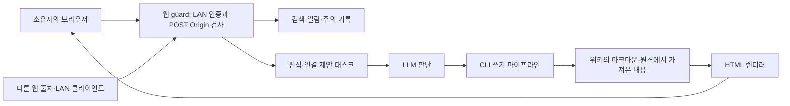

# 웹 UI 독립 리뷰 — 2026-10-09

검토 기준은 **v0.10.0, `ede67e302a8487aecbb4d59587a8686292018cf6`**이다. 구현은 수정하지 않았다. 가장 확실한 결함은 성공했다고 응답한 편집 제안의 소실(WEB-03), 동시 상태 저장의 소실·일시적 JSON 오류(WEB-04), 인증 리다이렉트를 자동 읽음 성공으로 해석하는 클라이언트(WEB-05)다. 로컬 Host 경계(WEB-01)와 본문 실행 신뢰(WEB-02)는 비밀 위키에 중요하지만, 실제 브라우저 공격 성립을 확인한 결과와 혼동해서는 안 된다.

`AGENTS.md`, `docs/philosophy.md`, `docs/invariants.md`를 먼저 읽었다. 다른 영역의 초안 보고서는 읽지 않았다. 새 대시보드의 제작 주체를 판단 근거로 삼지 않았다. 비교 기준은 원래 목적, 즉 **개인 마크다운 지식과 주의 기록을 로컬에서 검색하고, 사람이 요청한 변경을 LLM이 판단하는 위키**다. 보고서의 불변식·시험은 향후 제안이며 현재 `invariants.md`의 보증으로 추가하지 않았다.

## 범위와 검증 수준

[파일 manifest](evidence/web-file-manifest.txt)는 아래 **47개 대상 파일**의 크기·줄 수·SHA-256을 고정한다. 첫 번째 그룹들은 전 파일을 읽었고, minified vendor와 폰트는 아래에 적은 제한된 방식으로만 조사했다.

| 범위 | 정확한 파일 목록 | 확인 방식 |
|---|---|---|
| 서버·핸들러·인증·렌더링 | `internal/webui/{auth,browse,discover,edit,graph,history,i18n,render,server,speak,suggest,tasks}.go` | 모든 함수·라우트·분기 정독, 주요 분기 httptest 재현 |
| Go 테스트 | `internal/webui/{auth,i18n,mermaid_serve,render,tasks,workspace}_test.go` | 전체 소스 및 웹 패키지 테스트 실행 |
| 템플릿 | `internal/webui/templates/{attention,base,browse,discover,edit,gaps,graph,history,home,login,page,recent,search,setup,tasks}.html` | 전체 소스, 실제 Go 템플릿 HTTP 출력 |
| JS·CSS | `internal/webui/static/{app,graph}.js`, `internal/webui/static/{style,chroma}.css` | 전체 소스, shipped app.js를 기존 fake DOM으로 실행; 브라우저 레이아웃 검증 불가 |
| 로케일 | `internal/webui/locales/active.{en,ko}.toml` | 메시지·표현·소스, 기존 parity/fallback 시험 |
| UI 시험 어댑터 | `internal/webui/uitest/app.test.cjs` | 전체 구현·18개 테스트 실행, 별도 성공 응답 모형 재현 |
| vendor | `internal/webui/static/vendor/{force-graph.min,tex-svg}.js` | 헤더·해시·URL 문자열·통합 호출 확인; 번들 전체 의미·취약점 DB 감사 아님 |
| 폰트 | `internal/webui/static/vendor/fonts/{LICENSE-fonts.txt,MaruBuri-Bold.woff2,MaruBuri-Regular.woff2,PretendardVariable.woff2}` | 라이선스 안내·파일 존재·크기·해시; 글리프·래스터·폰트 파서 미검증 |
| CLI 기동 | `cmd/canopy/serve.go` | 전 파일 정독; 실제 CLI 기동·종료 신호 통합 시험은 하지 않음 |

경계를 추적하기 위해 `internal/wiki/page.go`, `internal/config/config.go`의 경로·기본값, `internal/reads/reads.go`의 Load/Save/Mark, `internal/tasks/tasks.go`의 저장·ID·Close·edit 검증, `internal/resurface/state.go`, `internal/attention/gaps.go`, `internal/skills/canopy_wiki.md`의 Mermaid 규칙도 읽었다. Goldmark v1.8.4의 링크 렌더 분기도 로컬 모듈 캐시에서 확인했다. 이 지원 파일들과 검색·임베딩 엔진 전체에 대한 별도 전수 감사를 주장하지 않는다.

**격리:** 모든 페이지·상태·임시 업로드는 `/private/tmp/canopy-audit-20261009/web` 아래의 합성 fixture다. `GOCACHE=/private/tmp/canopy-review/go-cache`, `GOPROXY=off`, 네 XDG 변수를 fixture 경로로 지정했다. 실제 HOME/XDG 설정과 사용자의 위키를 읽거나 바꾸지 않았다. 생산 서비스에 접속하거나 재시작하지 않았다. 폐기용 `127.0.0.1:51805` 서버만 잠깐 기동하고 SIGINT로 종료했다. OS는 darwin/arm64, Go 1.27.1, Node v22.22.3이었다.

**확인한 실행:** 웹 패키지 Go 테스트는 `ok …/internal/webui 1.737s`, 기존 JS 어댑터는 **18/18 통과**했다. 관측용 Go probe의 PASS는 “결함이 없다”는 뜻이 아니다. 재현이 끝났다는 뜻이며, 현재 결함의 출력 자체를 기록하는 시험이다. 동시성 probe에 `-race`를 적용해도 PASS였으나 파일 소실·HTTP 500은 계속 관찰됐다. Go의 메모리 race 검사와 파일의 read/modify/write 정합성은 다른 문제다.

**브라우저 공백:** 승인된 Orca UI 경로로 `orca tab list --json`은 빈 목록을 반환했고, `orca tab create --url http://127.0.0.1:51805/page/alpha --json`은 exit 1, `runtime_error`, **`Browser tabs are unavailable while a remote runtime is active`**를 반환했다. 우회 브라우저·CDP·OS GUI를 쓰지 않았다. 따라서 스크립트 실행·DNS rebinding의 끝단, 실제 DOM 파싱·기본 form submit·포커스·IME, 스크린리더, 360px/1280px 폭, 터치, dark/light 화면, Mermaid/MathJax/canvas 렌더·외부 요청은 **미검증**이다. HTML 문자열이나 fake DOM의 PASS를 그 증거로 쓰지 않는다. [정확한 실패 기록](evidence/web-browser-result.txt)을 보존했다.

## 목적에 맞는 신뢰 경계



네트워크 클라이언트 인증과 **본문이 브라우저에서 가진 권한**은 서로 다른 경계다. 로컬 프로세스가 이미 같은 Unix 계정의 파일을 읽을 수 있다는 사실도, 일반 웹 페이지에 그 권한을 줄 이유는 아니다. LAN에서는 단일 계정이 위키의 모든 작업을 할 수 있는 개인용 모델이므로 다중 사용자 ACL의 부재를 결함으로 세지 않는다.

현재 보호는 실재한다. `serve.go:49–65,82`는 loopback 밖 바인딩에 인증을 강제하고 기본값은 `localhost:8737`이다. `auth.go:107–136`은 설정 코드를 비교하고 계정 생성과 코드 소모를 mutex 안에서 처리한다. 비밀번호는 bcrypt, 자격증명은 위키 밖 XDG config, 신규 파일 모드는 0600이다. 세션 토큰은 32바이트 난수이며 HttpOnly·SameSite=Lax·30일 유효기간을 갖고, 서버 재시작 때 메모리 세션이 사라진다. LAN 인증 벽은 JSON API에도 적용되며 static·login·setup의 공개는 위키 내용 공개와 다르다.

TLS 직접 종단을 하지 않는 것은 `philosophy.md`의 명시적 비목표이고 기동 시 프록시/Tailscale 안내도 있다. 평문 LAN에서 도청 가능한 자격증명·세션은 **암호화된 네트워크를 택하지 않은 배치의 위험**이다. Secure 쿠키가 없다는 사실만으로 별도의 인증 우회라고 판정하지 않았다. 동일 host의 다른 포트 서비스에 쿠키가 전달되는 브라우저 모델, 장기 세션의 폐기·정리, 캐시·로그에 남는 비밀은 아래 WEB-08의 운영 선택·추가 시험으로 다룬다.

## 발견·제안 목록

| ID | 판단·우선도 | 핵심 전제 |
|---|---|---|
| WEB-01 | 서버 경계 결함 확인, 유출 공격은 조건부 높음 | loopback 무인증 + 외부 Host로 도달 가능한 브라우저/프록시 경로 |
| WEB-02 | 명시적 본문 신뢰 선택, 조건부 높음 | 공격자가 영향을 준 HTML/링크가 위키 페이지로 반영됨 |
| WEB-03 | 확정 결함, 높음 | 같은 페이지에 동시 제안 접수 |
| WEB-04 | 확정 결함, 중간 | 상태 쓰기·읽기/피드백의 동시 실행 |
| WEB-05 | 확정 프로토콜·JS 결함, 중간 | 열린 페이지에서 세션 만료·서버 재시작·다른 탭 로그아웃 |
| WEB-06 | 안전 메서드의 지속 상태 변경 확인, 낮음 | 오래된 재발견 후보 + 그날 첫 홈 요청 |
| WEB-07 | 확정 입력 정합성 결함, 낮음 | 잘못된 slug로 읽음·피드백 POST |
| WEB-08 | 자원 경계 결함 확인, LAN에서 중간 | 인증 전 요청을 보낼 수 있는 네트워크 클라이언트 |
| WEB-09 | cold 검색 결함·규모 비용 확인, 중간 | 빈 검색 캐시 또는 수천 페이지 위키 |
| WEB-10 | 확정 표시 결함, 중간 | 오래되고 링크·벡터 신호 없는 미읽음 페이지 |
| WEB-11 | 편집 제안의 보증 부족, 낮음 | 편집창 열기와 제출 사이에 원문 변경 |
| WEB-12 | UI 보증 부족·접근성 개선 제안, 낮음 | 실제 브라우저·키보드·테마·큰 문서 사용 |
| WEB-13 | 확정 로그아웃 분기 결함, 낮음 | 인증 모드의 쿠키·기존 탭이 로컬 무인증 모드에 남음 |

### WEB-01 — localhost 바인딩을 HTTP Host 신뢰와 동일시한다

**근거:** `cmd/canopy/serve.go:49–66,82`; `internal/webui/auth.go:209–259`. 바인딩 주소 분류는 IPv4/IPv6 loopback과 localhost를 올바르게 구별한다. 하지만 guard는 들어온 Host를 허용 목록과 대조하지 않으며, GET/HEAD는 Origin 검사도 건너뛴다. POST 검사는 Origin의 `u.Host == r.Host`만 확인한다. 따라서 공격 출처의 hostname이 loopback으로 도달하는 경우 요청이 자기 출처로 보인다.

**재현·실제:** `TestBoundary`는 `PRIVATE-CANARY`를 넣은 서버에 `Host: evil.test:8737`를 주었다. `/page/alpha`, `/api/preview/alpha`, `/api/graph`는 모두 **200, private=true**였다. 같은 Host에서 `Origin: http://evil.test:8737`의 제안 POST는 **303**, 태스크가 생성됐다. `Origin: https://evil.test` 및 `Origin: null`은 **403**이었다. Origin 없는 CLI 형태 POST도 303이었다. `EnableAuth()` 후 세션 없는 `/api/graph`는 **302 /setup, private=false**였다. [출력](evidence/web-probe-output.txt), `TestBoundary` [소스](evidence/web-probe-test.go.txt).

**기대/실제:** loopback 모드는 의도한 로컬 authority만 위키를 읽고 바꾸게 해야 한다. 지금은 네트워크 연결 위치만 loopback이면 어떤 HTTP Host도 받아들인다. **끝단 DNS rebinding·유출은 미검증**이다. 위 관찰은 hostile Host를 받는 서버 측 필요조건의 증명이지, 특정 최신 브라우저를 뚫었다는 증명이 아니다. CORS를 켜지 않았으므로 단순한 다른 출처 fetch가 응답 본문을 읽을 수 있다고도 주장하지 않는다.

**가장 강한 반론:** 최신 브라우저의 로컬 네트워크 제한·DNS 정책이 공격 경로를 막을 수 있고, 평범한 LAN 바인딩은 이미 인증돼 있다. 로컬 악성 프로세스는 원래 파일 접근권을 가질 수 있다. 이 때문에 심각도는 **브라우저가 공격 Host로 loopback 연결을 허용하거나, 사용자가 무인증 로컬 서버를 프록시로 노출한 경우**에 한정한다. 그래도 현재 주석의 “CSRF/DNS-rebinding defence”가 읽기 기밀성을 보증하는 것은 아니다.

**제한된 처방·대안:** loopback 모드의 실제 listener/명시 설정에 맞춘 Host 허용 목록을 우선 제안한다. localhost·127.0.0.1·[::1]과 필요한 port를 다루고, 임의 hostname·port를 조용히 신뢰하지 않도록 한다. 커스텀 로컬 hostname은 명시 opt-in 또는 인증으로 허용할 수 있다. 모든 로컬 접근에 인증을 요구하는 대안은 더 단순하지만 현재 편의 모델을 바꾼다. Origin의 scheme까지 비교하는 것은 의미를 정확하게 만들지만 Host 경계를 대신하지 못한다. Origin 없는 비브라우저 클라이언트를 무조건 차단할 필요는 없다.

**제안 불변식·수락 시험:** “무인증 loopback 서버는 허용하지 않은 authority로 어떤 위키 HTML/JSON도 반환하지 않고 상태도 바꾸지 않는다.” `Host: evil.test`, `Origin: http://evil.test`, Origin 생략, GET/HEAD/POST 조합을 403/421 등으로 거부하고 파일 해시가 유지되는 httptest를 둔다. localhost·IPv4·IPv6·정상 프록시 설정 회귀도 포함한다. 허용된 브라우저가 준비되면 폐기용 두 서버와 DNS fixture로 별도 끝단 시험을 하며, 실패 원인을 서버와 브라우저 정책으로 분리한다.

### WEB-02 — 본문 신뢰가 스크립트·위험 URL·원격 이미지 권한까지 포함한다

**근거:** `internal/webui/render.go:26–43,59–65,87–88`; `templates/page.html:25`; `static/app.js:219–239`. `WithUnsafe()`는 raw HTML뿐 아니라 일반 Markdown의 위험 URL도 통과시킨다. 최종 결과는 `template.HTML`이다. “사용자의 own content”라는 주석은 신뢰 선택을 밝히지만, LLM이 수집·통합한 원문까지 실행 코드로 신뢰하는지 별도 합의가 없다. 외부 링크의 `noopener`와 Mermaid `securityLevel: "strict"`는 각각 해당 기능을 보호하며 본문 전체 sanitizer가 아니다.

**재현·실제:** `TestRenderTrust`의 페이지 HTTP 결과는 `script=true`, `eventhandler=true`, `javascriptURL=true`, `remoteImage=true`, `escapedAlias=true`였다. `<script>window.auditExecuted=true</script>`, ``, `[go](javascript:alert%281%29)`가 실행 가능한 형태로 보존됐다. 원격 pixel URL은 출력만 검사했고 **연결하지 않았다**. 브라우저 실행·실제 외부 전송도 **미검증**이다. 위키링크 alias의 ``는 `&lt;…&gt;`로 안전하게 처리됐다. [출력·소스](evidence/web-probe-output.txt), [렌더 probe](evidence/web-probe-test.go.txt).

**기대/실제:** 개인 지식 페이지를 읽는 행위가 지식 문자열에 서버 API 실행권을 주어서는 안 된다는 모델이라면 경계를 넘는다. 실행된 same-origin 본문 코드는 HttpOnly 쿠키를 직접 읽지 못해도 로그인 브라우저의 fetch 권한으로 위키를 읽거나 태스크를 접수할 수 있다. 반대로 “페이지 작성자는 웹 앱 코드를 실행할 수 있다”는 모델이라면 이 동작은 허용된 능력이다. **무인증 사용자가 edit 제안만 접수해서 즉시 XSS를 만든다는 주장은 틀리다.** 제안은 페이지로 적용되지 않고 `tasks.html:14`의 `<pre>{{.Body}}</pre>`에서 이스케이프된다. 에이전트가 반영하거나 git/직접 편집으로 페이지에 들어오는 단계가 전제다.

**가장 강한 반론:** 위키는 원래 소유자의 로컬 파일이고 HTML 삽입이 필요한 페이지도 있다. LLM 검토가 위험 콘텐츠를 제거할 수 있다. 그래서 현재를 “공개 사이트에 임의 공격자가 글을 올리는 무조건적 stored XSS”로 분류하지 않는다. 다만 프로젝트의 “불변식은 코드가” 원칙에서 콘텐츠 판단과 실행 권한 판정까지 LLM에게 맡기는 비용은 크다.

**제한된 처방·대안:** 기본 렌더링을 비실행 allowlist로 정하고 위키링크는 안전한 AST 노드/렌더러로 처리하거나 최종 HTML을 검증한다. script·event handler·위험 scheme·form/iframe 등 기능별 허용 범위를 명시한다. 필요한 HTML을 전부 없애는 처방은 호환성 비용이 크다. raw 실행은 명시한 trusted 모드나 별도 격리 origin에서 제공하는 대안이 있다. 원격 이미지는 별도 선택이다. 네트워크가 필요한 그림을 의도한 사용자에게 확인 후 로드 또는 명시 opt-in을 제공하면 기밀성과 호환성을 조절할 수 있다. CSP는 보조 수단이며 unsafe 출력 자체와 임의 원격 이미지 정책을 대신하지 않는다.

**제안 불변식·수락 시험:** “기본 위키 렌더는 지식 내용을 실행 권한으로 승격하지 않고, 원격 자원 요청 여부가 명시된 정책을 따른다.” script/onerror/SVG 이벤트/`javascript:`/data URL/악성 alias/태스크 본문을 corpus로 둔다. Mermaid·수식·표·정상 위키링크는 유지돼야 한다. 실제 브라우저에서 실행 marker와 폐기용 수집 서버의 요청·동일 출처 변조가 모두 없음을 확인한다. trusted 모드를 택하면 그 허용된 동작은 반대 시험으로 고정한다.

### WEB-03 — 동시 편집 제안은 모두 접수했다고 응답하면서 서로 덮어쓴다

**근거:** `internal/webui/edit.go:47–75`, `tasks.go:58–83`에는 접수 직렬화가 없다. 하위 `internal/tasks/tasks.go:189–211`은 초 단위 ID와 `os.Stat`으로 빈 이름을 찾은 뒤 `writeTask`를 호출한다. `writeTask:136–144`의 `os.WriteFile`은 exclusive create가 아니다. 두 요청이 같은 빈 이름을 보고 각자 성공할 수 있다.

**재현·실제:** `TestConcurrentProposals`에서 유효한 alpha 페이지에 서로 다른 본문 24개를 barrier로 동시에 제출했다. 세 회 모두 **303 24개**, 저장된 태스크는 **8·10·8개**, Load 오류는 없었다. 초기 별도 실행도 8·13·10개였고, race 실행은 5·8·8개였다. 성공한 요청의 본문이 사라졌다는 관측이며 프로세스 crash나 악성 페이지는 필요 없다. [정상 실행](evidence/web-probe-output.txt), [race 실행](evidence/web-race-output.txt), `TestConcurrentProposals` [전체 소스](evidence/web-probe-test.go.txt).

**기대/실제:** 접수 성공 24개는 독립 태스크 24개 또는 명시적인 동일 제안 dedup 결과와 대응해야 한다. 실제로는 다른 본문들이 조용히 덮어써진다. 페이지 파일을 건드리지 않는 I2/T6은 지켰지만, 접수한 판단 재료를 보존하는 T9의 실용적 의미와 원칙 3의 재현 불가 상태 보존을 훼손한다.

**가장 강한 반론:** 개인용 UI에서 동시 24개는 평소 사용보다 많고 HTTP handler에 mutex 하나로 좁게 막을 수 있다. 그러나 두 탭·중복 제출·웹과 CLI 동시 접수도 동일 경쟁 창을 공유한다. 높은 심각도는 원문 파괴가 아니라 **접수 성공 뒤의 재현 불가 요청 소실**에 대한 것이다.

**제한된 처방·대안:** 태스크 저장 계층에서 충돌 없는 ID와 exclusive reservation/완성 파일 atomic publish를 보장한다. 웹 mutex는 즉시 완화책이지만 다른 프로세스의 CLI를 보호하지 못한다. UUID/충분한 난수 ID는 가독성을 줄이고, 시간 기반 ID 유지 + O_EXCL 재시도는 조금 복잡하다. crash 시 반쯤 쓴 JSON이 권위 태스크로 보이지 않게 하는 원자적 publish도 필요하다. 큐를 머신-로컬 DB로 이동시키는 대안은 git 동행 목적을 바꾸므로 이 결함의 최소 처방이 아니다.

**제안 불변식·수락 시험:** “성공 응답을 받은 서로 다른 edit 제안은 각각 고유하고 완전한 태스크로 남는다.” 동일 초·동일 slug의 2개/24개 concurrent HTTP 제출과 웹+별도 CLI 프로세스를 시험한다. 성공 수 = 고유 파일 수 = 보존된 본문 수, 모든 JSON 유효, 페이지 해시 불변을 검사한다. connect의 의도적 pair dedup·dismiss 억제는 유지한다.

### WEB-04 — 집계 파일 쓰기가 읽는 중간에 노출되고 피드백 업데이트가 소실된다

**근거:** `internal/webui/discover.go:97–153`의 읽음 쓰기는 `s.mu`로 같은 서버의 다른 읽음 쓰기와 직렬화된다. 하지만 `graph.go:32–41`, `server.go:221,342`, 다른 GET의 `reads.Load`는 그 mutex에 참여하지 않는다. `internal/reads/reads.go:102–126`은 같은 파일에 truncate/write한다. 피드백은 `speak.go:82–107`에서 Load→변경→Save를 잠금 없이 수행하고, dailyMu는 저장 뒤 카드 포인터 변경만 보호한다. `internal/resurface/state.go:47–80` 역시 파일을 직접 읽고 덮어쓴다.

**재현·실제:** 존재하는 fixture 페이지 40개에 concurrent feedback을 보낸 `TestConcurrentReadsAndFeedback`는 **303 26개, 저장 feedback 3개, 나머지 요청에서 `unexpected end of JSON input`**을 냈다. 없는 slug에만 의존한 시험이 아니다. `TestConcurrentReadServing`는 alpha 읽음 쓰기 150회와 `/api/graph` 320회를 겹쳤고, **200 312회/오류 8회**, 최종 read count는 정상 151이었다. 즉 최종 파일이 정상이어도 중간 독자는 오류를 겪는다. race 실행도 GET 317/오류 3이었다. [출력](evidence/web-probe-output.txt), [race 출력](evidence/web-race-output.txt).

**기대/실제:** 독자는 이전 또는 다음의 완전한 snapshot을 읽고, 성공한 서로 다른 feedback은 보존돼야 한다. 실제로는 미완성 JSON을 읽거나 다른 요청의 변경을 지운다. auth/session mutex의 메모리 보호와 reads의 일부 직렬화는 인정하지만 파일 정합성의 전체 보증은 아니다.

**가장 강한 반론:** 단일 소유자의 반복 피드백이 드물고 이벤트 DB는 best-effort다. 하지만 소실되는 것은 비권위 이벤트 DB가 아니라 git으로 동행하는 피드백 집계다. 읽는 중 오류는 홈·그래프 사용과 자동 읽음이 겹치는 평범한 상황에도 나타난다.

**제한된 처방·대안:** 동일 파일의 read/modify/write를 저장 계층에서 잠그고, 쓰기는 완성된 임시 파일의 atomic replacement로 공개한다. 원자 교체만 하면 partial JSON은 막아도 lost update는 남는다. 웹 mutex만으로는 CLI·여러 serve 프로세스를 보장하지 못하므로 프로세스 간 잠금 또는 compare-and-swap 재시도가 대안이다. 카드 캐시 잠금과 파일 잠금의 순서를 정해 교착도 시험한다. 형식 변경은 위키 self-version 규칙을 따르고 머신-로컬 migration 사다리에 넣지 않는다.

**제안 불변식·수락 시험:** “집계 JSON은 독자에게 항상 완전하고, 성공한 독립 변경은 병합 후 남는다.” 병행 GET/POST 500회에서 500·JSON parse 오류 0, 성공 feedback 수와 저장 수 일치, explicit→auto 강등 없음, 인간/에이전트 파일 분리 유지, 웹+CLI 재실행을 검사한다. best-effort 이벤트 실패를 권위 상태 손실의 면제로 쓰지 않는다.

### WEB-05 — 세션이 없어도 로그인 HTML의 200을 자동 읽음 성공으로 표시한다

**근거:** `auth.go:245–258`은 인증 없는 API도 로그인/설정으로 302 redirect한다. `static/app.js:265–275`는 fetch의 `response.ok`만 검사한 뒤 읽음 컨트롤을 성공 상태로 교체하며 JSON의 `{read:true}`를 검증하지 않는다. 어댑터 `uitest/app.test.cjs:84–89`의 읽음 응답 모형은 `{ok:…}`뿐이며, 성공 시험도 JSON을 요구하지 않는다.

**재현·실제:** `TestAuthRedirectAndCookie`에서 정상 계정을 만든 뒤 쿠키 없는 `/api/read/alpha`에 HTTP client로 POST하면 redirect를 따라 **최종 200 /login, text/html, readStored=false**였다. 별도 [어댑터 probe](evidence/web-adapter-probe.cjs.txt)는 그 성공 상태만 가진 기존 모형에서 **readRequests=1, autoSuccess=true**, JSON 확인 없음으로 끝났다. [HTTP 출력](evidence/web-probe-output.txt), [모형 출력](evidence/web-adapter-output.txt). 실제 브라우저 form 교체·로그아웃 탭 시퀀스는 미검증이지만 HTTP 계약과 실행한 JS의 성공 분기는 확인했다.

**기대/실제:** 세션 만료·재기동·다른 탭의 로그아웃 때 자동 읽음은 실패/재인증 상태이고 읽음 집계는 그대로여야 한다. 지금은 UI에 ✓ 자동을 보여주면서 서버는 기록하지 않는다. U4의 “실제 작업 성공 뒤에만 표시”를 HTTP 2xx만으로 점검한 것이 부족하다.

**가장 강한 반론:** 30일 세션이라 만료가 흔하지 않고 다음 navigation은 로그인 화면으로 간다. explicit 읽음 버튼도 남는다. 하지만 개인 위키를 장기간 열어두거나 serve를 재기동하는 경우에는 현실적인 전제이며, 관측을 거짓 기록으로 착각하는 비용이 있다.

**제한된 처방·대안:** `/api/*` 인증 실패는 redirect HTML 대신 JSON 401/403으로 응답하고, 클라이언트는 성공 payload의 `read === true`까지 확인한다. 일반 페이지는 현재 로그인 redirect UX를 유지할 수 있다. 서버 변경 없이 redirected·content-type·JSON 확인을 하는 대안은 방어를 강화하지만 API 계약을 불명확하게 남긴다. 실패 시 현재 명시 컨트롤을 보존하고 재인증 안내를 제공한다.

**제안 불변식·수락 시험:** “자동 읽음의 성공 표시는 저장 성공 payload에만 대응한다.” expired cookie/서버 재시작/다른 탭 logout/302→200 HTML/200 잘못된 JSON/네트워크 오류를 모두 시험한다. 실제 브라우저에서 ✓가 생기지 않고 reads 해시 불변이며, 재인증 후 정상 성공만 표시되는지 확인한다. 기존 모형도 `Response`의 redirect·URL·content-type·payload를 표현하도록 넓힌다.

### WEB-06 — GET뿐 아니라 HEAD도 그날의 재발견 상태를 소비한다

**근거:** `server.go:215–282`의 홈 렌더가 `todaysCard()`를 부르고, `speak.go:34–77`은 후보를 MarkShown/MarkPairShown하고 `_meta/resurface/state.json`에 저장한다. guard `auth.go:233`는 GET/HEAD를 변경 검사에서 제외한다. Go의 GET route는 HEAD에도 대응한다.

**재현·실제:** 오래된 후보를 가진 서버의 첫 홈 요청을 `HEAD /`, `Origin: https://evil.test`로 보낸 `TestReadAndHomeMutations`는 **200, stateChanged=true**였다. 이는 reads.json을 읽음으로 만드는 결함이 아니다. 노출 기록·45일 재발견 cooldown의 변경이다. [출력·소스](evidence/web-probe-output.txt), [상태 구현](../../../internal/resurface/state.go).

**기대/실제:** HEAD 상태 확인·프리페치가 사람에게 카드를 노출했다고 기록하지 않는 것이 자연스럽다. 지금은 본문을 받지 않는 요청도 동기화되는 재발견 상태를 바꾼다. 브라우저의 top-level cross-site 이동으로 같은 효과가 나는지는 미검증이며, 쿠키 SameSite와 브라우저의 로컬 접근 정책도 고려해야 한다.

**가장 강한 반론:** 재발견 카드의 실제 노출은 소비와 다르고, 원래 홈페이지 노출에 cooldown을 주려는 의도다. 모든 GET을 엄격한 무변경으로 바꾸면 페이지 view·검색 관측도 포기해야 한다. 그래서 이 항목은 현재 H5/U2의 “노출≠읽음” 위반이나 고위험 CSRF로 분류하지 않는다. HEAD가 사람의 노출을 흉내내는 점과 persistent cooldown을 핵심으로 한정한다.

**제한된 처방·대안:** HEAD는 카드 선택/표시 기록을 건너뛰고, GET에서 후보를 peek한 뒤 사람에게 실제 표시된 카드만 별도 확인 경로로 기록하는 방식을 검토한다. JS 노출 확인은 JS 없는 사용자·프리페치 판정의 비용이 있다. 최소 대안은 GET 노출 기록을 의도된 예외로 문서화하면서 HEAD만 무변경으로 고정하는 것이다. 일일 캐시는 후보를 고르는 비용 완화이지 요청이 실제 노출인지의 보증은 아니다.

**제안 불변식·수락 시험:** “HEAD는 동기화되는 읽음·재발견 상태를 바꾸지 않는다.” 후보가 있는 새 서버에서 HEAD를 처음 보내 상태 파일 존재·해시 불변을 검사한다. GET 노출을 유지하기로 결정하면 그 예외·그날 재요청 no-op·인증 전 무변경도 명시적으로 시험한다.

### WEB-07 — 명시 읽음·재발견 피드백은 실존 페이지를 검사하지 않는다

**근거:** `discover.go:97–122`는 NormalizeLink 이후 페이지 lookup 없이 Mark/Unmark한다. 반면 자동 경로 `discover.go:127–138`는 Scan과 실존 검사를 한다. `speak.go:82–100`의 feedback/snooze도 slug 존재를 확인하지 않는다.

**재현·실제:** `/read/phantom` POST는 **303, recorded=true**, `/api/read/phantom`은 **404**, `/resurface/feedback`의 phantom/up은 **303, feedback에 phantom 저장**이었다. [출력](evidence/web-probe-output.txt), `TestReadAndHomeMutations` [소스](evidence/web-probe-test.go.txt).

**기대/실제:** 새 기록은 현재 페이지를 대상으로 하거나 명시적 별도 의미를 가져야 한다. 지금은 typo·옛 탭의 개명된 slug·직접 호출로 재현 불가 상태에 유령 기록이 들어간다. 홈 summary는 실존 scan.Pages만 세므로 phantom을 읽은 수로 부풀리지는 않는다(`server.go:230–235`); 이 보호를 인정한다.

**가장 강한 반론:** 웹 폼이 제공하는 slug는 정상이고, 삭제·개명 후 과거 기록을 보존하는 목적도 있을 수 있다. 이는 기록을 Load할 때 오래된 slug를 지우라는 제안과 다르다. 지금의 문제는 **새 입력을 검증하지 않는 비대칭**이다.

**제한된 처방·대안:** Mark/feedback/snooze의 새 요청은 실존 lookup 후 404/400으로 거부하고, 미읽음 취소처럼 이미 남은 과거 기록을 지우는 작업은 별도 허용 규칙을 둔다. 개명된 페이지로 안내할 수 있는 alias 기능은 유용하지만 이 결함의 필수 처방은 아니다. 안정적인 내부 ID 도입은 더 큰 형식 변경이므로 최소안보다 범위가 크다.

**제안 불변식·수락 시험:** “새 인간 읽음·피드백은 실존 페이지에만 추가되고 잘못된 요청은 상태를 바꾸지 않는다.” unknown/빈 slug/삭제 직후/개명 직후, auto·explicit·feedback·snooze를 비교한다. 거부 전후 파일 해시와 이벤트 의미를 확인하고, 기존 과거 기록의 읽기 호환성과 취소 가능성은 유지한다.

### WEB-08 — 인증 전 요청의 업로드·시간 경계가 없고 파싱 실패가 잘못된 오류로 바뀐다

**근거:** `serve.go:66`의 `http.Server`에는 ReadHeaderTimeout/ReadTimeout/IdleTimeout/WriteTimeout 설정이 없다. `auth.go:283–292,321–326`, `edit.go:58–71`, `tasks.go:40–49,69`는 FormValue를 쓰고 parse 오류를 분리하지 않는다. 이 경로에 MaxBytesReader·요청별 제한이 없다. Go의 기본 urlencoded 크기 제한과 multipart 메모리 제한은 있으므로 “모든 form body가 무제한 메모리”라는 주장도 하지 않는다.

**재현·실제:** `TestBodyLimits`에서 urlencoded 1MiB는 303, **11MiB는 500 `edit task needs a request or a proposed body`**, 같은 11MiB multipart 본문은 303으로 저장됐다. parse 오류가 빈 form 값으로 해석된 결과다. `TestUnauthMultipartSpool`은 계정 없는 설정 화면에 코드 없이, UI가 쓰지도 않는 file field를 보냈다. **64MiB 전부 임시 디스크에 spool된 뒤 400**이었다. httptest의 request를 직접 쓰므로 probe는 MultipartForm.RemoveAll로 임시 파일을 회수했다; 실제 net/http 서버의 요청 종료 정리가 없다는 주장은 아니다. `TestSlowHTTP`는 serve와 같은 zero-timeout 구성의 폐기 서버에 미완성 헤더를 **1.5초** 유지한 뒤 완성했고 **HTTP/1.1 200 OK**, 설정된 timeout은 모두 0이었다. 무한 시간이나 대규모 DoS는 실행하지 않았다. [출력](evidence/web-probe-output.txt).

**추가 인증 관측:** 틀린 ID 첫 요청은 401·약 175µs였고, 그 뒤 **정상 비밀번호의 정상 로그인까지 약 1.070초 지연**됐다(`TestLoginDelay`). `auth.go:139–161`의 실패 계수는 전역이고 context와 무관한 Sleep이다. 계정 존재를 추정할 수 있는 시간차와 병렬 초기 실패의 제한 부족은 코드상 보이지만 계정 탈취·온라인 brute force는 재현하지 않았다. 8 hex 설정 코드는 난수·single-use·terminal-only이며 선점 레이스 방지는 효과가 있다. 코드 TTL/시도 제한이 없다는 사실만으로 코드를 실용적으로 추측했다고 주장하지 않는다.

**기대/실제:** 인증 전에도 불필요한 업로드·헤더 대기·form 작업을 작은 예산으로 제한하고, 과대 입력은 413 등 정확한 오류로 실패해야 한다. 현재 정상 위키 내용이 보호되더라도 서버 자원을 쓰게 하는 경로는 열려 있다. LAN 가용성 위험은 도달 가능한 악성/오동작 클라이언트가 전제다. 단일 소유자·신뢰된 암호화 네트워크에서의 우선도는 더 낮다.

**가장 강한 반론:** 프록시가 이미 body/time/rate 제한을 할 수 있고 local 개인 서버에서 공격량이 낮다. Go 기본 헤더 제한·form 제한과 업로드 종료 시 정리도 있다. 그러나 기본 LAN 직접 bind는 공식 사용 경로이며 `/setup`은 인증 전에 열려 있다. 프록시 보호는 자동 강제 불변식이 아니다.

**제한된 처방·대안:** auth와 task/read/feedback에 서로 다른 명시 body/field 예산을 두고 사용하지 않는 multipart/file을 초기에 거부한다. ParseForm 오류를 처리하고 편집 실패에는 제출 내용을 잃지 않는 재시도 가능한 화면을 제공한다. 서버 헤더·유휴 제한은 보수적으로 두되 큰 위키 검색/임베딩의 유효 작업 시간과 구별한다. 로그인 제한은 source별 제한+작은 전역 동시성 예산/취소 가능한 backoff가 대안이며 IP 공유·프록시의 실제 원격 주소 신뢰 비용을 고려한다. 프록시에 맡기는 대안은 지원 구성·검증 명령을 문서화해야 한다.

TLS는 앞서 적은 배치 선택이다. Secure 쿠키는 신뢰된 HTTPS 종단 설정이 있는 경우에만 켜는 정책이 합리적이며, 전달 헤더를 누구나 조작할 수 있게 신뢰해서는 안 된다. 세션의 TTL·restart/logout 무효화·expired entry 정리·허용 동시 세션 수, 인증된 내용의 캐시와 `logRequests(server.go:129–133)`의 질의 문자열/`search-gaps.jsonl` 동기화 범위도 같은 **개인 기밀성 정책**에 명시할 것을 제안한다. 헤더 부재만으로 로그아웃 뒤 캐시 유출을 입증했다고 주장하지 않는다.

**제안 불변식·수락 시험:** “인증 전 포함 모든 요청은 route별 byte/time/concurrency 예산을 지키고, 거부된 입력은 태스크·집계를 만들지 않는다.” 크기 경계 ±1byte, urlencoded/multipart/unknown file, 느린 header/body, 취소된 로그인, 공격 source 실패와 정상 source 로그인을 시험한다. 과대 요청의 413·임시 디스크 상한·소요 시간 상한을 관찰한다. setup 코드의 wrong/replay·계정 재등록 거부, bcrypt 저장·파일 권한, TTL/restart/logout/복수 포트 쿠키·프록시 HTTPS 설정도 회귀 시험한다. 캐시 정책은 실제 브라우저 logout→Back/새 요청으로 확인한다.

### WEB-09 — cold 자동완성은 존재하는 페이지를 못 찾고 작은 응답도 전체 위키를 다시 파싱한다

**근거:** `serve.go:33–48`/`server.go:54–76`에는 초기 reindex가 없다. `server.go:452–467,559–574`는 `refresh=false`여도 Scan을 수행하고 빈 DB를 열 수 있지만 색인을 채우지 않는다. 정상 `/search`만 `refresh=true`로 재인덱싱한다. preview `server.go:577–595`, graph `graph.go:32–103`, browse `browse.go:26–56`, 홈도 전량 Scan한다. `internal/wiki/page.go:168–218`의 Scan은 각 페이지 파일 전체를 읽고 YAML·본문·링크를 파싱한다. 검색의 `s.mu`는 취소된 fetch의 서버 계산 취소를 보장하지 않는다.

**재현·실제:** `TestSearchCold`의 본문에 `unique-queryword`가 있지만 첫 `/api/search`는 **200 results=[]**였다. `/search`를 한 번 호출하면 실제 hit가 나오고, 그 뒤 같은 API는 alpha hit를 반환했다. 오류 안내 없이 같은 질의가 캐시 준비 여부에 따라 달라진다. [출력](evidence/web-probe-output.txt).

`TestWikiScale`은 약 4KiB 본문·frontmatter·alpha 링크를 가진 100/1,000/5,000페이지를 만들었다. 아래는 같은 handler를 세 번 호출한 **중앙값**, `runtime.MemStats.TotalAlloc` 차이(요청 중 누적 할당량), 실제 응답 크기다. RSS나 최대 resident memory가 아니며, httptest는 socket·gzip·브라우저·ORT 모델 비용을 포함하지 않는다. 다른 감사 worker가 같은 머신에서 실행 중이므로 절대 시간은 벤치마크 보증이 아니다.

| 요청 | 100p 시간 | 1,000p 시간 | 5,000p 시간 | 5,000p 할당 | 5,000p 응답 |
|---|---:|---:|---:|---:|---:|
| `/api/preview/alpha` | 7.06ms | 52.93ms | 259.77ms | 221,793,536B | 102B |
| `/api/search?q=fixture` | 6.71ms | 53.08ms | 261.53ms | 221,574,920B | 50B |
| `/browse` | 6.22ms | 55.90ms | 281.19ms | 231,611,920B | 1,377,144B |
| `/api/graph` | 7.47ms | 68.35ms | 340.29ms | 483,301,480B | 1,659,836B |
| `/` | 7.50ms | 63.98ms | 289.95ms | 222,029,200B | 13,096B |

API search를 일부러 cold 상태에서 측정했으므로 위 결과에는 벡터 검색·임베딩도 없고 결과 JSON도 50B뿐이다. `app.js:94–108`의 150ms debounce보다 오래 걸리지만 AbortController는 표시 순서를 보호할 뿐 Go Scan/Embed를 중단시키지 않는다. browse는 전체 페이지를 DOM 항목으로 보내고 graph는 전체 excerpt를 선적하며, `graph.js:120–126`의 라벨 사각형 충돌 확인은 표시되는 라벨 수에 대해 선형 탐색을 반복한다. 클라이언트의 실제 대규모 DOM/force/canvas 시간은 미검증이다.

**기대/실제:** 캐시가 없어도 첫 검색은 정직한 결과 또는 준비 상태를 제공하고, 한 페이지 미리보기/키 입력마다 본문 수천 개를 다시 파싱하지 않아야 한다. 현재는 응답 크기와 무관하게 위키 크기에 따른 비용을 지불한다.

**가장 강한 반론:** Enter 검색이 스스로 cache를 채우고, CLI 쓰기도 reindex하므로 대부분의 운영 캐시는 warm하다. 전량 Scan은 외부 편집을 즉시 반영하는 단순하고 정확한 구현이다. 5,000p는 작은 개인 위키보다 크고 260ms도 단일 요청으로는 쓸 만하다. 그러나 원칙 4가 수백 페이지 이후의 탐색을 검색으로 해결하겠다는 프로젝트의 확장 이유이며, 반복 preview/typing·GC·직렬화 대기는 사용자 비용을 키운다.

**제한된 처방·대안:** index readiness를 확인해 최초 한 번 재구축하거나 명시 준비 상태를 제공한다. 변경 감지로 갱신되는 immutable Scan snapshot/metadata cache를 공유하고 preview는 필요한 페이지만 읽는 대안을 검토한다. TTL은 단순하지만 freshness 지연, watcher는 외부 rename/git checkout·재시작 처리 비용이 있다. browse pagination과 graph의 규모별 요약/부분 로드도 전체 선적의 비용을 제한한다. 검색 context/작업 예산은 WEB-08과 함께 설계한다. 캐시 DB 레이아웃 변경이 필요하면 store schema를 올리고 재구축하며 migration 사다리는 쓰지 않는다.

**제안 불변식·수락 시험:** “빈 캐시 첫 검색도 존재 페이지를 찾고, 무변경 단일 preview/API 질의는 전체 파일 재파싱에 비례하지 않는다.” cold/warm/캐시 삭제/외부 본문 변경/CLI update/rename 이후 결과를 비교한다. 100/1,000/5,000p 고정 fixture에서 alloc·p50/p95·파일 읽기 수·빠른 취소 후 대기열을 측정한다. 예를 들어 warm preview의 파일 읽기는 대상 페이지 수에 가깝고 alloc은 1MiB 이내라는 후보 예산을 먼저 정한다. 페이지 내용 freshness와 stale vector 삭제 보호를 희생해서는 안 된다. 브라우저에서는 전체 browse·graph의 응답/DOM/프레임 예산도 별도 측정한다.

### WEB-10 — 추천 후보가 없는 것을 “전부 읽음”으로 표시한다

**근거:** `discover.go:53–75`는 30일 넘은 페이지의 newness=0, backlink=0, 벡터 affinity=0이면 `score <= 0`로 미읽음 페이지를 제외한다. `templates/discover.html:5–15`, `templates/home.html:24–32`는 Ranked/Discover가 비면 `disc_all_read`를 보여준다. 메시지는 `locales/active.ko.toml:144`의 “전부 읽으셨습니다 🎉”, 영어도 동일 의미다. 대시보드 unread 카드(`home.html:9`)는 이 추천 화면으로 연결된다.

**재현·실제:** 2020년에 생성된 isolated alpha 하나, 빈 벡터 캐시, 인간 읽음 0인 `TestReadAndHomeMutations`에서 **home unreadOne=true, allReadMessage=true**였다. 동일 조건의 discover 계산은 같은 함수·template 분기를 따른다. 최종 출력과 source를 보존했다. 전체 페이지가 읽혔다는 거짓 주장은 새 dashboard의 count 실측이 맞더라도 생긴다.

**기대/실제:** 미읽음 1이면 추천 신호가 약하더라도 “추천 없음/미읽음 1”이어야 한다. 실제로는 읽음 완료로 축하하고, unread 카드의 목적지에서 그 페이지를 찾을 수 없다. 검색·browse에는 여전히 그 페이지가 있으므로 접근 자체가 차단되는 것은 아니다.

**가장 강한 반론:** Discover는 unread 목록이 아니라 추천 순위 화면이며, 신호 없는 페이지를 추천하지 않는 것은 설계 선택이다. 이 선택은 타당하지만 실제 읽음 상태와 다르게 말하는 근거는 되지 못한다. empty wiki도 같은 “전부 읽음” 문구로 흘러갈 수 있어 zero 상태 구분이 필요하다.

**제한된 처방·대안:** readCount/total로 완료 문구를 결정하고, score 0 후보가 남으면 별도 문구·미읽음 browse 링크를 제공한다. 모든 미읽음을 최소 점수로 포함시키는 대안은 완전성은 높이지만 추천 목적을 희석한다. dashboard에서 추천 링크와 정확한 unread 필터를 구별하면 검색 우선 목적에도 맞는다.

**제안 불변식·수락 시험:** “전부 읽음 표시는 실존 인간 읽음 수 = 실존 전체 페이지 수인 경우에만 나온다.” old isolated/no vectors, hub/new pages, all read, agent-only, 빈 위키를 ko/en에서 비교한다. 미읽음 카드의 목적지에서 모든 미읽음을 볼 수 있는 경로가 있고 0개의 추천과 0개의 미읽음을 구별하는지 검사한다.

### WEB-11 — 제출 시점 base로는 사용자가 편집한 원문의 버전을 알 수 없다

**근거:** `templates/edit.html:3–8`에는 viewed base가 없다. `edit.go:29–44`는 현재 본문을 보여주지만 `edit.go:66–71`은 제출 때 다시 읽은 파일의 hash를 Base로 저장한다. 이는 현재 T9의 “접수 시점 sha256”에 맞는 동작이다. `internal/tasks/tasks.go:341–359`의 done 검증도 접수 후 내용이 바뀌었는지만 확인한다.

**재현·실제:** `TestStaleProposalBase`는 old body의 편집창을 GET한 뒤 fixture 파일을 new agent body로 바꾸고 old body에 오타만 고친 제안을 제출했다. **formOldBody=true, submission=303, storedOldProposal=true, baseMatchesNewFile=true, pageUnchangedAfterSubmit=true**였다. 기존 지식을 직접 덮어쓰지는 않았지만, 제안에 사용자가 실제로 본 버전이 실리지 않는다. [출력](evidence/web-probe-output.txt).

**기대/실제:** full-body 제안을 해석하는 에이전트가 “사용자가 본 old base → 제안”과 현재 본문을 비교할 수 있어야 한다. 지금 Base는 new body인데 제안은 old body에서 나와서, 기존 변경을 의도적으로 되돌린 것인지 오래된 편집창인지 구별할 수 없다. **현재 불변식 위반이나 자동 덮어쓰기 exploit은 아니며 보증 추가 제안**이다.

**가장 강한 반론:** 웹은 제안 접수구이고 최종 판단은 LLM이 한다. 두 제안을 태스크로 남기는 모델에서 optimistic locking으로 접수를 막을 이유는 없다. 정확한 반론이다. 필요한 것은 충돌 거부가 아니라 판단 재료의 provenance이며 오래된 제안도 접수할 수 있다.

**제한된 처방·대안:** viewed base hash와 필요한 원문 snapshot/조회 가능한 commit 식별자를 별도로 보존하고 submitted-at base와 구별한다. 또는 제출 시 stale 안내를 하되 그대로 접수하는 선택지를 제공한다. 본문 전문 두 벌 저장은 용량·기밀 기록 비용이 있고 git commit만 참조하면 미커밋 편집을 설명하지 못한다. self-versioned task의 additive 필드로 진화시키되 구버전 재저장 필드 보존을 시험한다. 머신 migration을 추가할 일은 아니다.

**제안 불변식·수락 시험:** “full-body 제안에는 사용자가 편집한 기준과 접수 당시 현재 기준이 혼동 없이 식별된다.” GET 편집창→CLI 변경/개명/삭제→POST, 두 탭, 오래된 버전 load/save를 시험한다. stale 제안을 정상 저장할 수 있고 원문 파일이 불변이며, 에이전트가 새 지식의 비의도적 삭제를 구별할 충분한 자료가 남는지 확인한다.

### WEB-12 — fake DOM의 성공 범위를 실제 작업 공간 보증으로 읽으면 안 된다

**근거:** `uitest/app.test.cjs:10–46`은 selector 결과를 수동 Map으로 공급하고 `innerHTML`은 단순 문자열이다. `focus()`는 count를 올리고 `click()`은 콜백만 실행한다. native submit·required validation·포커스 이동·DOM 파싱·CSS·layout·실제 Response는 모형에 없다. `cloneNode()`도 text만 복사한다. shipped app.js를 실행하므로 질의 seq·abort·IME 상태·성공 분기 시험에는 가치가 있지만 템플릿과 실제 DOM의 통합 증명은 아니다. 테스트 주석 `:8–9`도 이 제한을 인정한다.

**관찰·기대/실제:** 18/18 통과는 그대로 인정한다. WEB-05의 잘못된 성공 계약도 현재 성공 모형에서 통과했다. 실제 browser access가 없어서 U5의 `scrollWidth <= innerWidth`를 실행하지 못했다. CSS의 `[hidden]`, minmax/min-width, 표·pre의 자체 overflow, mobile 버튼 크기, focus-visible·skip link·reduced-motion은 유용한 보호이고, 폭 초과가 발생했다고 추측하지 않았다. 다만 다음은 **소스상 추가 보증이 필요한 설계**다.

| 검토 대상 | 정확한 근거·현재 한계 | 제한된 제안과 수락 시험 |
|---|---|---|
| 그래프 키보드·스크린리더 | `graph.js:137–152,178–196`, `templates/graph.html:3–12`: node 열기는 pointer click, find Enter는 center/zoom만 한다. 검색 가능한 DOM node 목록·열기 동작은 first-party 코드에 없다. 다른 화면 browse가 대안이다. 실제 접근성 tree는 미검증 | find 결과를 링크 목록으로도 제공하거나 선택 노드 “열기”를 keyboard control로 제공. Tab/Enter만으로 특정 노드·이웃에 접근, screen reader로 제목·상태 식별. 전체 canvas를 복잡한 ARIA widget으로 바꾸는 대안보다 작은 DOM 대안을 우선 |
| 모바일 목차 | `style.css:291–298`는 1200px 이하에서 목차를 숨긴다. `page.html:105–107`, `app.js:199–218`은 desktop outline을 만든다. 좁은 화면에서도 본문은 읽히지만 긴 페이지의 jump 기능은 소스상 사라짐 | 모바일 disclosure 목차 또는 본문 앞 “섹션 이동”을 제공하는 선택. 화면 공간·복잡성과 교환 관계. 360px·키보드·긴 H2/H3 제목에서 실제 anchor·뒤로가기 검사 |
| OS 테마 전환 | `style.css:17–25`는 live media query지만 `app.js:169,225`, `graph.js:13–23`은 초기 theme/colors만 저장한다. Mermaid/graph가 열린 채 OS 테마 변경될 때 정적 초기 색을 쓰는 코드이며 시각적 결과는 미검증 | theme change 시 그림을 다시 그리거나 “reload 시 반영”으로 범위를 명시. 재렌더 비용·zoom 보존을 고려. light→dark→light에서 본문·canvas·Mermaid 배경/글자 대비와 상태 보존 확인 |
| 코드 주석 대비 | `chroma.css:57–60,120–124`, `style.css:181,184`: 명시 색 기준 light `#999988/#edf1ed` **2.533:1**, dark `#007f7f/#242d27` **2.935:1**. [계산 기록](evidence/web-color-output.txt)은 실제 computed-style 측정이 아님 | 작은 코드 글자의 후보 최소 대비 4.5:1을 정하고 comment token을 조정하는 제한안. 원래 syntax 팔레트 변경 비용은 작지만 screenshot/computed style로 실제 cascade·배경 확인 필요 |
| vendor의 오프라인·오류 표시 | `app.js:223–239`는 로컬 Mermaid/MathJax bundle을 lazy-load하며 실패를 빈 catch로 삼킨다. 번들 내 SRE CDN 문자열은 발견했지만 실제 전송 증거가 아니다. `graph.js:197–199`는 실패 메시지를 제공함 | 네트워크 차단 상태에서 수식·Mermaid·접근성 메뉴·복사/읽음을 실행. 실제 외부 요청 0 또는 명시된 opt-in 요청만, parse/load 실패는 사용자에게 원문/재시도 표시. 번들 URL 문자열만 제거하는 처방은 제안하지 않음 |

**가장 강한 반론:** 네이티브 Go template·외부 의존 없는 작은 어댑터는 유지 비용이 낮고, 이미 browser-only U5와 JS의 한계를 문서에 나눠 두었다. 모든 node를 DOM에 올리면 큰 graph 성능이 악화되고 모바일 TOC를 숨기는 것도 공간 절약 선택이다. 이 때문에 이를 “모바일 UI 고장 확인”이나 광범위 접근성 준수 실패로 선언하지 않는다. 문제는 아직 수행되지 않은 브라우저 검증을 성공 보증처럼 읽는 것과, 기능별 대안을 갖추지 않은 부분이다.

**제안 불변식·수락 시험:** 기존 U1/U3/U4/U6의 순수 logic 어댑터를 유지하고 실제 브라우저 통합 smoke를 별도로 둔다. 합성 fixture에 long title, 큰 표·literal code, 한글 IME, 여러 heading, Mermaid·math, pending/closed task, 만료 세션을 넣는다. 360px/1280px, light/dark, JS on/off, keyboard-only, reduced motion에서 템플릿 선택자 연결·form 기본 동작·aria state·focus·page overflow·실제 copy 문자열·HTTP 실패를 검사한다. 화면 테스트가 없으면 그 부분은 **미검증**이라고 표시한다. snapshot 문자열 golden만 늘리는 것은 대안이 아니다.

### WEB-13 — 인증 쿠키가 남은 로컬 무인증 서버의 logout은 nil 패닉이다

**근거:** `NewServer(server.go:54–76)`는 auth를 만들지 않는다. 무인증 guard `auth.go:241–243`는 모든 handler로 진행한다. `handleLogout(auth.go:337–342)`는 cookie가 있으면 `s.auth.dropSession`을 호출한다. auth가 nil인 모드도 고려하지 않는다.

**재현·실제:** `TestLoopbackLogoutWithOldCookie`는 정상 설정으로 얻은 fixture cookie를 새 무인증 Server의 `/logout`에 보냈다. **oldCookiePresent=true, loopbackLogoutPanicked=true, `runtime error: invalid memory address or nil pointer dereference`**였다. httptest에서 recover해 관찰했다. [출력](evidence/web-logout-output.txt), [probe 소스](evidence/web-probe-test.go.txt). 실제 net/http는 요청 goroutine의 panic을 회복하므로 전체 프로세스가 죽는다고 주장하지 않는다.

**기대/실제:** 인증 모드로 쓰던 same-host 브라우저가 로컬 모드로 바뀌거나 기존 탭의 logout을 누르면 남은 쿠키를 정리하고 redirect해야 한다. 현재는 요청이 패닉으로 끝난다. 현재 무인증 템플릿에는 logout 버튼이 없고, LAN IP→localhost처럼 host가 바뀌면 쿠키가 넘어오지 않을 수 있어 평상시 영향은 좁다.

**가장 강한 반론:** 개인 로컬 모드는 원래 로그인하지 않으며 오래된 탭·같은 host 재기동이 필요하다. 맞는 제한이다. 이 항목은 기밀성 우회가 아니라 모드 전환의 작은 신뢰성 결함이다.

**제한된 처방·대안:** logout이 auth 없는 모드에서 cookie 폐기만 수행하도록 정의한다. 라우트를 없애 404로 만드는 대안은 패닉은 없애지만 오래된 탭의 복구 UX가 떨어진다. 공통 session store를 항상 만드는 대안은 로컬 모드에서 불필요한 자격증명 파일 접근을 늘린다.

**제안 불변식·수락 시험:** “logout은 어느 인증 모드·쿠키 상태에서도 패닉 없이 쿠키를 폐기한다.” auth on/off × valid/invalid/no/expired cookie를 검사하고, 같은 host의 모드 전환 fixture에서 응답·Set-Cookie·잔여 세션 무효화를 확인한다.

## 재현 방법·증거·기각한 주장

전체 재현 소스는 [Go HTTP/동시성/규모 probe](evidence/web-probe-test.go.txt), [폐기 서버](evidence/web-server-main.go.txt), [module](evidence/web-go.mod.txt), [기존 어댑터 확장 probe](evidence/web-adapter-probe.cjs.txt)에 비빌드 `.txt`로 보존했다. 새 증거 파일 보존은 coordinator의 2026-10-09 04:09:24 UTC 지시에 따른다. 실행 가능한 `review_probes/web`는 보존 소스의 재실행을 확인한 뒤 제거했다. 다른 영역 probe 디렉토리는 건드리지 않았다.

저장소 root에서 다음 명령으로 복원·실행·자동 제거할 수 있다. Go·Node·Python 3와 로컬에 캐시된 의존 모듈이 필요하다. 이미 `review_probes/web`가 있으면 덮어쓰지 않고 실패하며, GOPROXY를 켜서 우회하지 않는다.

```bash
bash docs/review/2026-10-09/evidence/web-reproduce.sh.txt
bash docs/review/2026-10-09/evidence/web-reproduce.sh.txt --race
```

보존 소스와 실행 wrapper를 다시 실행해 주 probe 16개·race probe 3개의 관측 완료 및 자동 제거를 확인했다([재실행 점검](evidence/web-replay-check.txt)). 파일 경쟁의 구체적인 소실 수는 실행마다 달라지며, 아래 원 실행의 수치를 동일한 재실행 수치라고 주장하지 않는다.

관측 출력은 [주 실행](evidence/web-probe-output.txt), [동시성 race 실행](evidence/web-race-output.txt), [추가 logout](evidence/web-logout-output.txt), [Go 패키지 시험](evidence/web-existing-go-tests.txt), [18개 JS 시험](evidence/web-existing-ui-tests.txt), [어댑터 관찰](evidence/web-adapter-output.txt)에 있다. 공개 증거의 임시 session token만 표식으로 치환했다. 행 번호가 다른 여러 실행을 같은 한 실행으로 섞지 않았고, race 출력의 feedback 시험은 최초 합성 대상이었다. 본문에 채택한 feedback 수치는 최종 실행의 **실존 페이지 40개** 시험이다.

추가로 시험했지만 높은 심각도의 취약점으로 채택하지 않은 주장도 있다. `/task/cancel/..%2f..%2f..%2foutside-task`는 fixture root 밖의 합성 JSON까지 Get할 수 있었으나, handler가 `tasks.Close(..., t.ID, ...)`로 읽은 task ID를 다시 쓰므로 **500 `task not found: victim`, outsideChanged=false**였다. 이 결과는 임의 파일 덮어쓰기 성공이 아니다. 일반 사용자 경로로 공격자가 통제한 path-bearing 내부 ID를 만들 수 있는지도 확인하지 못했으므로 arbitrary-write finding을 만들지 않았다. `/static/`는 embedded FS이며 실제 위키 파일을 서빙하는 mount가 아니다. aliases·JSON 메시지·task proposal escaping, read explicit 보존·인간/에이전트 구분, connect pair 존재/dedup와 pending-edit 취소 범위, 언어 선택의 외부 redirect 차단·query 보존은 기존 코드를 통해 확인했고 무시하지 않았다.

우선 판단은 **WEB-03/04/05의 성공·보존 불변식**, **WEB-01/02의 개인 위키 신뢰 모델 확정**, 그리고 **WEB-08/09의 기본 LAN·큰 위키 예산**이다. WEB-10은 대시보드의 정확성을 바로 평가할 수 있는 결함이다. WEB-06/07/11/12/13은 위에서 명시한 좁은 범위로 다룬다. ORT 모델의 실제 동시 임베딩·TLS 프록시·브라우저 공격/화면 결과는 이 리뷰가 보증하지 않는다.
