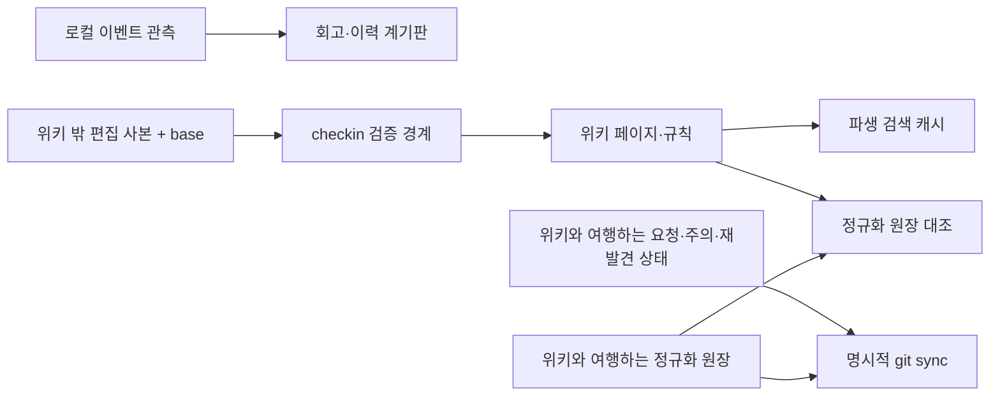

# 상태 관리 독립 검토 — v0.10.0

대상은 `ede67e302a8487aecbb4d59587a8686292018cf6`이다. 2026-10-09에 `AGENTS.md`, `docs/philosophy.md`, `docs/invariants.md`를 먼저 읽고 검토했다. 앞선 도메인 감사 보고서는 읽지 않았다. 코드 수정·커밋·push·릴리스·서비스 재시작·모델 다운로드 없이 보고서와 자체 증거만 작성했다.

원래 목적은 로컬 마크다운 지식을 LLM이 판단하며 유지하고, 도구가 기억과 구조의 불변식을 책임지는 것이다. 이에 따라 페이지 본문, 사용자의 제안 본문, 판단·읽기 집계, 로컬 관측을 구분했다. 정상 입력에서도 편집 제안이 성공 응답 뒤 사라지는 경우, 연결 페어가 잘못 중복 처리되는 경우, 체크아웃의 유일한 미반영 본문이 덮어써지는 경우를 확인했다. **이번 검토에서 기존 위키 페이지 본문이 유실된 사례는 재현하지 않았다.** 그렇다고 쓰기 파이프라인 전체의 콘텐츠 안전성을 입증한 것은 아니다.

## 검증 범위와 증거

실행 환경은 macOS arm64, Go `go1.27.1`, `CGO_ENABLED=0`의 로컬 lite 빌드다. ldflags를 각인하지 않아 실행 파일의 앱 버전 표시는 `dev`지만 소스 HEAD는 위 대상 커밋이다. Go 모듈은 이미 설치된 캐시를 읽었고 `GOCACHE=/private/tmp/canopy-review/go-cache`, `GOPROXY=off`, `GOTOOLCHAIN=local`, `GOENV=off`, `GOTELEMETRY=off`, `-mod=readonly`를 사용했다. HOME·XDG·TMPDIR은 명령 프로세스 안에서만 `/private/tmp/canopy-audit-20261009/state-fb76b/`로 지정했다. 실제 사용자 위키(`/Users/nobocop/workspace/wiki`)는 읽지 않았고 실제 HOME/XDG의 canopy 상태는 변경하지 않았다. 기존 Go 모듈 캐시 읽기는 위 경로 격리와 별개로 허용된 오프라인 빌드 입력이다.

| 영역 | 읽은 구현·경계 | 독립 실행 범위 | 확인하지 않은 범위 |
|---|---|---|---|
| 설정 | `internal/config/config.go` 전량; `cmd/canopy/main.go:77–103,192–234` | 합법 slug 판정, 기본 위키 자동 채택 시 필드 손실, 심볼릭 링크 별 로컬 키 | 모든 탐색 우선순위 조합, 잘못된 XDG 환경변수, 실제 모델·인증 설정 |
| 이행 | `internal/migrate/migrate.go`, `migrations.go` 전량; main startup·version·migrate | 신규/재실행, 높은 버전 거부, 깨진 JSON, null/음수 버전, 동시 Ensure, 중간 실패 후 재개 | 다른 파일시스템 간 rename, 전원 장애, 역사적 릴리스 rung 불변성 전수 비교 |
| 태스크 | `internal/tasks/tasks.go`, `cmd/canopy/tasks.go` 전량; web `tasks.go`, `edit.go` | 동시 POST, ID 충돌, GC 대상 식별, 기각 후 GC, 완료 검증 하한, JSON 호환성, 형식 오류·접수 hang | 장기간 다중 clone 운용, 동시 done/dismiss의 모든 순서, 실제 에이전트의 내용 판단 |
| 읽기·주의 | `internal/reads/reads.go`, `attention/{touch,events,gaps}.go` 전량; show/recall·웹 읽음·history 경계 | 두 작성자 갱신, 저장 I/O 실패, null, 미래 필드, CLI mv, 시간대 혼합 조회/정리, 이벤트 DB 삭제, explicit 유지 | 이벤트 DB의 실제 미래 스키마, 모든 웹 계기판, 64KiB 이상 gap 행·scanner 오류, 이벤트 DB 재구축 |
| 재발견 | `internal/resurface/{state,pick}.go`, `cmd/canopy/resurface.go` 전량; web `speak.go` | 상태 손실, 최근 shown 억제, 읽기 파일 오류 시 강등, snooze 날짜, 주어진 RNG·동률의 결정론 범위 | 실제 임베딩·ORT 후보 품질, 공개 웹 서버·오래 살아 있는 daily 캐시 |
| 회고 | `internal/digest/digest.go`, `cmd/canopy/recall.go:85–132` | 비정상 날짜 포함, attention 조회의 시간대 오류, lite hybrid 강등 | 인용 청크 품질·검색 코어, 대규모 위키 성능, 모든 `--since` 경계/overflow |
| 정규화·체크아웃 | `internal/reconcile/reconcile.go`, `internal/checkout/checkout.go` 전량; cmd handlers·`writeops` 호출 인터페이스 | 원장 동시 갱신, 미래 필드, 오류 가시성, 사본 메타 손상·부재·회수 실패, 순차 base 충돌, 접근 기록 경계 | write pipeline의 다중 파일 트랜잭션·TOCTOU 코어, 원격 autostash/rebase 충돌 처리 |

관련 기존 테스트 코드는 검증 범위를 판단하기 위해 읽었다. 전체 ordinary·`-race` 테스트 성공은 디스패치가 제공한 사전 정보이며 이번 검토에서 반복하지 않았다. 예를 들어 `internal/reads/reads_test.go:115–123`은 `Rename` 메서드만 검증해 CLI의 호출 조건을 증명하지 않고, `internal/tasks/tasks_test.go:170–200`은 미지 문자열 보존을 검증해 큰 정수 보존을 증명하지 않는다.

독립 관측 하네스의 **20개 case**를 실행했다. 프로그램의 exit 0은 관측 완료를 뜻하며 아래 강한 계약의 통과를 뜻하지 않는다. 실패 현상을 출력하는 관측 프로그램이다. 소스는 비실행 텍스트인 [state-probe.go.txt](evidence/state-probe.go.txt), 최종 실제 출력은 [state-output.txt](evidence/state-output.txt)에 보존했다. 복원·실행·자체 probe 제거 절차는 [state-run.py.txt](evidence/state-run.py.txt)에 있다.

```sh
python3 docs/review/2026-10-09/evidence/state-run.py.txt --case all
python3 docs/review/2026-10-09/evidence/state-run.py.txt --case connect-id
```

이하 재현 명령의 `run CASE`는 위 `python3 …/state-run.py.txt --case CASE`를 뜻한다. helper는 내부 import를 위해 `review_probes/state/main.go`를 잠시 만들고 `finally`에서 제거한다. 이 경로가 이미 있으면 덮어쓰지 않고 중단한다. OS 제한·권한·시간대를 바꾸는 실험도 자체 fixture 또는 자식 프로세스에만 적용된다. 실제 네트워크 서비스를 띄우지 않고 `httptest`로 웹 handler를 호출했다. Git 실험은 자체 fixture의 `git init`과 `git merge-file`뿐이며 커밋·pull·push는 실행하지 않았다.

각 항목의 `Test…` 이름은 **아직 없는 신규 수용 테스트 제안**이다. 구현 전에 테스트를 추가하고 `go test <package> -list <name>`에서 이름이 실제로 출력되는지 확인한 다음 `go test <package> -run '^<name>$' -count=1`로 검증해야 한다. 존재하지 않는 이름의 공허한 성공을 증거로 쓰면 안 된다.

## 상태의 권위와 손실의 종류

| 저장물 | 권위·이동 | 손실·복구 성격 |
|---|---|---|
| 페이지·raw·`canopy.toml` | 위키 원본, git 이동 | 기존 지식 본문·규칙. 이번 검토의 콘텐츠 쓰기 코어 감사 대상은 아님 |
| `_meta/tasks/<id>.json` | 위키 이동, 요청과 판단의 진실 | pending 요청·기각·제안 본문은 현재 페이지에서 재구축 불가. 제안 본문 손실은 사용자 작성 텍스트 손실이며 현재 위키 페이지 삭제와 구분 |
| `_meta/webui/reads.json`, `_meta/attention/agent-reads.json` | 위키 이동, human/agent 집계의 진실 | 읽음 등급·이력 손실. 커밋/백업 또는 로컬 이벤트 일부로 복구할 수 있으나 현재 마크다운으로 정확히 재구축 불가 |
| `_meta/resurface/state.json` | 위키 이동, 노출·기각·snooze의 진실 | 판단/억제 기간 손실. 본문 불변이어도 이전 추천이 재등장할 수 있음 |
| `_meta/reconcile/state.json` | 위키 이동, 판단한 바이트의 원장 | 검토 기준선 손실. 페이지가 남아도 어느 내용이 판단을 거쳤는지 자동 복구할 수 없음 |
| `_meta/webui/search-gaps.jsonl` | 위키 이동, 누적 수요 | 질의 수요 손실. 현재 페이지나 로컬 다른 기기의 이벤트가 전체 이력을 복원하지 못함 |
| config `config.toml`, `state.json`, `webauth.json` | 머신-로컬; 인증은 비밀 | 설정·이행 위치·자격증명. 마크다운으로 재구축 불가. 인증 동작 코어는 본 감사 밖이며 이동 인터페이스만 검토 |
| data `models/`, `lib/` | 머신-로컬, 이행 대상 | 다운로드 산물은 재획득 가능하지만 이행이 사용자 파일을 덮어써서는 안 됨. 실제 다운로드는 하지 않음 |
| state `attention/<해시>.db` | 머신-로컬, 관측만 | 상세 이벤트는 재현 불가. 지워도 요청/판단은 남아야 하며 그 점은 일부 실행 확인 |
| state `checkout/<해시>/*.md,*.json` | 머신-로컬, 미반영 편집 사본 | `.md`가 유일한 새 본문일 수 있음. 위키가 온전해도 이 사본의 손실은 단순 계기판 손실보다 큼 |
| cache `index/<해시>.db` | 파생 캐시 | 재구축 가능. 이행 사다리·이벤트 보존 문제와 분리 |



정규화는 opt-in·검출·비차단 설계다(`internal/reconcile/reconcile.go:9–10,93–114`, `cmd/canopy/write.go:173–177`). 원장 대조는 schema page directory의 마크다운에 한정된다(`internal/reconcile/reconcile.go:122–144`). 다른 `_meta` JSON의 형태·미지 필드 보존은 각 상태 패키지의 책임이며 STATE-05/06과 연결된다. 현재 파일 해시가 원장과 같다는 사실은 내용 판단의 의미적 증명이 아니다. `Effects.Written/Removed`와 실제 파이프라인 바이트의 일치·경합은 다른 감사의 쓰기 코어 영역으로 남긴다.

## 발견과 제안

중요도 P1은 정상 사용 중 요청·유일한 편집 텍스트를 잃거나 durable 상태를 깨뜨리는 경로, P2는 조건부 손실·거짓 상태·잘못된 보장, P3는 명시하면 수용할 수 있는 제한 또는 선택 제안이다. 보안 취약점 등급이나 릴리스 차단 결정을 뜻하지 않는다.

### STATE-01 — durable JSON의 갱신은 원자적 게시와 동시 갱신 보존을 보장하지 않는다

- **분류·조건:** 실제 결함, P1. 두 CLI/웹/프로세스가 같은 집계 스냅샷을 읽거나 저장 중 I/O 실패가 발생할 때. 단일 사용자도 여러 요청·터미널을 사용한다.
- **근거·기대/실제:** `internal/reads/reads.go:99–126`, `internal/resurface/state.go:71–80`, `internal/reconcile/reconcile.go:59–68`, `internal/tasks/tasks.go:136–144`는 원본에 `os.WriteFile`한다. 이전 완전한 기록 또는 새 완전한 기록이 남고 두 독립 갱신이 보존되어야 하나, 마지막 전체 저장이 다른 갱신을 지운다. `internal/migrate/migrate.go:91–111`은 rename을 쓰지만 고정 `state.json.tmp`를 공유한다.
- **재현:** `run lost-updates` → `human saves=2 alpha=false beta=true`, `agent … alpha=false beta=true`, snooze가 빈 문자열, 한 원장 갱신이 사라짐. `run atomic-failure` → 파일 크기 제한에 `Save=…file too large`, 기존 파일이 128바이트로 잘림, 다음 Load가 `unexpected end of JSON input`. `run migration` → 32개 동시 Ensure 중 일부가 공유 tmp rename의 `no such file or directory`로 실패. 스냅샷 실험은 허용된 interleaving을 직접 구성했고, Ensure는 goroutine 호출이다. 전원 장애나 서로 다른 실행 파일의 동시 이행은 직접 재현하지 않았다.
- **가장 강한 반론:** 웹 읽음 handler는 `Server.mu`로 잠기고(`internal/webui/discover.go:98,128`) 주의 손실은 지식 본문 손실보다 가볍다. 그래도 프로세스 사이에는 이 mutex가 없고, 웹 태스크·feedback은 그 잠금을 쓰지 않는다. 정규화 판단·제안 본문까지 캐시로 취급할 수 없다.
- **제한된 수정·대안:** 상태별 read–modify–write 구간에 머신 내 파일 잠금/재검증을 두고, 같은 디렉토리의 고유 임시 파일에 완전 기록한 뒤 게시한다. rename만 추가하면 lost update는 남는다. 프로세스 내 mutex만 쓰는 대안은 단일 서버 요청만 해결한다. 기기 간 합류는 별도 STATE-15이며 분산 lease나 저장소 전체 재설계는 필요 조건이 아니다. 전원 장애까지 약속하면 file/dir sync 정책과 실패 전달도 별도 검증해야 한다.
- **제안 불변식·수용:** 메타 저장 실패는 이전 완전한 값을 보존하며, 같은 머신에서 승인된 두 독립 갱신이 사라지지 않는다. `TestStateWriteFailureKeepsOldFile`, `TestConcurrentStateUpdates`, `TestConcurrentEnsure`를 해당 패키지에 추가한다. 크기 제한/주입 I/O 실패 후 이전 해시 동일, 두 slug·판단 모두 존속, 동시 Ensure 전부 성공·유효 state·재실행 no-op을 검사한다. 이는 위키 본문 안전성 전체를 증명하지 않는다.

### STATE-02 — 합법적인 서로 다른 connect 페어의 ID가 충돌한다

- **분류·조건:** 실제 결함, P1. `--`를 포함한 합법 slug 사용.
- **근거·기대/실제:** `internal/tasks/tasks.go:147–170`은 정렬한 slug를 `--`로 연결한다. `internal/wiki/slug.go:8–13`은 연속 하이픈을 허용한다. `(a,b--c)`와 `(a--b,c)`는 서로 다른 요청인데 모두 `connect-a--b--c`가 되어 두 번째 요청이 첫 요청의 Pages를 반환한다. T4의 멱등성은 같은 페어에 한정되어야 한다.
- **재현:** `run connect-id` → 네 파일명 모두 `valid_filename=true`, `created=true,false`, `stored_second_pages=[a b--c]`. 첫 페어를 dismissed로 바꾸면 별개 페어도 같은 ID 때문에 억제되는 구조다(이 후단은 별도 실행하지 않음).
- **가장 강한 반론:** 기본 Slugify는 보통 `--`를 만들지 않는다. 명시적 `--slug`와 기존 마크다운은 검사에 통과하므로 실제 허용 계약 안의 입력이다.
- **제한된 수정·대안:** 우선 기존 파일을 반환하기 전에 payload 페어 동일성을 확인하고 충돌을 명시적으로 거부한다. 이어 길이 구분 인코딩 또는 정렬 페어의 해시 ID를 쓴다. 기존 큐·기각은 payload로 찾아 존중해야 하며 기존 파일을 일괄 재명명할 필요는 없다. `--` 금지 대안은 기존 합법 페이지를 깨뜨린다.
- **제안 불변식·수용:** 서로 다른 합법 페어는 별개 task 또는 명시적 충돌 오류를 얻고, 다른 페어를 성공한 중복으로 반환하지 않는다. `TestConnectIDDistinctLegalPairs`에서 위 두 페어와 역순 재접수를 검사한다. 기존 dismissed 파일도 남겨 구형 ID 호환을 확인한다.

### STATE-03 — 동시 편집 접수가 같은 ID를 덮어써 성공한 제안 본문을 잃는다

- **분류·조건:** 실제 결함, P1. 같은 페이지를 같은 초에 여러 요청/프로세스/기기가 접수.
- **근거·기대/실제:** `internal/tasks/tasks.go:194–207`의 초 단위 ID와 `Stat` 뒤 WriteFile은 예약이 아니다. `internal/webui/edit.go:47–75`, `internal/webui/tasks.go:58–83`도 직렬화하지 않는다. `internal/webui/edit.go:20–22`의 “two proposals are just two tasks”와 달리 각 성공한 제출 본문이 보존되지 않는다.
- **재현:** `run concurrent-edits`는 실제 POST handler에 48개 서로 다른 본문을 보낸다. 최종 증거 실행은 모두 HTTP 303이지만 보존 본문은 13건뿐이다([원본 출력](evidence/state-output.txt)의 `CASE concurrent-edits`). 수는 스케줄링에 따라 바뀐다. 별개 두 fixture에서 같은 timestamp를 쓴 경우도 ID가 모두 `edit-topic-20261009-120000`이다. 실제 두 clone의 add/add 합류는 실행하지 않았다.
- **가장 강한 반론:** 순차 접수는 suffix loop가 처리하고 개인 위키는 저빈도다. 브라우저 두 탭·중복 클릭도 동시성이며 사용자에게 성공했다고 답한 본문을 잃는 것은 빈도와 별개다.
- **제한된 수정·대안:** 기기 간 구별 가능한 nonce ID와, 기존 파일을 덮어쓰지 않는 원자적 게시를 사용한다. 동일 제출 재시도를 합치고 싶으면 명시적 idempotency key를 별도로 둔다. 서버 mutex만으로는 CLI·다른 서버·기기 충돌이 남고 초 정밀도만 높이는 방식도 배타 예약을 대신하지 못한다.
- **제안 불변식·수용:** 성공한 편집 접수마다 본문이 그대로 남은 task가 하나 존재한다(T9 확장). `TestConcurrentEditProposalsRetained`에서 서로 다른 본문 N개를 동시에 제출해 성공 수 = 서로 다른 보존 본문 수를 확인한다. `TestIndependentDeviceEditIDs`도 동일 시각 접수의 충돌 부재를 확인한다.

### STATE-04 — GC가 파일명 대신 JSON의 id를 신뢰해 pending 파일을 지울 수 있다

- **분류·조건:** 실제 결함, P2. 손작성·손상·혼합 버전 task의 내부 id가 파일명과 다름. 정규 접수 함수가 생성한 파일만 있으면 이 경로는 발생하지 않는다.
- **근거·기대/실제:** `internal/tasks/tasks.go:77–85,98–107`은 filename/id 정합성을 검증하지 않는다. GC는 `273–290`에서 읽은 closed 레코드의 `t.ID`를 삭제 경로로 다시 사용한다. 판단한 closed 파일만 지워야 하나 다른 pending 파일을 삭제할 수 있다. `pathOf:63`에 경로 성분 제한도 없다.
- **재현:** `run gc-id`는 실제 pending 파일과, 그 id를 가진 closed `alias.json`을 만든다. `removed=1 actual_pending_file_missing=true closed_alias_survives=true`. 경로 traversal의 위키 밖 삭제는 실행하지 않았으며 여기서 재현한 손실은 task JSON 하나다.
- **가장 강한 반론:** 사람이 큐 파일을 잘못 고친 결과다. 그러나 이 파일들은 여행하는 상태이고 Get은 관용 읽기를 표방한다. 비정상 입력에서 destructive GC의 대상이 바뀌는 것은 단순 표시 오류보다 크다.
- **제한된 수정·대안:** 읽을 때 basename/id 일치를 검증하고 실제 읽은 filename을 GC의 삭제 대상에 사용한다. ID에 경로 구분 성분을 허용하지 않고, GC는 명시적으로 `done|dismissed`만 선택한다. 모든 레코드를 재작성/삭제하는 복구는 불필요하다. 미래의 모르는 type은 여전히 list/dismiss 가능하게 둔다.
- **제안 불변식·수용:** GC는 선택한 closed 파일 외 다른 파일을 삭제하지 않고 잘못된 id/status는 가시적 오류로 남긴다(T8 강화). `TestGCRejectsMismatchedID`, `TestGCLeavesUnknownActiveStatus`에서 별개 pending 파일과 미지 상태의 파일 해시·존속을 확인한다.

### STATE-05 — 관용 읽기 뒤 재저장이 미래 필드를 잃고 큰 정수를 바꾼다

- **분류·조건:** 실제 결함과 문서 과장, P2. 새로운/additive 필드가 있는 JSON/TOML을 구형 writer가 갱신. 현재 정상 파일에 없는 미래 필드를 일부러 심은 호환성 검사다.
- **근거·기대/실제:** `docs/philosophy.md:213–218`·AGENTS 규칙 1b는 기존 필드 보존을 약속한다. `internal/reads/reads.go:70–110,118–126`, `internal/resurface/state.go:47–80`, `internal/reconcile/reconcile.go:41–68`의 typed decode/re-encode는 미지 필드를 버린다. agent 파일 version은 9에서 1로 돌아간다. `internal/tasks/tasks.go:250–260`의 `map[string]any`는 숫자를 float64로 바꾼다. `internal/config/config.go:200–216`은 default가 빈 유효 TOML의 다른 필드를 지운다.
- **재현:** `run compatibility` → human/agent top·nested 필드 소실, resurface/ledger top 필드 소실, agent `version=1`, task 미래 정수 `9007199254740993 → 9007199254740992`, `future_setting_preserved=false`. unknown 문자열 task 필드는 남는다. `init --force`의 명시적 설정 덮어쓰기는 이 발견에 포함하지 않는다.
- **가장 강한 반론:** agent 별도 파일이 이미 구형 human writer로부터 agent 상태를 보호하며 task의 일반 필드는 보존된다. 이는 현재 두 파일의 격리를 보장할 뿐 임의의 미래 필드·숫자 값을 보존하지 않는다. additive 진화를 현재 코드가 정확히 지원한다는 주장은 더 강하다.
- **제한된 수정·대안:** JSON은 top/nested raw 필드를 보존한 채 알려진 키만 패치하고 task도 `json.RawMessage`/정확한 숫자를 쓴다. TOML 자동 채택은 기존 키를 보존해 default만 추가한다. 지원하지 않는 미래 형식의 쓰기를 거부하는 대안은 안전하나 구형 바이너리의 기능을 제한한다. 별도 파일 분리는 명확한 새 도메인에 유효하지만 같은 파일의 미래 확장을 일반적으로 해결하지 못한다.
- **제안 불변식·수용:** 허용된 mixed-version 갱신은 미지 top/nested 값·정확한 정수·version을 보존하거나 쓰기 전에 거부한다. `TestFutureMetadataRoundTrip`를 reads/resurface/reconcile/config에, `TestClosePreservesLargeUnknownNumber`를 tasks에 추가한다. 문자열·큰 정수·중첩 객체·구버전·미래버전을 행렬로 검사하고 변경한 키만 달라야 한다.

### STATE-06 — 의미상 깨진 상태는 panic·접수 hang 또는 거짓 “0건”으로 나타난다

- **분류·조건:** 실제 결함/보증 공백, P2. null 레코드, 잘린 파일, tasks 디렉토리를 가리는 파일 등 손상 상태.
- **근거·기대/실제:** `internal/reads/reads.go:74–95`는 map의 null value를 허용하지만 `Mark:137–145`, `MarkAgent:174–181`, `LastAccess:195–201`은 역참조한다. `internal/tasks/tasks.go:98–107`은 JSON `null`을 빈 Task로 읽는다. `FileEdit:196–200`은 Stat의 ENOTDIR/권한 오류를 영원히 다음 이름으로 재시도한다. `cmd/canopy/main.go:254–265`는 count/ledger 오류를 버려 0 또는 생략으로 보고한다. `cmd/canopy/resurface.go:43–49`는 오류를 조용히 무주의 상태로 강등한다.
- **재현:** `run malformed` → null human/agent Load 성공 뒤 nil pointer panic; null task는 `len=1 pending=0`·오류 없음. truncated task의 직접 Load는 오류지만 status는 exit 0·`tasks_pending:0`; 깨진 원장도 status에서 오류가 안 보인다. 오늘 agent 읽음이 정상이어도 human 파일 하나가 깨지면 resurface에 그 페이지가 등장한다. tasks 경로를 파일로 만들면 CLI 접수는 2초 timeout까지 종료하지 않아 **자체 자식 프로세스만** kill했다.
- **가장 강한 반론:** read의 best-effort는 지식 열람을 계속시키고 직접 tasks list/reconcile은 parse 오류를 보여준다. 그러나 0건은 검사 불가와 다르며 best-effort가 crash·무한 루프·주의 근거의 허위 표시를 뜻하지는 않는다.
- **제한된 수정·대안:** 객체/필수 필드/null entry를 검증하고 Stat은 EEXIST에 해당하는 경우만 이름을 바꿔 재시도한다. 상태 보고는 unavailable/errors를 0과 구별하고 원본은 보존한다. human/agent 로드는 한 파일 실패가 다른 문 기록까지 무효화하지 않도록 경계를 분리한다. 복구 불가 시 resurface를 숨기거나 불완전 근거를 명시하는 선택은 가능하다. 손상 파일을 빈 상태로 자동 저장하는 대안은 원본을 지워 부적절하다.
- **제안 불변식·수용:** 비정상 durable 상태는 panic/hang 없이 가시적 진단을 만들고 검사 실패를 건강한 0건으로 보고하지 않는다. `TestNullEntriesNeverPanic`, `TestFileEditReturnsStatErrors`, `TestStatusExposesStateErrors`, `TestResurfaceDoesNotSilentlyLoseOtherDoor`에서 프로세스 timeout·원본 해시 보존·JSON 오류 필드·오늘 접근 억제를 확인한다.

### STATE-07 — 체크아웃 메타가 깨지면 미반영 본문을 덮어쓰고, 회수 실패도 성공 처리한다

- **분류·조건:** 실제 결함, P1(본문 보존)/P2(회수). modified working copy에 metadata 부재·parse/읽기 오류가 있거나 사본 디렉토리가 지우기 불가.
- **근거·기대/실제:** `internal/checkout/checkout.go:87–108`은 readMeta가 성공한 경우에만 modified 보호를 적용하며 오류를 모두 신규/refresh 경로로 흘린다. `Open:243–245`는 corrupt meta를 숨긴다. `Discard:212–219`, `reclaim:222–224`는 Remove 오류를 버린다. 설계의 “사본 자동 삭제는 없다”(`docs/checkout-design.md` §4)와 R5/R6의 실제 오류 경로가 맞지 않는다.
- **재현:** `run checkout-meta` → corrupt meta 때 `open_count=0`, Checkout 성공, `Modified=false`, `edited_copy_preserved=false`, `wiki_unchanged=true`; meta를 지운 경우도 edited copy 소실. 자체 checkout 디렉토리를 0555로 만들면 Discard가 nil 오류를 반환하면서 copy와 meta가 모두 남는다. 순차 base 충돌에서 edited copy가 남는 정상 경로는 `run positive-boundaries`로 통과했다.
- **가장 강한 반론:** 정상 meta의 modified copy는 기존 테스트가 보호하고 이 입력은 상태 손상이다. 다만 copy→meta의 두 직접 쓰기 사이 중단·metadata 쓰기 실패가 orphan을 만들 수 있다. 유일한 미반영 본문을 무조건 원본으로 덮는 복구는 보수적이지 않다.
- **제한된 수정·대안:** meta 오류와 copy 존재를 먼저 확인해 orphan/corrupt 상태를 노출하고 modified 여부를 입증하지 못하면 사본을 보존한다. 명시적 discard·격리 백업 후 새 checkout은 가능하다. 회수 오류를 호출자에 전달한다. 두 파일의 게시 순서를 개선하더라도 이미 있는 orphan 보호는 필요하다. 전체 edit 사본을 자동 merge하는 대안은 판단 경계를 바꾼다.
- **제안 불변식·수용:** meta 읽기 실패/부재는 기존 working-copy 바이트를 바꾸지 않으며, 회수 성공은 실제 사본·meta 부재를 뜻한다. `TestCorruptOrMissingMetaPreservesEditedCopy`, `TestDiscardReportsRemoveFailure`에서 copy 해시·상태 노출·오류 반환을 검사한다. 이 손실은 기존 위키 본문 손실이 아니라 **위키 밖에서 작성한 새 본문 손실**이다.

### STATE-08 — CLI mv는 agent-only 읽기 이력을 이관하지 않는다

- **분류·조건:** 실제 결함, P2. 사람 읽음 없이 show/recall/checkout의 agent 이력만 있는 페이지를 개명.
- **근거·기대/실제:** `cmd/canopy/write.go:512–519`는 `rs.IsRead(p.Slug)`일 때만 Rename한다. `internal/reads/reads.go:208–220`의 Rename 자체는 양쪽 기록을 옮기지만 IsRead는 human만 본다(`162–164`). H3/주의 상태의 동행을 CLI가 끝까지 구현하지 않는다.
- **재현:** `run rename` → mv exit 0, `agent_old=true agent_new=false`; human+agent가 모두 있는 경우는 `human_new=true agent_new=true`. pending task Pages와 snooze도 old slug에 남는다. 후자의 자동 이관은 현재 T/E에서 명시되지 않은 **별도 제품 선택**이며 H3 위반으로 묶어 주장하지 않는다.
- **가장 강한 반론:** H3의 점검 명령은 human reads.json만 확인하고 Rename 단위 테스트는 통과한다. agent-only 소비도 여행하는 상태인데 CLI 조건 때문에 사라진 정체성에 묶이는 것은 그 테스트가 놓친 경계다.
- **제한된 수정·대안:** 성공한 reads Load 뒤 Rename을 무조건 호출하고 dirty Save가 필요한 파일만 쓰게 한다. tasks·snooze의 개명 정책은 따로 정해 최소한 영향을 노출하거나 매핑을 남긴다. 사용자 제안 Body나 판단 ID를 임의로 고쳐서는 안 된다. 모든 상태에 영구 UUID를 도입하는 것은 이 결함의 필수 해법이 아니다.
- **제안 불변식·수용:** human 유무와 무관하게 agent 기록은 같은 페이지의 새 slug를 따라간다(H3 확장). `TestCLIMoveMigratesAgentOnly`에서 실제 CLI mv 전후 양쪽 파일을 검사한다. tasks/snooze는 이관 또는 명시적 잔류 안내 중 선택한 계약의 `TestMoveReportsPendingStateReferences`로 검증한다.

### STATE-09 — RFC3339 문자열 비교가 시간대 혼합 시 잘못 조회하고 최신 이벤트를 삭제한다

- **분류·조건:** 실제 결함, P2. 같은 로컬 DB에 다른 UTC offset의 이벤트가 쌓이거나 다른 TZ의 프로세스가 조회/GC. 원격 이벤트 합류를 전제로 하지 않는다.
- **근거·기대/실제:** `internal/attention/events.go:106–108,152–165,175–176,223–231,250–252`는 offset을 유지한 TEXT ts를 비교한다. `internal/reads/reads.go:229–242,255–263`도 문자열로 최근성을 정한다. 문자열 순서는 실제 instant 순서가 아니다.
- **재현:** `run offsets`에서 older=`2026-10-09T09:00:00+09:00`(00Z), newer=`2026-10-09T05:00:00Z`. since 04Z의 기대 `[newer]`가 `[older newer]`가 된다. prune before=`10:00+09:00`(01Z)의 기대는 older만 삭제인데 **둘 다 삭제**된다. RecentAccessSlugs도 `[older newer]`다.
- **가장 강한 반론:** 현재 머신이 항상 KST이면 보통 동일 offset이다. OS 시간대 변경·TZ가 다른 CLI/웹·기존 이력은 합법적인 입력이며 N5의 보존 창은 문자열 시간대가 아닌 실제 시간이어야 한다.
- **제한된 수정·대안:** 새 이벤트는 UTC로 정규화하고 기존 값은 변환 이행하거나 epoch/파싱한 instant로 조회한다. **UTC로 새 행만 쓰면 기존 행과 혼합될 때 해결되지 않는다.** 비재현 로컬 DB 변환이 필요하면 새 rung으로 추가하고 원래 rung을 고치거나 DB를 drop하지 않는다. 조회 때 SQLite 날짜 함수를 쓰는 대안은 이행이 작지만 index 이용·오류 ts 처리 비용이 있다. 집계 정렬도 파싱한 instant + slug tie-break를 쓴다.
- **제안 불변식·수용:** offset이 달라도 Query/정렬/TopConsumed/Prune의 창은 동일 instant 기준이며 cutoff 이후 이벤트는 지워지지 않는다. `TestMixedOffsetQueryAndRetention`, `TestRecentAccessUsesInstant`에 위 값을 넣고 삭제 수=1·newer 존속을 검사한다. 이는 머신-로컬 상세 이력 손실이며 wiki aggregate 자체 삭제는 아니다.

### STATE-10 — snooze N일이 날짜 저장·UTC 해석 때문에 일찍 끝난다

- **분류·조건:** 실제 사용자 동작 결함/시간 계약 공백, P3. UTC가 아닌 시간대에서 늦은 시각에 snooze.
- **근거·기대/실제:** `internal/resurface/state.go:143–144`는 now+N×24h의 로컬 날짜만 남기고 `92–95`는 그 날짜를 UTC 자정으로 읽는다. `cmd/canopy/resurface.go:129`는 “hide … for N days”라고 안내한다. 상대 기간인지 달력 날짜인지 계약도 없다.
- **재현:** `run snooze` → KST `2026-10-09T23:00:00+09:00`의 1일 snooze가 `until=2026-10-10`; 9시간 뒤 억제, **10시간 뒤 eligible=true**. E4의 즉시 억제는 만족하지만 1일 기간을 만족하지 않는다.
- **가장 강한 반론:** 달력 날짜까지의 snooze라면 24시간을 약속할 필요는 없다. 그래도 로컬 날짜를 UTC 날짜로 해석해 다른 머신에서 경계가 바뀌는 것을 그 설명만으로 정당화할 수 없다.
- **제한된 수정·대안:** 상대 기간이면 별도 additive RFC3339 `snoozed_until`을 저장한다. 구버전 재저장이 새 필드를 지우는 STATE-05를 먼저 고려한다. 달력 기준을 유지하는 대안은 위키의 기준 시간대/만료 시각을 명시하고 같은 기준으로 읽어야 한다. 기존 YYYY-MM-DD는 문서화한 보수적 규칙으로 읽는다.
- **제안 불변식·수용:** 선택한 기간 또는 달력 경계 전까지 후보에 안 나온다. `TestSnoozeExpiryAcrossOffsets`에서 KST/UTC/음수 offset·자정 전후·구형 날짜를 검사한다. 24시간 정책이면 위 10시간 시점에도 억제되어야 한다.

### STATE-11 — edit done과 base는 수행·출처를 강하게 증명하지 않는다

- **분류·조건:** 문서 과장/제품 트레이드오프, P2. 요청과 무관한 파일 변경, base 없는 구형/손작성 task, 오래 열어 둔 편집 폼, 미래 version의 기존 type.
- **근거·기대/실제:** `internal/tasks/tasks.go:341–359`는 파일 존재와 base와의 불일치만 검사하며 빈 base는 존재만 검사한다. `Task.Body/Request` 수행 여부·어떤 actor가 바꿨는지·정규화/쓰기 게이트는 확인하지 않는다. `Close:238–243`은 type만 gate하고 version은 gate하지 않는데 Get 주석(`96–97`)은 version/type gate라고 한다. 웹 `internal/webui/edit.go:40–43,66–71`은 폼을 본 시점이 아니라 POST 시점 파일을 base로 잡는다. base는 sha256 문자열이지 보관된 원문이나 조회 가능한 git object ID가 아니다.
- **재현:** `run completion` → 본문·요청은 그대로인데 frontmatter updated만 바꿔 done 성공; `version=99,type=connect`도 done 성공; GET 후 파일을 바꾸고 POST하면 `base_matches_form=false base_matches_post=true`. T9의 **접수 시점** SHA 계약은 그대로 만족한다. 이것을 T9 저장 버그라고 주장하지 않는다. 비교 가능한 과거 base 원문 확보는 검증되지 않는다.
- **가장 강한 반론:** 내용 판단은 LLM 몫이고 의미적 완료를 코드로 검증하려 하면 철학을 훼손한다. 맞다. 그러나 “done은 코드가 수행 결과를 확인”, “base 대비 비교 가능”의 표현은 현재 해시 변화 하한보다 강하다(`docs/agent-tasks.md:56–57,65–70,89,93–99`).
- **제한된 수정·대안:** 자동 검증의 실제 하한을 명시하고 의미적 수행은 에이전트 판단으로 표시한다. frontmatter-only 변화까지 막을 필요가 있으면 additive 본문 baseline hash를 보관한다. 비교용 출처가 필요하면 폼 origin hash/본문 또는 별도 immutable snapshot을 task에 보존하고 submission base와 구별한다. 스냅샷 대안은 저장 비용이 증가하며 git에만 맡기면 미커밋 base는 복원되지 않는다. 미래 version의 known type은 허용 범위를 문서화하거나 verifier 지원 version을 명시한다. LLM 판단을 문자열 매칭으로 대체하는 제안은 하지 않는다.
- **제안 불변식·수용:** 완료 표시가 주장하는 자동 검증 수준과 비교 가능한 base의 출처가 명시된다. `TestEditDoneVerificationScope`, `TestProposalOriginAcrossStaleForm`, `TestKnownTypeFutureVersionPolicy`에서 본문 미변경·기록 없는 base·stale 폼·미래 버전에 대해 선택한 정책을 검증한다. origin snapshot을 택하면 task만으로 실제 비교용 본문이 복원되어야 한다.

### STATE-12 — dismissed connect의 “영구 억제”는 GC 뒤 유지되지 않는다

- **분류·조건:** 문서 과장/제품 트레이드오프, P2. 기각 후 보존 창이 지나 `tasks gc` 실행.
- **근거·기대/실제:** T4/T10(`docs/invariants.md:237,243`)과 `agent-tasks.md:111`은 기각 존중·영구 억제를 설명한다. `internal/tasks/tasks.go:169–173,273–290`은 파일 존재만으로 중복 억제하고 GC는 dismissed 파일도 지운다. 별도 tombstone은 없다.
- **재현:** `run gc-dismissal` → GC 전 `refiling_created=false`; 90일 GC 뒤 `removed=1 refiling_created=true status=pending`.
- **가장 강한 반론:** closed task 삭제는 GC의 명시적인 목적이므로 사용자가 그 기억을 버리기로 선택했다고 볼 수 있다. 그렇다면 “영구”를 유지하는 현재 안내와 GC의 효과를 정확히 바꿔야 한다.
- **제한된 수정·대안:** 영구 판단을 원하면 dismissed connect를 GC에서 제외하거나 작은 별도 tombstone으로 옮긴다. 별도 파일은 기존 구버전 GC와의 혼합 안전성에 유리하지만 상태가 하나 늘어난다. 유한 억제를 선택하면 문서·UI에 보존 창 이후 재접수 가능함을 안내한다. pending 보존과 영구 판단 보존을 혼동하지 않는다.
- **제안 불변식·수용:** GC 뒤에도 기각 유지 또는 명시한 만료 정책이 성립한다. `TestDismissedConnectPolicyAfterGC`에서 구형 dismissed 파일·GC·재접수를 연결해 검사한다. traveling metadata이므로 머신 migration rung에 넣지 않는다.

### STATE-13 — 후보 결정론의 범위가 과장되고 최근 접근 동률은 실제로 불안정하다

- **분류·조건:** 문서 과장/제품 선택 + 동률 결함, P3. random/auto 전략 또는 같은 시각의 접근이 recent K 경계에 걸림.
- **근거·기대/실제:** `docs/philosophy.md:88–96`은 결정론적 후보 생성을 말하지만 CLI `cmd/canopy/resurface.go:41–42`·web `internal/webui/speak.go:50–57`은 UnixNano로 RNG를 새로 시드한다. hub의 고정 상태 점검은 random/auto를 증명하지 않는다. `internal/reads/reads.go:237–244,259–265`는 map 순서에서 시작해 timestamp만 정렬한다. `internal/webui/discover.go:41–44`가 그 top K를 affinity 입력으로 사용한다.
- **재현:** `run determinism` → 동일한 attention 객체를 100회 호출해 서로 다른 top10 순서, 같은 scan/state/now에 RNG seed만 바꿔 auto 첫 후보 8종. 동률로 실제 affinity score가 달라지는 임베딩 실행은 하지 않았다. hub·정렬된 bridge의 모든 입력에 비결정성이 있다고 확대하지 않는다.
- **가장 강한 반론:** 재발견 random은 의도된 다양성이고 철학 점검은 hub만 명시한다. 그 선택은 합리적이다. 하지만 같은 시각에 recall이 여러 페이지를 기록하는 것은 정상이며 recent K 구성까지 map 순서에 맡길 이유는 없다.
- **제한된 수정·대안:** instant 정렬 + slug tie-break를 넣고 결정론 주장을 “같은 입력·now·seed”로 한정한다. 감사/재현용 `--seed` 또는 일 단위 고정 seed는 선택 기능이며 무작위 기본을 없앨 필요는 없다. 전역 RNG 고정 대안은 매번 같은 다양성만 주는 비용이 있다.
- **제안 불변식·수용:** 동일 snapshot·now·seed·전략·K는 같은 후보/관심 집합을 반환한다. `TestRecentAccessTiesStable`, `TestPickPagesFixedSeedDeterminism`에서 map 삽입 순서·같은 timestamp·K 경계를 바꿔 확인한다. 시드가 다른 random 결과의 차이는 실패가 아니다.

### STATE-14 — digest는 검증하지 않은 날짜를 범위 안의 사실로 센다

- **분류·조건:** 보증 공백, P2. 직접 수정/구형 페이지의 날짜가 형식상 비정상. 기본 canopy new가 생성한 정상 날짜에서 재현된 버그는 아니다.
- **근거·기대/실제:** `internal/digest/digest.go:89–97`의 “dates are normalized” 전제와 문자열 비교는 `internal/wiki/page.go:95–98,124–134`의 quoted string 관용 읽기에서 보장되지 않는다. `internal/resurface/pick.go:56–58`은 실제 날짜를 파싱해 건너뛰지만 digest는 같은 자료를 시간창에 포함한다. G4의 검사 성공과 G5의 내부 수치 일관성은 원본 날짜의 진실성을 보장하지 않는다.
- **재현:** `run determinism` → `created: z-not-a-date` 또는 `updated: z-not-a-date`가 각각 created/updated 1건으로 집계된다. 각 count는 배열 길이와는 일치하므로 G5만으로 검출되지 않는다.
- **가장 강한 반론:** schema가 지켜진 위키라면 YYYY-MM-DD이므로 간단한 비교가 적절하다. canopy는 구형/직접 수정 페이지도 read-only로 받아들이고 회고는 그 원문을 보고 판단하는 도구다. 이 전제를 강한 보장으로 표시해서는 안 된다.
- **제한된 수정·대안:** digest 안에서 날짜를 파싱하고 invalid 항목은 별도 진단으로 남기거나 범위 집계에서 제외한다. 전체 frontmatter 형식을 바꾸거나 과거 페이지 날짜를 자동 수정할 필요는 없다. schema 검증에만 맡기는 대안은 read-only 입구의 보증 범위를 명시해야 한다. “since”만 있는 API의 미래 날짜 상한은 별도의 제품 결정이며 이번 증거로 그 정책을 단정하지 않는다.
- **제안 불변식·수용:** 범위에 포함된 날짜는 실제 파싱 가능한 날짜이고 실패한 원문을 정상 범위 통계로 세지 않는다. `TestDigestInvalidDateDiagnostics`에서 created/updated 각각 invalid·빈 값·구형 quoted 날짜·정상 경계일을 검사한다.

### STATE-15 — 위키와 함께 이동한다는 것은 metadata가 자동 합류한다는 뜻이 아니다

- **분류·조건:** 문서 과장/수용된 제품 트레이드오프, P3. 두 clone이 동시에 JSONL 끝에 append하거나 같은 JSON/task를 갱신.
- **근거·기대/실제:** `internal/attention/gaps.go:32–33`은 append-only JSONL이 clean merge된다고 한다. 서로 다른 task 파일은 충돌을 줄이지만 같은 task의 `closed`/`note`는 달라질 수 있어 `docs/agent-tasks.md:87–89`의 내용 동일·수렴은 보장이 아니다. `internal/gitops/gitops.go:70–77`과 sync는 기본 Git 합류를 사용하며 metadata 의미를 병합하는 기능은 없다. 읽기/원장 JSON 충돌은 이미 `web-ui-plan-4.md:112–115`, `reconcile-design.md:140–141`에서 수용한 제한이다.
- **재현:** `run merge`에서 하나의 공통 JSONL에 각기 한 줄을 append한 ours/theirs를 `git merge-file -p ours base theirs`로 합치면 exit 1·conflict marker가 생긴다. 실제 clone의 `canopy sync`, autostash, 원격 장애 후 재시도는 제약상 **실행하지 않았다**. 그 코어 실패를 여기서 중복 보고하지 않는다.
- **가장 강한 반론:** 개인 위키는 충돌이 드물고 수동 Git 해결은 이미 의도한 모델이다. 그렇다면 여행/동기화 가능성과 무충돌·자동 수렴을 구분하는 것이 가장 작은 수정이다.
- **제한된 수정·대안:** 우선 clean merge/내용 동일의 표현을 낮추고 충돌 시 어떤 요청·기각·읽음 기록을 보존해야 하는지 명시한다. 빈번해지면 gap을 기기별 파일로 나누거나 ID가 있는 append 이벤트를 의미적으로 합칠 수 있다. 후자는 중복 제거·순서·tombstone 정책이 필요하다. 모든 metadata를 DB/CRDT로 다시 쓰는 제안은 하지 않는다.
- **제안 불변식·수용:** eventual sync는 성공한 합류 후 보존되는 상태와, 수동 판단이 필요한 충돌을 명시한다. 제약이 허용되는 후속 단계에서 `TestMetadataSyncConflictPreservesBothSides`를 추가해 fixture 두 clone의 동시 append·같은 task done/dismiss·같은 read 키를 검사한다. 해결 전 성공으로 보고하지 않고 원문 양쪽 복구가 가능해야 한다. 이미 수용한 드문 충돌 자체를 새 버그로 세지 않는다.

### STATE-16 — 제안: 로컬 상태의 위키 경로 정체성을 명시한다

- **분류·조건:** 독립 제품 제안, P3. 같은 위키를 symlink/경로 별칭·이전 위치로 열음. 별개 clone의 로컬 DB를 합쳐야 한다고 주장하는 제안은 아니다.
- **근거·기대/실제:** `internal/config/config.go:226–233,162–182`는 Abs(root) 문자열을 hash하며 symlink를 해소하지 않는다. 사용자 기대는 같은 위키의 열린 checkout/로컬 이력일 수 있지만 실제로는 경로별 다른 namespace다.
- **재현:** `run path-identity` → 같은 디렉토리의 symlink에서 `event_DB_equal=false checkout_dir_equal=false open_checkout_visible_via_alias=0`. 파일 삭제·본문 손실은 없다.
- **가장 강한 반론:** 경로별 상태는 단순하고 clone 사이 로컬 관측 격리에 맞는다. 따라서 이것은 지금의 명시된 path hash 구현 자체의 오류가 아니라 visibility·정체성 정책 선택이다.
- **제한된 수정·대안:** 같은 물리 경로 별칭을 하나의 canonical key로 정하거나, 경로별 namespace를 안내하고 예전 위치의 열린 사본을 찾는 기능을 둔다. 키를 바꾸면 기존 이벤트·사본을 버려서는 안 되며 machine-local layout 변경으로서 새 migration rung/기존 키 fallback이 필요하다. 영구 traveling wiki UUID는 이동에 강하지만 clone 공유/복제의 정체성 정책까지 늘어난다.
- **제안 불변식·수용:** 같은 물리 위키의 별칭에서 열린 사본이 보이거나 별개 namespace임이 명시된다. `TestWikiAliasLocalStatePolicy`에서 실제 symlink·기존 hash 경로의 편집 사본·이벤트를 심고 선택한 정책 및 이행 후 바이트 보존을 검사한다.

### STATE-17 — 제안: 로컬 버전 기록의 유효 형태와 이벤트 DB 다운그레이드 경계를 정의한다

- **분류·조건:** 보증 공백에 대한 독립 제안, P3. 존재하는 state.json이 null/음수이거나 직접 주어진 DB가 더 높은 user_version. 실제 미래의 파괴적 DB 스키마는 확보하지 않았다.
- **근거·기대/실제:** `internal/migrate/migrate.go:76–88,192–199`는 객체 형태/음수를 검증하지 않는다. `internal/attention/events.go:83–99`는 schema DDL을 먼저 실행하고 user_version이 0일 때만 각인한다. J4는 startup의 전역 state.json 높은 버전을 정상적으로 막지만 개별 DB Open의 version gate를 입증하지 않는다.
- **재현:** `run migration` → missing은 신규 각인·재실행 no-op, schema 99는 거부, truncated JSON은 거부(정상 방어). 반면 null/−1은 rung 0/−1로 인정해 이행·재각인한다. 빈 synthetic DB를 user_version=99로 만든 뒤 Open하면 거부하지 않고 events table을 만들고 Log도 성공한다. 미래 실제 데이터가 깨진다고 단정할 증거는 없다.
- **가장 강한 반론:** 파괴적 DB 변경에는 전역 migration rung이 의무이며 정상 startup이 먼저 그 버전을 확인한다. 현재 schema는 additive·CREATE IF NOT EXISTS여서 더 높은 번호만으로 실제 손상이 일어나지는 않는다. 중앙 가드를 신뢰하는 정책도 가능하다.
- **제한된 수정·대안:** 존재하는 이행 기록은 객체·필수 비음수 정수를 검증하고 missing baseline과 구분한다. DB 버전을 쓰기 전에 확인해 미래 버전을 read-only/미지원으로 취급하거나 중앙 가드가 보장하는 전제 조건을 명시한다. 로깅 실패는 best-effort여야 하므로 이 가드로 task 접수를 실패시키지 않는다. 기존 DB를 cache처럼 drop하는 대안은 불가하다.
- **제안 불변식·수용:** 손상된 버전 기록은 원본 불변으로 진단되며 미지원 DB에 스키마/이벤트를 추가하지 않는다(개별 가드 선택 시). `TestInvalidMigrationStateShape`, `TestAttentionFutureSchemaPolicy`로 null/음수/정상 old/current/new와 기존 이벤트를 검사한다. 기존 정상 downgrade 거부와 N2 접수 성공도 유지한다.

### STATE-18 — checkout의 R1 점검 명령은 허용된 접근 기록까지 금지한다

- **분류·조건:** 문서 점검 과장, P3. 당일 첫 checkout이며 아직 agent 기록이 없는 위키.
- **근거·기대/실제:** `docs/invariants.md:203`은 “접근 기록만 남음”을 허용하면서 전후 `git status --short`가 동일해야 한다고 한다. `cmd/canopy/checkout.go:62–64`는 access Touch를 하고 `internal/reads/reads.go:109–110`은 traveling agent aggregate를 생성/갱신하므로 status 차이가 정상이다.
- **재현:** `run checkout-git` → `CLI checkout exit=0 git_status_identical=false page_identical=true agent_record_created=true`. fixture에 git init만 했고 커밋은 하지 않았다. 이 결과는 wiki content 변경 버그가 아니다.
- **가장 강한 반론:** 같은 날 이미 읽은 페이지라면 양자화 때문에 동일 status가 가능하다. 그 사전조건이 없는 현행 점검은 신규/첫 접근 환경에서 정상 동작을 실패로 판단한다.
- **제한된 수정·대안:** R1 점검은 페이지 원본 해시가 같고 허용된 aggregate 이외 변경이 없음을 검사한다. git status 동일을 유지하는 대안은 agent 기록을 미리 준비해야 하지만 checkout의 접근 기록 기능까지 독립적으로 검증하지 못한다.
- **제안 불변식·수용:** checkout은 페이지·스키마·raw를 수정하지 않으며 access 집계만 허용한다. `TestCLICheckoutOnlyChangesAttentionMetadata`에서 당일 첫 접근과 반복 접근의 diff 경로·원본 해시를 확인한다. H7의 같은 날 반복 no-op은 별도 검사한다.

## 확인된 정상 경로와 남은 한계

| 확인 | 실행 결과·한계 |
|---|---|
| 신규 이행·재실행 | 빈 fixture는 schema 1 각인, 재실행 no-op. 모든 과거 설치 유형을 대신하지 않음 |
| 일반 downgrade 가드 | schema 99 거부, 잘린 JSON도 parse 오류. STATE-17의 유효한 객체 형태/개별 DB 보장과 구분 |
| 부분 이행 재개 | 모델 marker 이동 뒤 자체 config directory를 0555로 막아 실패시킴; 버전 미각인, 원본 config 존속, 권한 복구 후 모델·synthetic auth·config 보존 및 재실행 no-op (`migration-interruption`) |
| human 등급 | 웹 auto POST 200; explicit 뒤 auto를 적용해 explicit 유지. 모든 web 이벤트 실패 조합은 미검증 |
| edit 검증 하한 | 파일 전체가 unchanged면 done 거부, filing이 페이지를 바꾸지 않음. STATE-11의 의미적 수행 보장은 아님 |
| 비권위 이벤트 DB | 자체 이벤트 DB 삭제 후 task 파일·human 집계 바이트 동일. N1의 status/tasks/reconcile 전 출력 동등성은 전부 직접 검사하지 않음 |
| 순차 checkout 충돌 | wiki 변경 후 checkin 거부·수정 사본 유지; 정상 discard는 사본 제거. 동시에 쓰는 두 writer의 R4 보장은 미검증 |
| 노출 억제 | 최근 MarkShown의 페이지가 같은 now 후보에서 제외. 모든 30/45/90/120일·DST 경계는 미검증 |
| lite 강등 | 자체 lite 바이너리 hybrid search가 keyword 경고와 exit 0. ORT·시맨틱 모델·품질·실제 사용자 인덱스는 미검증 |

인터페이스 별 JSON 취급도 보장의 한계가 다르다. missing 파일은 빈 상태/opt-out으로 읽고, top-level null은 일부 형식에서 기본 객체로 받아들인다. reads/resurface/reconcile의 nil map은 초기화되지만 **reads의 포인터 map value null은 검증·정규화되지 않는다**. malformed JSON은 패키지 Load가 대체로 오류를 반환하지만 status/배너/후보 경계가 그 오류를 버릴 수 있다. tasks unknown type의 done 거부·dismiss 허용은 현재 구현과 기존 테스트에서 확인되며, 모든 future known type semantics를 검증했다는 뜻은 아니다. legacy tags 해석은 기존 테스트와 구현을 읽었고 본 독립 하네스에서 전수 재검증하지 않았다.

인덱스 재구축은 손실된 task Body, 읽기 집계, 기각, 정규화 판단, checkout 본문을 복구하지 않는다. 이미 커밋한 메타데이터는 git/백업으로 복구할 수 있지만 아직 성공 응답만 받은 미동기 기록은 그 보장이 없다. 따라서 cache 강등의 성공을 irreversible state 안전성의 증거로 사용해서는 안 된다.

이 보고서는 수정안을 적용하지 않는다. 우선 검토할 근거는 STATE-01/02/03/07의 승인된 작업·편집 보존과 STATE-09의 실제 retention 오삭제이며, 나머지는 해당 입력 조건·제품 계약 선택과 함께 판단할 수 있다. 신규 local-state 형식/키 이행은 append-only rung, traveling metadata 진화는 self-version/additive 보존이라는 기존 규칙을 따른다. 실행 probe는 제거했으며 소스 증거와 관측 출력만 남겼다.
