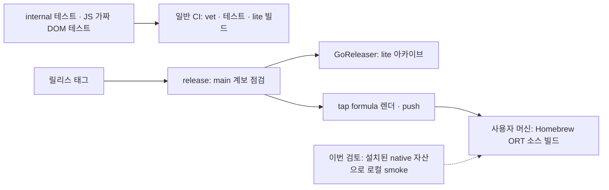

# 운영·검증·배포 독립 검토

대상은 `v0.10.0`, `ede67e302a8487aecbb4d59587a8686292018cf6`이다. `AGENTS.md`, `docs/philosophy.md`, `docs/invariants.md`를 먼저 읽었고, 다른 영역의 감사 보고서를 읽지 않은 상태에서 이 보고서를 완성했다. 코드·기존 추적 문서 수정, 커밋·push·release, 서비스 재시작, 모델 다운로드·양자화는 수행하지 않았다.

원래 목적은 **로컬 마크다운 위키를 LLM이 관리하되, 판단 대신 구조·상태의 불변식을 도구가 보장하는 것**이다. 이 기준에서 lite의 실제 강등과 현재 머신의 ORT 추론은 동작했다. 다만 정상 Mermaid를 웹에 전달하면서 망가뜨리는 경로, 사용할 수 없는 모델을 준비 완료로 표시하는 경로, lint의 필수 필드 누락, 수량 플래그의 panic을 재현했다. 테스트·배포 설정이 이러한 경계를 충분히 확인하지 않는다는 사실은 별도의 보증 공백으로 분류했다.

## 확인 범위와 증거의 한계

작업 디렉토리는 `/Users/nobocop/play/canopy`, 임시 자료는 `/private/tmp/canopy-audit-20261009/ops-term398`이다. 모든 Go 호출에 `GOCACHE=/private/tmp/canopy-review/go-cache`, `GOPROXY=off`, `GOTOOLCHAIN=local`을 사용했다. 실제 실행한 SDK는 `go1.27.1 darwin/arm64`이며, `go.mod`의 `go 1.26.4`와 **동일한 툴체인 검증은 아니다**. 기존 SDK·모듈 캐시와 설치된 native 라이브러리를 참조했고 설치·업그레이드를 수행하지 않았다.

모든 canopy 실행과 테스트 fixture에는 임시 HOME/XDG/TMPDIR를 지정했고 `/Users/nobocop/workspace/wiki`는 읽지 않았다. 초기 Go `version/build/vet/mod verify/tidy -diff` 호출은 기존 HOME을 상속했다. 사용자 canopy 설정을 쓰는 명령은 없었지만, 초기 Go tool telemetry의 HOME 기록 유무는 별도로 확인하지 못했다. 따라서 이 검토에 대해 “도구 실행까지 실제 HOME에 어떤 기록도 남기지 않았다”는 강한 보장은 하지 않는다. 이후 Go 호출도 HOME을 격리했으며 실제 HOME에 대한 수정·되돌리기는 하지 않았다.

| 영역 | 실제로 읽거나 실행한 범위 | 남은 한계 |
|---|---|---|
| 테스트 전체 | 기존 `internal`의 24개 Go test 파일·112개 `Test` 함수와 JS test 파일의 assertion/fixture를 모두 읽음. inventory는 [ops-test-inventory.tsv](evidence/ops-test-inventory.tsv) | 모든 테스트를 이 작업에서 다시 실행하지 않음. 기존 일반·`-race` 전체 통과는 코디네이터의 기준선 결과이며 여기의 독립 실행 결과와 구분 |
| 독립 테스트 실행 | `lint`, `mermaid`, `skills`를 `-count=1 -coverprofile`로 실행, 각각 statement coverage 89.6%·83.1%·74.7%. JS 18개 모두 통과. 특정 tasks test로 HOME 부작용 재현 | coverage 비율은 테스트가 실행한 해당 패키지의 문장 비율일 뿐, 불변식 전체·프로세스 간 경쟁·손상 복구의 증명이 아님 |
| CLI | `cmd/canopy` 10파일/3,047행의 명령 구성·플래그·오류 경로, model/download, read/checkout/tasks/events/reconcile/serve 경계를 읽음. version/init/status/search/reindex/model/lint/tags/new를 고정 fixture로 실행 | CLI test 파일 0. 모든 명령 조합을 실행한 것은 아니며 sync의 실제 git 원격·write pipeline의 모든 실패 단계·신호/서비스 복구는 미검증 |
| 빌드 | 기존 root `canopy`를 만들지 않도록 Makefile의 build 명령에 임시 `-o`를 적용. `CGO_ENABLED=0` lite, ORT darwin/arm64, lite darwin/linux × amd64/arm64 컴파일 성공. 기본 태그 `go vet ./...` 통과 | 크로스 바이너리는 해당 OS에서 실행하지 않음. Linux/Intel ORT 및 정확한 Homebrew formula install은 실행하지 않음 |
| ORT 런타임 | 설치된 `libonnxruntime.dylib`, `libtokenizers.a`, 기존 모델을 읽기 전용으로 사용. 3개 고정 문장의 실제 추론, semantic CLI 검색, 최초/무변경 reindex 성공 | 기존 `bge-m3` 디렉토리의 weight data는 567,735,312 bytes. 공식 다운로드 revision/양자화 출처, 공식 pooling/reference, 광범위 한국어 relevance, int8 품질 수치는 증명하지 않음 |
| 배포 | Makefile, 두 workflow, 실제 파일명인 `.goreleaser.yaml`, formula, 4개 scripts, buildinfo 검토. `goreleaser check`, Ruby syntax, shell syntax 통과 | GoReleaser publish/snapshot, release tag/push, tap 반영, Homebrew 서비스는 실행하지 않음. J7의 원격 fetch도 이 작업에서 실행하지 않음 |
| Go 의존성 | `go.mod`, `go.sum`, lite/ORT의 조건부 의존성, spike의 hugot 경로 확인. `go mod verify` → `all modules verified` | `go mod tidy -diff`는 goja의 test-only 의존성 두 개가 로컬 캐시에 없어 GOPROXY=off로 실패. 실제 다운로드는 없으며 tidy 결과까지 검증한 것은 아님. CVE 전수 조회·전체 전이 라이선스 판정은 하지 않음 |
| 기타 소스 | lint/audit, mermaid/JS shims/bootstrap, skills 설치 및 두 내장 스킬, buildinfo, root AGENTS/CLAUDE/README/.gitignore, spike 3파일 전부 검토 | spike는 탐색용이며 production engine과 동일한 검증 계약으로 취급하지 않음. 별도 과거 실험 결과의 진위는 판정하지 않음 |
| 내장 웹 자산 | vendor JS, font 고지, embed/서빙 경로, Mermaid parser와 renderer 전처리, MathJax loader/module 경로 확인 | 실제 브라우저·레이아웃·접근성·SVG 렌더링·graph 애니메이션·수식 typesetting은 미검증. JS test의 가짜 DOM은 이를 대신하지 않음 |

공유 저장소의 다른 worker 파일을 바꾸지 않기 위해 format 검사는 `cmd`, `internal`, `spike`와 자신의 probe에 한정했다. 출력은 비었다. 사용자 명령인 `make build-lite`는 root 파일을 쓰므로 그대로 실행하지 않았으며, 명령의 같은 패키지·ldflags를 사용하되 임시 출력과 명시적 `CGO_ENABLED=0`을 적용했다.

모듈 안의 임시 `review_probes/ops`는 완료 전에 제거했고, 원문과 동일한 bytes를 [ops-probe.go.txt](evidence/ops-probe.go.txt)에 보존했다. 이 probe의 Mermaid/HTTP 경로 확인은 기본 태그로 빌드할 수 있고, `embed-smoke`만 ORT 태그·native 자산·모델이 필요하다. 명령·환경·빌드 방법은 [추가 증거](evidence/ops-extra-checks.txt)에 있다.

## 확인된 정상 경로

[원시 실행 기록](evidence/ops-checks.json), [추가 명령·환경 기록](evidence/ops-extra-checks.txt)에 stdout/stderr와 exit가 있다.

- lite `search MQTT --mode hybrid --json --no-mark` → exit 0, `mode: "keyword"`, `protocol` hit, stderr에 `hybrid → keyword only`. 명시적 semantic은 exit 1. **F2를 실제 호출로 확인했다.**
- `init` 이후 전혀 다른 임시 cwd에서 `status --json` → exit 0, 임시 wiki 선택. F4의 기본 위키 채택 경로를 확인했다.
- ORT probe → 1,024차원, 유한 성분, L2 norm 약 1.0인 벡터 3개. 로드 707ms, 3문장 inference 37ms, 한국어/영어 protocol 유사도 0.96244, protocol/점심 0.58432. 이 한 번의 smoke는 일반적인 retrieval 품질 평가가 아니다.
- 2페이지 ORT `reindex` → `embedded_pages: 2`; 재실행 → `embedded_pages: 0`, `total_chunks: 2`. semantic 검색은 protocol을 점심보다 높게 반환했다.
- 실제 CLI의 깨진 Mermaid 생성은 exit 1, `Parse error on line 2`와 진단을 출력하고 새 페이지를 만들지 않았다. [CLI 증거](evidence/ops-mermaid-cli.json)
- `make i18n-check` → 4개 번역 current. `goreleaser check --config .goreleaser.yaml` 및 `ruby -c` 성공. source formula의 v0.3.0 URL은 workflow가 태그별로 바꾸는 template이므로, 이 값만으로 현재 tap이 낡았다고 판정하지 않았다.

## 보증 구조

source formula를 배포하는 것과 release job이 그 formula를 빌드·추론하는 것은 다르다. 현재 테스트는 schema·task·checkout·reconcile·읽음 상태 등의 작은 결정론적 예제를 잘 다루지만, 명령 연결·native 환경·브라우저 전달·배포의 마지막 단계는 다른 증거가 필요하다. production Go는 `internal` 45파일/7,741행, CLI 10파일/3,047행으로 아직 부분별 책임을 추적할 수 있는 크기다. 문제를 해결하기 위해 새로운 서비스나 전체 재작성부터 시작할 근거는 발견하지 못했다.

## OPS-01 — 명시된 불변식과 CI·릴리스가 검사하는 범위 사이의 공백

**분류·심각도·전제:** 보증 공백 및 일부 문서 과장 / 중간. CLI wiring, 강등, ORT 또는 웹 전달 경계를 바꾸는 커밋을 릴리스할 때 해당한다. 현재 릴리스가 실패했다는 발견은 아니다.

**위치:** `Makefile:29–33,65–69,87–97`; `.github/workflows/ci.yml:3–6,32–46`; `.github/workflows/release.yml:15–36,38–90`; `.goreleaser.yaml:13–24`; `packaging/homebrew/canopy.rb:99–101`; `cmd/canopy/main.go:41–74`; `internal/mermaid/mermaid_test.go:86–109`; `internal/webui/uitest/app.test.cjs:8–155`.

**기대와 실제:** F2는 실행 시 강등+경고+exit 0인데 CI는 빌드만 한다. Makefile의 lite target은 CGO를 0으로 고정하지도 않는다. F1의 “전체 테스트” 명령은 `./internal/...`이며 CLI에는 test가 없다. release-check는 clean tree·internal tests·format을 확인하고 release workflow는 계보 확인 후 바로 GoReleaser를 실행한다. “ORT는 release 때 Homebrew 소스 빌드로 검증된다”는 CI 주석과 달리 release job에는 Homebrew install 또는 ORT build/smoke가 없다. formula test도 `version` 문자열만 비교하므로 native loader를 호출하지 않는다. Mermaid P4의 기존 테스트는 error classifier의 문자열을 확인하며, 실제 sandbox init/timeout/promise 실패를 주입하지 않는다. JS tests는 shipped app.js를 실행하지만 실제 DOM·vendor renderer를 구동하지 않는다.

**근거·재현:** `go test ./cmd/canopy` → `[no test files]`; test inventory와 위 workflow 원문. 이번 독립 smoke는 성공했고, OPS-03/11은 이 공백에서 빠져 있는 실제 경계 오류다. release의 원격 실행 자체는 미검증이다.

**가장 강한 반론:** 의도된 배포 경로가 main이고 main CI가 먼저 통과한다면 태그 job의 테스트 반복은 비용일 수 있다. 2GB 모델을 매 PR에 받지 않는 선택도 타당하다. 그러나 CI 자체의 F2는 행동을 실행하지 않으며 native 체크가 어느 job에도 없다는 사실은 남는다. 기존 green을 이보다 강한 보장으로 읽을 수 없다.

**제한된 개선·대안:** 먼저 작은 임시 위키로 F2, CLI 기본 위키 채택, 잘못된 플래그, 쓰기 거부 전후 파일 불변을 실제 binary에서 확인한다. 이 검사를 태그의 정확한 소스 또는 검증 완료된 artifact에 연결한다. ORT는 release 전용/수동으로 승인된 기존 모델 fixture를 사용하는 한 플랫폼 smoke로 시작할 수 있다. 모델 비용이 부담되면 ORT compile+missing-model 강등까지만 필수로 하고 실제 추론의 미실행을 명시하는 대안이 있다. CLI root 생성 함수를 테스트 가능하게 분리하는 작은 변경은 유용하나, 명령 전체를 다른 프레임워크로 옮길 이유는 없다.

**제안 불변식·인수 테스트:** F2 검사에서는 `CGO_ENABLED=0` binary로 실제 검색을 실행하고 JSON mode·hit·stderr·exit를 assert한다. 태그 publish가 사용하는 커밋/소스의 검사 결과를 job이 확인한다. ORT의 compile, library load, 실제 inference는 각각 별도 결과로 기록하며 version 출력은 inference 통과로 계산하지 않는다. 실패 입력 하나를 주입했을 때 해당 gate가 빨강이 되고 publish가 진행하지 않는지 fixture/job-level 테스트로 확인한다.

## OPS-02 — 사용할 수 없는 모델을 available·ready로 표시하고 재시도도 고치지 않는다

**분류·심각도·전제:** 실제 운영 버그 / 중간. 모델 파일이 손상되거나 기존 incomplete bundle이 남은 설치에서 발생한다. upstream의 악성 모델이 있었다고 확인한 것은 아니다.

**위치:** `internal/embed/engine.go:43–50`; `internal/embed/engine_ort.go:58–91`; `cmd/canopy/main.go:467–501,508–521,580–603`.

**기대와 실제:** `model pull`의 완료 표시는 사용 가능한 일관된 모델 묶음을 뜻해야 하며, 이미 내려받은 파일이 손상됐다면 재시도가 복구 가능해야 한다. 실제 `ModelAvailable`은 `model.onnx`의 Stat 성공만 본다. pull도 각 파일이 존재하면 크기·종류·내용 검증 없이 skip한다. 6개 0바이트 fixture로 `model status`는 `model_available: true`, pull은 전부 cached와 `✓ model ready`를 출력하고 exit 0이었다. 같은 data로 semantic은 `unexpected end of JSON input`, exit 1이다. hybrid는 keyword로 강등되어 기본 읽기 길은 살아 있었다.

**재현:** [ops-cli-checks.py.txt](evidence/ops-cli-checks.py.txt)의 `zero-byte-model-*`와 [실행 출력](evidence/ops-checks.json). 모든 이름을 미리 만든 뒤 cached branch만 실행했으며 HTTP 다운로드는 하지 않았다. 깨진 파일을 실제 모델이라고 사용한 변환은 없다.

**추가 보증 한계:** 6파일 URL은 각각 mutable `resolve/main`이고 revision/checksum manifest가 없다. 중단 후 재시도 사이에 upstream revision이 달라지면 old graph와 new weight/tokenizer가 섞일 여지가 있다. 이 혼합 revision 장애 및 네트워크 hang은 실행하지 않았으며 코드에서 확인되는 조건이다. `http.Get`에는 command context·deadline이 없고 `.part`의 이름도 pull별로 고유하지 않다. 이것을 확인된 공격이나 현재 설치의 혼합 상태로 단정하지 않는다.

**가장 강한 반론:** downloader는 `.part`와 rename으로 단일 파일의 완료 전 노출을 피하고, 일반적인 stream 오류 시 part를 삭제한다. 보통 새 설치의 재시도는 정상이다. 모델 존재 검사가 매번 대형 파일을 hashing하지 않아 빠른 점도 유효하다. 그러나 이미 존재하는 깨진 파일은 영구히 cached이고 ready가 계속 거짓이라는 재현은 이 보호로 해결되지 않는다.

**제한된 개선·대안:** pull에서 필수 파일이 regular/nonempty이고 config/tokenizer JSON이 읽히는지를 검사하고 incomplete를 구분한다. 초기 다운로드에서 revision과 digest를 고정·기록하고 완료 manifest를 마지막에 쓴다. 재시도는 잘못된 파일만 재수신할 수 있는 명시적 repair/force 경로를 둔다. 매 status에서 2GB 전체 checksum을 계산하는 대신 manifest와 저비용 검사를 사용할 수 있고, full validation은 별도 명령/최초 준비 단계로 제한하는 대안이 있다. downloader의 context/deadline과 임시 파일 고유화는 이 경로 안에서만 보완한다.

**제안 불변식·인수 테스트:** “model ready”는 모든 required artifact가 동일 revision의 완료 묶음일 때만 출력된다. 작은 fake bundle+가짜 HTTP transport로 0바이트·missing sidecar·손상 JSON·중간 실패·재시도를 시험하고, ready false 또는 명확한 incomplete 오류, 기존 정상 bundle 불변, repair 후 성공을 assert한다. 배포 시 큰 모델 full hash를 매 검색에서 요구하지 않는다.

## OPS-03 — 같은 Mermaid 번들이어도 렌더러에 넘기는 원문이 달라진다

**분류·심각도·전제:** 실제 버그, P1/P3의 보증 설명 과장 / 중간. CommonMark의 `~~~mermaid` 또는 4-backtick fence에서 subroutine 노드 `A[[foo]]`를 사용한다. CLI 생성 재현에는 `foo` 페이지를 fixture에 두었다.

**위치:** `internal/mermaid/mermaid.go:147–179`; `internal/webui/render.go:47–54,59–65,70–115`; `internal/wiki/page.go:37–59`; `internal/webui/static/app.js:222–227`; `internal/webui/mermaid_serve_test.go:13–25`; `docs/invariants.md:182–193`.

**기대와 실제:** lint가 검사한 Mermaid source가 웹의 Mermaid element text로 그대로 전달되어야 한다. Blocks는 goldmark로 CommonMark fence를 추출하지만 wikilink 전처리의 fenced regex는 3-backtick만 제외한다. 따라서 정상 `A[[foo]]`가 `A<a class="wikilink" ...>foo</a>`로 변한다. renderer는 이를 escaped text로 `<pre class="mermaid">`에 넣고 browser의 element text가 다시 parser 입력이 된다.

**재현·출력:** [probe 원문](evidence/ops-probe.go.txt)의 `render-parity`와 [출력](evidence/ops-checks.json). 같은 source에 대해 3-backtick은 전후 valid, tilde/4-backtick은 원문 `original_bad:null`, 렌더 전달문 `rendered_bad: Parse error on line 2`, 두 환경 오류는 모두 null이다. [실제 CLI 재현](evidence/ops-mermaid-cli.json)은 정상 tilde body의 `new` exit 0과 lint의 `invalid-mermaid` 부재를 확인했다. 실제 browser의 SVG/오류 box는 실행하지 않았고, HTML 전달문을 같은 parser에 넣어 생기는 오류까지 확인했다.

**가장 강한 반론:** 내장 스킬 예제는 3-backtick을 사용하며 P3의 문자 그대로의 “번들 동일”은 현재도 사실이다. 하지만 두 fence는 renderer 자체가 지원하는 유효한 markdown이고, 같은 번들 test만으로 “판정이 어긋날 수 없다”는 결론을 낼 수 없다. 이 차이는 sanitizer의 추측 문제가 아니라 parser에 전달한 bytes의 실제 변경이다.

**제한된 개선·대안:** wikilink 추출/렌더 전처리가 CommonMark AST의 모든 code region을 건너뛰게 하고 Mermaid source를 보존한다. goldmark 기반 extractor를 재사용하는 범위로 제한할 수 있다. 빠른 대안은 tilde/긴 fence까지 regex를 확대하는 것이지만 nested/indented fence 및 code span에서 다시 diverge할 수 있다. canonical 3-backtick만 허용하는 정책도 가능하나 이미 renderer가 지원하는 markdown을 축소하므로 명시적 제품 선택이 필요하다.

**제안 불변식·인수 테스트:** 모든 지원 fence에서 `mermaid.Blocks(body).Source == renderedMermaidElement.textContent`다. 3/4-backtick·tilde·blockquote/indented fence와 `[[...]]` 포함 노드를 table test로 비교하고, 유효한 source가 원문 검사와 전달 후 검사 양쪽을 통과하며 코드 안의 `foo`가 page link로 집계되지 않는지 확인한다. P3 번들 equality 검사는 유지하되 source equality를 추가한다.

## OPS-04 — lint가 A3의 필수 tags 누락을 검출하지 않는다

**분류·심각도·전제:** 실제 검출 버그 / 낮음. 직접 편집/외부 도입 페이지의 frontmatter에 title/type/created/updated는 있으나 tags key가 없다.

**위치:** `docs/invariants.md:15`; `internal/lint/lint.go:83–113`; `internal/wiki/page.go:91–101,138–155`; `internal/lint/lint_test.go:14–39`.

**기대와 실제:** A3는 `title/created/updated/type/tags`를 요구한다. missing-field 검사는 tags를 아예 포함하지 않으며 Parse가 “누락”과 빈 tags를 구분할 필드도 저장하지 않는다. tags 없는 fixture의 lint에는 orphan warning뿐, `no-frontmatter`/`frontmatter-fields`가 모두 없다. 따라서 문서의 A3 점검은 통과한다.

**재현·출력:** [고정 fixture 생성·명령](evidence/ops-cli-checks.py.txt), [lint-A3 출력](evidence/ops-checks.json): `counts: {"orphan":1}`, exit 0. 같은 fixture의 `created/updated: nonsense`도 진단되지 않았다. 날짜 형식까지 A3의 명시 계약이라고 확대하지는 않지만, 현재 점검이 시간 기반 기능에 쓸 수 있는 날짜를 보증하지 않는다는 한계를 함께 기록한다. 또한 malformed YAML은 다른 `bad-frontmatter` kind로 진단되므로 A3의 두 count만 확인하는 절차는 그것도 포괄하지 않는다.

**가장 강한 반론:** 태그 없는 페이지가 의미상 허용된다면 누락을 빈 목록으로 읽는 관용성은 합리적이다. `new`는 기본적으로 tags를 만든다. 그러나 빈 `tags: []`와 필수 key 부재는 문서에서 동일하다고 선언되어 있지 않고, 외부 편집을 잡는 lint의 책임은 남는다.

**제한된 개선·대안:** Parse에서 필요한 key 존재와 자료형을 보존하고 lint의 required-field 검사에 tags를 포함한다. 또는 tags를 optional로 의도했다면 A3와 스키마 안내를 그에 맞게 좁힌다. 날짜 검증을 추가하려면 별도의 명시된 invariant로 정하고, legacy 값을 즉시 쓰기 불가로 만드는 호환성 비용을 따져야 한다.

**제안 불변식·인수 테스트:** A3의 모든 required key가 검사된다. tags 없음은 `frontmatter-fields`, 빈 sequence는 허용, scalar/객체 등 잘못된 형식은 정의한 진단을 낸다. 각 필드를 하나씩 지운 table fixture를 lint에 전달해 진단 count를 확인한다. 문서 점검에는 `bad-frontmatter`도 포함한다.

## OPS-05 — 태그 사용률이 페이지가 아닌 중복 항목 수를 센다

**분류·심각도·전제:** 실제 계측 버그 / 낮음. 한 페이지에 같은 태그가 두 번 이상 들어 있다. 외부 편집에서 유효 taxonomy tag를 반복하는 경우로 재현했다.

**위치:** `internal/lint/audit.go:10–15,42–58,72–78`; `internal/lint/lint_test.go:87–149`; `internal/wiki/page.go:138–147`; `cmd/canopy/write.go:50–64`.

**기대와 실제:** TagUsage는 “태그를 사용하는 페이지 수/전체 페이지”를 나타낸다. 코드가 페이지마다 seen set 없이 항목을 모두 count하므로 1페이지의 `tags: [tool, tool, tool]`은 `count:3`, `pct:300`, overbroad topic으로 나온다. 사용률과 분할 압력이 실제 지식 범위를 반영하지 못한다.

**재현·출력:** [taxonomy-duplicate-tags](evidence/ops-checks.json) → `total_pages:1`, `tool.count:3`, `tool.pct:300`. 이것은 score 품질 가정이 아니라 산술적으로 확인된 오계수다.

**가장 강한 반론:** 중복 tags가 없는 정상 데이터에서는 현재 count가 맞고, 기존 audit test도 그 경우를 잘 검사한다. 중복 자체를 정규화해야 한다는 관점도 가능하다. 하지만 lint/new tag 검사는 membership만 보고, audit를 실행하기 전 중복 없음이 강제된다는 보장은 없다.

**제한된 개선·대안:** audit의 각 페이지에서 tag를 deduplicate해 페이지 사용 수를 센다. 별도로 duplicate-tag lint를 제공할 수 있다. 페이지를 자동 retag하거나 taxonomy를 자동으로 쪼개는 변경은 이 문제의 해결 범위를 넘는다. 항목 빈도를 보고 싶다면 page count와 별도 항목으로 분리하는 대안이 있다.

**제안 불변식·인수 테스트:** `0 <= count(tag) <= total_pages`이고 `0 <= pct <= 100`이다. 한 페이지의 반복 태그는 1회, 다른 두 페이지에 있는 같은 태그는 2회로 계산하는 fixture를 넣고 overbroad 판정도 동일한 page count를 사용하도록 assert한다.

## OPS-06 — 기본 테스트 fixture가 개발자의 머신 상태 디렉토리에 이벤트 DB를 남긴다

**분류·심각도·전제:** 실제 테스트 격리 결함 / 낮음. `make test`/해당 tasks test를 별도 HOME/XDG 지정 없이 실행한다. 실제 사용자 wiki 내용 손실을 확인한 것은 아니다.

**위치:** `internal/tasks/tasks_test.go:16–24,45–85,266–315`; `internal/webui/tasks_test.go:16–32,45–79`; `internal/webui/workspace_test.go:23–28`; `internal/tasks/tasks.go:181,210,246,267`; `internal/attention/touch.go:21–29`; `internal/attention/events.go:83–99`; `internal/config/config.go:32–55,172–174`; `Makefile:32–33`.

**기대와 실제:** t.TempDir의 임시 위키가 끝나면 그 시험이 남기는 durable state도 임시 영역 안에 있어야 한다. tasks의 일반 helper는 wiki root만 임시로 만들고 XDG_STATE_HOME을 설정하지 않는다. lifecycle 함수가 기본 HOME 아래 attention DB를 열어 기록한다. 나중 두 tests는 XDG를 설정하고 workspace helper도 cache/state를 격리하지만 일반 tasks tests에는 적용되지 않는다.

**재현·출력:** fake HOME을 임시 폴더에 두고 `XDG_STATE_HOME='' go test -count=1 ./internal/tasks -run '^TestConnectDoneRequiresMutualLinks$'` → pass. 그 HOME에 `.local/state/canopy/attention/08a800f0b008.db`가 남았다. [결과](evidence/ops-test-side-effects.json)의 Go telemetry 파일은 SDK 자체의 기록이며 이 finding의 근거 DB와 구분한다. 재현은 실제 HOME을 쓰지 않았다.

**가장 강한 반론:** DB는 임시 wiki root hash별로 분리되어 기존 wiki 이벤트를 덮어쓰지 않고, non-authoritative local 기록이다. 영향은 주로 테스트 간/개발 머신 오염이다. 그럼에도 기본 test 명령의 부작용과 fixture 생명주기 불일치는 실제이며 repeated tests마다 새 DB가 누적된다.

**제한된 개선·대안:** 해당 공용 test helper에서 XDG state/cache를 t.TempDir로 설정하고, 다른 함수가 파일을 열 때도 같은 test 환경을 사용한다. Makefile에서 test 실행 전체를 임시 HOME/XDG로 감싸는 대안은 빠르지만 helper를 다른 방식으로 실행할 때 문제를 숨길 수 있다. 개발자 전체 HOME을 지우거나 production logging을 제거할 필요는 없다.

**제안 불변식·인수 테스트:** package test는 그 test의 temporary root 밖에 canopy state/cache를 만들지 않는다. sentinel default HOME을 두고 package suite를 실행한 전후를 비교하여 `.local/state/canopy` 파일이 추가되지 않으며 fixture state에만 DB가 생기는지 확인한다.

## OPS-07 — 단일 MathJax 파일은 모든 활성화된 수식 확장의 오프라인 완결을 보장하지 않는다

**분류·심각도·전제:** 문서 과장 및 자산 보증 공백 / 낮음. 페이지 수식이 `\color` 같은 autoload 매크로나 `\require{physics}` 같은 확장을 요구한다. 기본 수식 전체가 실패한다고 주장하지 않는다.

**위치:** `docs/philosophy.md:230–234`의 외부 서비스 비목표; `internal/webui/static/app.js:233–239`; `internal/webui/static/vendor/tex-svg.js:1`의 webpack modules 235(loader), 3282(version), require/autoload modules; `internal/webui/server.go:30–31,88`; `internal/webui/uitest/app.test.cjs:116–136`.

**기대와 실제:** 문서는 수식 라이브러리를 vendor해 오프라인에서 완결된다고 설명한다. app.js는 기본 tex/svg 설정만 지정하고 autoload/require를 제한하지 않는다. 저장된 MathJax 3.2.2 loader 모듈을 추출해 실행하면 extension URL은 `/static/vendor/input/tex/extensions/color.js`와 `physics.js`다. 실제 Handler에 대한 httptest는 tex-svg.js 200, 두 extension 404였다. [probe](evidence/ops-mathjax-probe.cjs.txt), [명령·출력](evidence/ops-extra-checks.txt)

공식 3.2 문서는 TeX component의 autoload와 `\color` 확장, 표현식 내 require를 설명한다. [autoload 문서](https://docs.mathjax.org/en/v3.2/input/tex/extensions/autoload.html), [require 문서](https://docs.mathjax.org/en/v3.2/input/tex/extensions/require.html). 이 문서와 loader/404 증거에서 해당 수식의 렌더 실패 가능성을 **추론**한다. 실제 browser typesetting 및 사용자 화면은 미검증이며, vendor 안 CDN 문자열이 있다는 이유만으로 모든 페이지가 외부 통신한다고 판정하지 않는다.

**가장 강한 반론:** 보통의 수식은 combined tex-svg bundle에 포함되어 있고 사용자가 확장을 필요로 하지 않을 수 있다. 실제 404는 같은 origin에 대한 요청이므로 CDN 의존이 재현된 것도 아니다. 하지만 현재 앱이 활성화한 확장 수요보다 shipped asset 집합이 좁다는 사실 때문에 “수식 오프라인 완결”을 무조건 보장할 수 없다.

**제한된 개선·대안:** 필요한 작은 확장 집합을 명시하고 동일 version으로 vendor해 loader 경로를 제공한다. 지원 범위를 core로 제한하고 autoload/require를 끄는 대안은 바이너리를 작게 유지하지만 매크로 호환성을 줄인다. full bundle을 추가하는 대안은 간단하나 크기와 고지/업데이트 비용이 늘어난다. 온라인 CDN fallback을 조용히 추가하는 것은 로컬 목적과 맞지 않는다.

**제안 불변식·인수 테스트:** 지원한다고 선언한 수식 corpus는 네트워크를 차단한 browser에서 렌더하고 요청되는 모든 component가 내장 자산에 대응한다. core와 대표 extension 수식을 포함하고 404·외부 요청·수식 error node를 assert한다. 지원하지 않는 확장에는 명확한 진단을 제공한다. browser가 없는 CI에서는 manifest/route completeness까지만 검사했다고 표시한다.

## OPS-08 — 직접 native 소스 빌드의 플랫폼 선택·검증이 formula보다 약하다

**분류·심각도·전제:** 플랫폼 선택의 실제 결함 및 supply-chain 보증 공백 / 낮음. Apple Silicon 이외에서 README의 `make build` 경로를 사용하거나 native static lib를 처음 준비/갱신할 때 해당한다.

**위치:** `README.md:40–45`; `Makefile:9–12,25–26,53–57`; `packaging/homebrew/canopy.rb:24–51`; `internal/embed/engine_ort.go:27–63`; `spike/session_ort.go:12–15`.

**기대와 실제:** source build가 실행 플랫폼에 맞는 libtokenizers를 받아야 한다. Makefile은 버전만 고정하고 URL을 `darwin-arm64`로 고정한다. `GOOS=linux GOARCH=amd64 make -Bn deps XDG_DATA_HOME=<fixture>`도 그 URL을 출력했다. 반면 formula는 네 가지 OS/arch resource와 SHA256을 선언한다. Makefile 다운로드에는 digest 검증·완료 marker가 없고 파일 존재 여부가 prerequisite 완료 기준이다. Native 배포의 위험을 실제 라이브러리 위변조 사건으로 확대하지 않는다.

**검증 한계:** curl/tar를 실행하지 않았으며 Linux/Intel full build 실패와 위변조는 미검증이다. 현재 darwin/arm64의 기존 라이브러리를 쓰는 ORT build/inference는 성공했다. 따라서 “모든 native 빌드가 깨졌다”는 결론은 틀리다. [dry-run 출력](evidence/ops-extra-checks.txt)

**가장 강한 반론:** Makefile이 주 개발자 Apple Silicon용이고 사용자에게는 Homebrew를 권한다면 지원 범위 축소는 타당하다. HTTPS와 특정 upstream release tag도 무의미한 보호가 아니다. 그러나 README source 경로에 그 제한이 없고 formula와 검증 수준이 다르다. 아키텍처 불일치는 입력에 따라 확정적으로 선택되는 wrong artifact다.

**제한된 개선·대안:** supported host tuple을 감지하고 이미 formula가 사용하는 OS/arch/version/digest 조합을 Makefile 경로에도 적용한다. 임시 디렉토리에서 검증·추출한 뒤 lib를 교체한다. 직접 빌드를 Apple Silicon으로 한정해 fail-fast하고 다른 사용자는 formula/lite로 안내하는 대안은 구현이 더 작지만 source build의 지원 범위를 명시적으로 좁힌다. native 라이브러리를 Go sum이 검증한다고 주장해서는 안 된다.

**제안 불변식·인수 테스트:** 각 지원 플랫폼은 맞는 pinned URL+digest를 선택하고 unsupported tuple은 다운로드 전에 오류다. fake curl/작은 tar fixture로 wrong hash·중간 실패를 주입해 기존 정상 lib가 유지되고 다음 재시도가 다시 검증하는지 확인한다. actual host native link/inference smoke는 별도 결과다.

## OPS-09 — 배포되는 내장 JS의 출처·라이선스 고지 추적이 부족하다

**분류·심각도·전제:** 배포 고지·provenance 보증 공백 / 중간. embedded web assets를 포함한 source/binary를 재배포할 때 해당한다. 악성 의존성이나 법적 분쟁을 발견했다는 뜻은 아니다.

**위치:** `internal/webui/server.go:30–31`; `internal/mermaid/mermaid.go:28–31`; `internal/webui/static/vendor/force-graph.min.js:1`; `internal/webui/static/vendor/tex-svg.js:1`; `internal/webui/static/vendor/fonts/LICENSE-fonts.txt:1–6`; `.goreleaser.yaml:31–37`; root `LICENSE:1–21`.

**기대와 실제:** shipped asset의 정확한 upstream/version·가공 방법·필요한 고지가 배포물에 연결되어야 한다. force-graph 헤더는 version 1.51.4와 upstream URL뿐이며 전체 bytes에 Copyright/license/LICENSE 문자열이 없다. MathJax VERSION은 3.2.2지만 같은 고지 문자열은 없다. archive files는 README.md와 canopy 자신의 MIT LICENSE뿐이다. Mermaid에는 일부 하위 라이브러리 license 주석이 실제로 있으므로 “모든 vendor license가 제거됐다”고 말할 수는 없다. font 고지 파일도 있으나 링크·저작자·라이선스명 중심이며 전이 자산의 전체 준수 여부까지 이 검토에서 판정하지 않았다.

정확한 tagged upstream의 [force-graph MIT license](https://github.com/vasturiano/force-graph/blob/v1.51.4/LICENSE)는 copyright/permission 고지 포함을 요구하며, [MathJax 3.2.2 Apache-2.0 license](https://github.com/mathjax/MathJax/blob/3.2.2/LICENSE)는 수신자에게 license 사본을 제공하는 조건을 명시한다. 해당 bytes와 release file 목록에 그 두 upstream 고지를 충족하는 경로가 보이지 않는다는 제한된 발견이다. 두 원문의 조건만 확인했으며 전체 Go/Rust/JS 전이 라이선스의 법적 결론은 내리지 않는다.

**근거·한계:** 세 주요 JS의 SHA256과 문자열 검사는 [추가 증거](evidence/ops-extra-checks.txt)에 보존했다. 실제 release archive를 내려받아 확인하지 않았고 upstream bytes와 committed bundle의 재현 빌드 equality도 검증하지 않았다. go.sum/`go mod verify`는 수동 vendor JS·native lib·model을 보증하지 않는다.

**가장 강한 반론:** root MIT로 코드 사용 권한은 공개되어 있고, minified bundle의 보존된 legal comments와 font 고지도 일부 존재한다. upstream link로 확인이 가능하다. 그러나 자신의 copyright 고지는 다른 저작자의 permission/license 사본을 대신한다는 증거가 아니며 바이너리를 받는 사용자는 module cache를 받지 않는다.

**제한된 개선·대안:** 현재 shipped JS부터 정확한 version/source/hash, 가공 명령과 full license/필요 notice를 가진 작은 third-party ledger를 둔다. archive에 포함하고 단일 binary 사용자도 확인 가능한 embedded license 경로를 제공한다. 전체 SBOM 체계를 새로 도입하기보다 이 자산 집합에서 시작할 수 있다. 표준 distro 파일을 그대로 vendor하면 재현 방법은 단순하지만 번들 크기가 늘 수 있다. 버전을 임의로 올리는 것으로 이 문제를 해결하지 않는다.

**제안 불변식·인수 테스트:** 모든 committed vendor asset은 source/version/hash와 라이선스 파일에 대응하고 배포 archive 및 bare binary에서 해당 고지를 확인할 수 있다. manifest에 빠진 asset, hash mismatch, archive에서 누락된 고지를 fixture로 검사한다. static tokenizer와 model provenance는 별도 artifact 항목으로 표시하며 미검증을 숨기지 않는다.

## OPS-10 — 안내된 양자화 스크립트가 XDG 모델 위치를 따르지 않는다

**분류·심각도·전제:** 정적 코드에서 확인한 운영 결함 / 낮음. 사용자가 XDG_DATA_HOME을 지정하고 문서가 안내하는 선택적 int8 변환을 수행한다. 실제 양자화 실행은 금지 범위라 수행하지 않았다.

**위치:** `scripts/quantize-model.py:6–19`; `internal/config/config.go:49–50,139–145`; `internal/embed/engine.go:38–40`; `README.md:204–205`; `docs/getting-started.md:107–108`.

**기대와 실제:** `model pull`과 선택적 변환이 같은 data root의 모델을 읽고 결과를 선택 가능한 위치에 놓아야 한다. Go는 XDG_DATA_HOME을 쓰지만 script는 source/destination 둘 다 `~/.local/share/canopy`를 하드코딩한다. custom XDG의 모델은 못 찾거나 HOME에 남은 별도 모델을 변환하고, runtime이 찾는 위치와 다른 곳에 출력할 수 있다. source 파일의 AST assignment만 읽어 확인했고 ONNX/Python 변환 모듈을 실행하거나 설치하지 않았다.

**추가 한계:** output directory를 먼저 만들고 최종 model 이름에 직접 변환한 뒤 tokenizer/config를 copy한다. 중간 실패 후 output가 쓸 수 있는 상태인지 full validation하는 단계는 없다. 실제 quantization 실패·기존 output 덮어쓰기와 Python package version compatibility는 미검증이다.

**가장 강한 반론:** 선택적 1회성 script이고 기본 XDG를 쓰는 개발 머신에서는 맞는 경로다. production Go의 XDG 지원 자체가 깨진 것은 아니다. 그러나 사용자 문서가 이 script를 일반 설치 후 선택지로 안내한다면 경로 해석 차이는 피할 수 있는 함정이다.

**제한된 개선·대안:** source/destination 인수를 받거나 Go와 같은 XDG fallback을 사용하고 실제 경로를 출력한다. 검증한 temp output를 마지막에 활성화하고 기존 결과 교체 정책을 명시한다. script를 개인 spike로 한정하고 사용자 문서에서 custom XDG 수동 경로를 요구하는 대안은 작지만 안내의 편의성을 낮춘다. 모델 자동 다운로드/전역 Python 설치를 끼워 넣을 필요는 없다.

**제안 불변식·인수 테스트:** 같은 HOME/XDG에서 pull과 변환의 source root가 같고 destination이 runtime config가 선택할 수 있는 위치다. path-resolver를 ONNX import 없이 시험하고 custom XDG/default/명시 경로를 assert한다. 작은 stub converter의 실패로 incomplete output를 ready로 승격하지 않는지 검사한다. 실제 fp32→int8 수치·속도·품질 검증은 별도 실행 결과로 남긴다.

## OPS-11 — 음수 검색 수량이 사용자 오류 대신 panic을 일으킨다

**분류·심각도·전제:** 실제 CLI 입력 검증 버그 / 낮음. ORT semantic/hybrid 검색에 `-k=-1`을 전달한다. 원격 서비스 악용이나 데이터 손실을 확인한 것은 아니다.

**위치:** `cmd/canopy/main.go:379–383,407–429,461–463`; `internal/store/vectors.go:94–129`; `internal/search/search.go:15–41`; `internal/search/search_test.go:63–71`.

**기대와 실제:** 결과 수가 음수면 명령이 명확한 user error로 거부되어야 한다. Cobra Int 플래그는 음수를 받고 mode 검증 이후 그대로 전달한다. `SearchSemantic`이 `hits[:k]`를 수행해 `slice bounds out of range [:-1]`, stack trace, exit 2가 된다. 기존 top-k test는 정상 양수 하나만 다룬다. `Fuse`에도 같은 slice 형태가 있으나 이 CLI 재현의 첫 panic은 `SearchSemantic`이었다.

**재현·출력:** 임시 ORT binary와 2페이지 fixture에서 `search MQTT --mode semantic -k=-1 --wiki <fixture> --json --no-mark`, hybrid도 동일 → exit 2, stdout 빈 값, panic at `internal/store/vectors.go:127`. [원시 증거](evidence/ops-negative-count.json)

**가장 강한 반론:** 잘못된 local CLI 입력이며 양수 default는 정상이다. 실패 exit 자체는 반환되고 프로세스의 defer도 실행되어 현재 fixture 손상이 확인된 것은 아니다. 따라서 심각한 서비스/보안 장애로 확대할 이유는 없다. 다만 agent 도구가 실수를 정상 오류로 설명하지 못하고 모델 로드·index refresh 뒤에 panic한다는 실제 경계 문제다.

**제한된 개선·대안:** 명령에서 engine/index 작업 전에 top-k의 허용 범위를 검사하고 public internal 함수도 invalid k에서 안전한 결과/오류를 반환하게 한다. 0을 빈 결과로 허용할지 양수만 허용할지는 문서화할 선택이다. 음수를 unlimited 의미로 쓰려면 모든 mode에서 일관된 별도 정책이 필요하며 현재의 mode별 동작 차이를 유지하는 대안은 좋지 않다.

**제안 불변식·인수 테스트:** count 플래그의 범위 오류는 panic 없이 command error이고 model/index 작업 전에 판정된다. keyword/semantic/hybrid에서 -1/0/1과 매우 큰 값의 경계를 table test로 확인하고, 잘못된 입력은 exit 1과 명확한 stderr, panic 부재, fixture state/cache 불변을 assert한다. synthetic vector store test로 native 모델 없이 내부 slice 경계도 확인할 수 있다.

## 운영·복구 판단과 남은 범위

현재 잘 작동하는 선택은 유지할 가치가 있다. derived cache를 원본 밖에 두는 구조, lite와 full의 분리, embedded JS/스킬, query JSON에서 실제 mode를 알려주는 강등, 명시적 semantic의 실패, downloader의 파일별 rename은 로컬 위키의 복구 경로를 단순하게 한다. 반대로 OPS-02의 거짓 ready는 이 복구 길을 사용자가 선택하지 못하게 하고, OPS-03은 코드가 검증한 markdown을 다른 통로에서 바꾸어 철학의 “한 복도” 보증을 약하게 한다.

`refreshIndex`의 매 읽기 전체 scan/FTS rebuild, native model load의 per-process 비용, 전체 vector scan은 현재 작은 위키를 위한 제품 tradeoff로 읽었다. 이번 2페이지 smoke에서 큰 위키·고빈도 요청의 latency나 long-running serve 메모리 증가를 검증하지 않았고, 그 근거 없이 캐시 계층·별도 임베딩 서버·데이터베이스 전체 재설계를 권하지 않는다. 파일 손상/부분 write의 모든 실패 단계, 여러 프로세스의 동시 mutation, cross-device merge, SIGTERM/launchd/Linuxbrew 복구는 이번 독립 실행의 사각지대다. 다른 영역의 결과를 읽기 전에 이 보고서의 독립 결론을 고정했다.

우선순위는 정상 입력을 실제로 망가뜨리는 OPS-03, 사용 가능 상태를 거짓으로 표시하는 OPS-02, 다음 변경에서 이를 회귀시키지 않을 OPS-01이다. 나머지 수정·정책 선택은 각 ID의 작은 acceptance test로 검토할 수 있다. 이 보고서는 제안만 하며 어떤 source fix도 적용하지 않았다.
