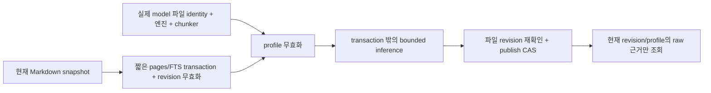

# 검색 profile과 현재 근거 계약

이 문서는 PLAN-09~11 구현의 설계 기록이다. V9~V11의 실행 점검은
`docs/invariants.md`에 먼저 등록했다. 캐시 스키마는 `3`이며 머신 migration
사다리를 바꾸지 않는다.



`indexer.EnsureCurrent`는 cold FTS를 만들고 engine 없이도 변경·삭제·빈 본문의
과거 vector를 제외한다. 모든 vector 소비자는 현재 scan으로 이 helper를 호출한다.
shared wiki lease 아래 fresh scan으로 전달받은 오래된 snapshot도 갱신하고,
lease를 풀어 추론한 뒤 짧은 shared lease에서 게시를 검증한다. 마지막 재스캔은
이전 batch 뒤에 바뀐 페이지도 무효화한다.
`EnsureCurrentContext`는 사전 취소와 batch 사이 취소를 검사한다. 추론 중 원문이
바뀌면 해당 결과를 게시하지 않고 재색인 오류를 반환한다. 다른 refresh가 pages 또는
profile을 교체했다면 짧은 publish transaction의 CAS도 게시를 거부한다.
이 계약은 관측한 snapshot을 식별하며 비협력 editor에 대한 파일시스템 CAS를 약속하지 않는다.

`source_revision`은 `SHA256(rel_path + NUL + title + NUL + parsed_body)`이다.
`start_byte`/`end_byte`는 frontmatter를 제외한 UTF-8 body 기준의 반열린 범위다.
반환 `text`는 그 범위의 원본 bytes이며 제목을 붙이지 않는다. 제목·문단 trim은 별도
embedding input에만 적용한다. 공백만 바뀌어도 source revision이 달라지므로 옛 range를
재사용하지 않는다. 빈 본문은 title-only가 아닌 0 chunk다.

실제 profile은 hugot v0.7.5, ORT, 첫 output, 3차원 output의 mean pooling,
L2 normalization, dimension 1024, paragraph chunker 1200/1600 **runes**, raw-range
버전과 input normalization 버전을 포함한다. 기존 mean pooling을 유지한다.
공식 BGE-M3 CLS encoder와 같은 계약이라고 표시하지 않는다. reference CLS parity는
별도 미검증 사항이며 실제 추론 성공이나 이 작은 retrieval 평가로 대신하지 않는다.

모델 directory 이름만으로 profile을 정하지 않는다. 파일 size/mtime/ctime/inode와
symlink target, 작은 digest manifest를 identity에 포함한다. 설치·변환·명시적 verify에서
전체 SHA256을 계산하며 검색마다 대형 weight를 hash하지 않는다. 같은 이름/차원 파일
교체도 identity가 바뀐다. filesystem metadata까지 위조한 변경의 무결성 보증은
`model verify`의 full digest 검사 범위다. 명시적인 `ProfileID()`가 없는 외부 engine은
재사용 가능한 공간을 식별할 수 없어 refresh마다 재계산한다.

직렬화된 `dimension`/`chunk_tokens`는 지원하는 계산 knob가 아니다. 기본값을 읽고
미지원 비기본 값에 stderr 경고를 내며 effective dimension과 rune 단위를 보여준다.
vector를 자르거나 token 값을 rune 값으로 몰래 해석하지 않는다.

수량은 k=1..1000, per-page=0..1000이며 0은 page cap 해제다. vector는 개수·일관 차원·
finite·nonzero·unit norm(절대 오차 0.01)을 검사한다. exact score tie는 소문자 slug,
원래 slug, chunk sequence 순이다. SearchChunks는 page cap을 반영해 최대 k개의 후보만
유지하고 선택 뒤 raw text를 읽는다. 한 query가 모든 text를 물질화하지 않는다.
nearest 후보와 사실을 뒷받침하는 근거의 판정은 별개다.

추론은 호출당 16 text/32000 rune, text당 16000 rune의 입력 경계가 있다.
이는 **token 수 또는 tokenizer truncation 측정이 아니다**. 넘는 text를 조용히
자르지 않고 오류를 반환한다. engine gate는 획득 전후에 취소를 검사한다. 이미 실행 중인
native batch가 즉시 중단된다고 약속하지 않는다. 초기화 실패의 hybrid→keyword
강등은 실제 mode와 진단을 반환하고, 실행 중 추론 실패는 명시 오류다. SQL·scan·취소를
모두 정상 빈 결과로 숨기지 않는다.

모델 준비는 nonempty regular file(유효한 symlink 허용), JSON object, ONNX graph의
external-data 선언과 sidecar, manifest kind/size를 검사한다. self-contained ONNX와
custom/int8 묶음은 default 다운로드의 파일 수를 강제하지 않는다. manifest 없는 정상
legacy 묶음은 cheap ready로 읽고 `model verify --adopt`로 digest manifest를 기록한다.
`model verify`는 전체 digest를 비교하며, 검토한 local 교체를 채택할 때만 `--adopt`를 쓴다.
기본 pull은 pinned revision/digest를 사용한다. `--repair`는 고유 sibling stage에서 완성
묶음을 준비하고 이전 묶음을 `.previous-*`에 남긴다. directory 두 rename 사이 잠깐의
unavailable은 가능하지만 서로 다른 묶음의 파일을 섞어 ready로 표시하지 않는다.
동시 installer는 같은 canonical destination의 lock으로 busy 거부한다. crash 뒤
`.install-lock`은 실행 중 installer가 없음을 확인하고 수동 제거한 뒤 재시도한다.

실행 점검:

```bash
go test ./internal/embed ./internal/indexer ./internal/store ./internal/search ./cmd/canopy
python3 scripts/test-native-download.py
# 실제 host library/model가 있을 때만: compile/load/infer 결과를 따로 기록한다.
go test -tags ORT ./internal/embed -run TestORTLoadAndInfer -v
```
