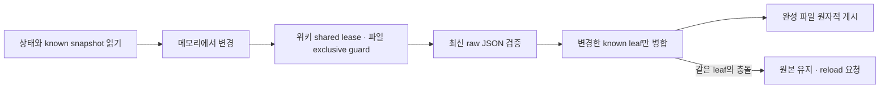

# 위키 상태의 보존과 시간 계약

Markdown에서 복원할 수 없는 읽기·제안·피드백·축복 기록은 사용자 데이터다.
손상된 파일을 빈 기록으로 덮지 않는다. 현재 구현의 범위와 실패 동작을 아래에 적었다.
점검은 `make test`와 `make test-cli`, 세부 시험은 `docs/invariants.md` V4–V8을 따른다.

| 상태 | 저장 위치와 형식 | 변경 정책 |
|---|---|---|
| 사람 읽기 | `_meta/webui/reads.json`, version 1 | 변경한 known 필드만 patch; unknown 보존 |
| 에이전트 읽기 | `_meta/attention/agent-reads.json`, version 1 | 별도 파일; 사람 파일 손상 시에도 healthy aggregate 보존 |
| 제안 | `_meta/tasks/*.json`, version 1 | 완성 파일의 exclusive create, queue 잠금, 종료 시 raw JSON patch |
| 추천·피드백 | `_meta/resurface/state.json`, version 1/2 | 기존 날짜 deadline 관용 읽기, 새 snooze 저장 시 version 2 이상 |
| 검토 원장 | `_meta/reconcile/state.json`, version 1 | 현재 파일 hash를 기록; unknown 보존 |
| 이벤트 | 머신의 XDG state DB | 위키 git과 별개; timestamp를 실제 instant로 해석 |

이 위키 파일들은 기기 사이를 여행하므로 머신 migration ladder를 사용하지 않는다.
future version 번호는 낮추지 않는다. 파생 검색 DB만 cache schema 3으로 재구축한다.
이번 변경은 머신 상태의 새 layout이나 새 migration rung을 도입하지 않는다.

## 협력 쓰기와 보존

object의 모르는 필드와 큰 정수는 raw JSON으로 보존한다. 서로 다른 key의 변경은
합치고, 같은 leaf의 오래된 수정은 저장 전에 거부한다. 배열의 unknown 항목까지
안전하게 합칠 수 없으면 거부한다. JSON object root가 아닌 null·array·깨진 JSON도
거부한다. 포맷과 key 순서까지 원문과 같다는 약속은 하지 않는다.

`reads.Load`는 오류와 함께 healthy half를 돌려줄 수 있다. 소비자는
`HumanAvailable`·`AgentAvailable`로 알려진 빈 상태와 사용 불가 상태를 구별한다.
`status --json`은 읽지 못한 task/checkout/reconcile 수를 null로 표시하고 availability와
diagnostic을 제공한다. healthy half까지 버리거나 손상을 정상 0건으로 숨기지 않는다.

rename은 사람 event count를 합치고 agent-only 이력도 옮긴다. source와 destination에
agent 이력이 모두 있으면 고유 날짜의 합집합을 복원할 수 없어 페이지를 바꾸기 전에
거부한다. 확장된 읽기 기록도 해석 없이 옮기며 잃지 않도록 사전 거부한다.
tasks와 추천 cooldown의 과거 slug 참조는 자동으로 바꾸지 않는다. 제안은 당시 요청이며,
삭제·rename 뒤에는 현재 페이지를 확인해 dismiss하거나 새 제안으로 판단한다.

## 시간과 정리

조회·정렬·GC는 RFC3339 offset 문자열의 사전순이 아니라 actual instant를 비교한다.
태스크는 오래된 instant부터, 동률은 ID 순으로 보인다. 파싱할 수 없는 created는
원본을 유지해 유효 시각 뒤에 놓고 원문·ID 순으로 안정적으로 정렬한다.
동률에는 slug 또는 event ID를 사용한다. 이벤트 GC는 해석 불가 timestamp를 보존한다.
위키 agent 집계는 touch 시각의 calendar day로 하루 한 번 기록한다.

digest의 created/updated 기간 집계에는 파싱 가능한 `YYYY-MM-DD`만 포함한다.
누락·무효 값은 `invalid_dates`와 텍스트 진단으로 남기며 전체 페이지 수에서 제외하지
않는다. 각 날짜 필드는 독립적으로 평가한다. 미래의 유효 날짜와 all-time decisions
목록의 기간 정책은 유지한다. 점검: `go test ./internal/digest/`.

새 snooze는 접수 시각부터 `days × 24h` 뒤의 RFC3339 deadline이다. version 1의
`YYYY-MM-DD`는 기존 UTC 자정 deadline으로 읽는다. version 2 값은 새 canopy가
해석한다. 구버전의 날짜 전용 추천기는 새 timestamp를 해석하지 못하므로 기간 중
추천을 운영하는 기기는 함께 업그레이드해야 한다. 읽음·피드백 기록을 삭제하는
migration으로 이 차이를 숨기지 않는다.

task GC의 기본 보존 기간은 종료 후 90일이다. 파일명과 내부 ID가 일치하고,
known version의 done/dismissed이며 유효한 종료 시각이 cutoff와 같거나 더 오래된 파일만
삭제한다. pending·unknown status·future version은 유지한다. dismissed connect는
파일이 보존되는 동안 재사용되며 GC 뒤 영구 억제를 보장하지 않는다.
음수나 `time.Duration`을 넘는 days는 GC 시작 전에 거부한다.

잠금은 canopy끼리 협력하는 로컬 프로세스를 보호한다. 외부 편집기·외부 Git·분산 파일
시스템·전원 장애에 대한 transaction 보장은 없다. 같은 파일의 여러 상태를 한 번에
rollback하는 체계도 추가하지 않았다. 적용 후 오류는 mutation 결과의 stage와 실제
적용 상태로 복구하며, 원래 요청을 무조건 재실행하지 않는다.
