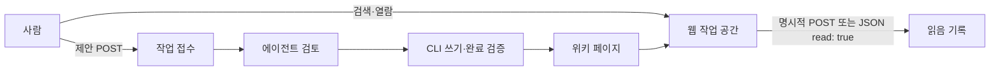

# 웹 작업 공간의 계약

웹은 위키를 읽고 읽음 상태를 기록하며 에이전트에게 작업을 접수하는 문이다. 본문
편집 화면의 제출은 `_meta/tasks/`의 제안이며 페이지 반영과 다르다. 접수 화면은 대상,
요청, 제안 본문, 상태와 시각을 함께 보여 준다. `base`는 **POST 접수 시점**의 파일
해시다. 편집 화면을 열었던 시점의 본문을 보관하거나 충돌 없이 적용한다고 약속하지
않는다. 변경·완료 검증은 [에이전트 작업 계약](agent-tasks.md)을 따른다.

홈의 미읽음 수, 추천 후보, 대기 작업 수는 독립적이다. 추천할 후보가 없어도 미읽음
페이지는 남아 있을 수 있다. 읽음 집계 한 파일을 읽지 못하면 다른 파일의 건강한
정보를 유지하고 해당 정보의 불가 상태를 표시한다. 손상된 집계를 초기화하여 저장하지
않는다. 새 읽음·피드백은 존재하는 페이지에만 추가하며, 과거 키와 읽음 취소는 남긴다.
첫 `HEAD /`는 재노출 기억을 소비하지 않는다. `GET /`는 하루 카드의 노출로 취급한다.

검색과 벡터를 쓰는 추천·연결 후보는 현재 파일 스캔과 임베딩 프로필에 맞춘 인덱스를
확인한 뒤 사용한다. 모델 없는 검색은 keyword이며, 벡터가 불완전하면 의미 추천을
표시하지 않는다. Overview·Discover·페이지·관심 목록의 HTML은 네이티브 추론을
기다리지 않는다. 현재 원문·프로필의 캐시를 확인해 완전한 벡터만 사용하고, 부족하면
일반 정보와 의미 추천 불가 상태를 먼저 표시한다. 필요한 임베딩은 서버당 하나의
백그라운드 작업으로 채운다. 이 작업 중 검색도 현재 근거를 확인해 keyword로
응답할 수 있다. 요청 취소가 백그라운드 갱신을 끊지 않으며, 서버 종료는 갱신을
취소하고 작업이 끝난 뒤 엔진을 닫는다. 점검은 `go test ./internal/webui/ -run
'TestNavigation|TestBackground'`와 `go test ./internal/indexer/ -run TestInspect`다.
검사와 벡터 조회 사이에 다른 요청이 캐시를 바꿔도, 각 벡터의 원문 revision과
현재 응답의 스캔을 대조하고 전부 갖춘 경우에만 의미 추천을 표시한다. 콜드 홈에서
비어 있던 오늘의 연결 카드는 갱신 후 첫 방문에 한 번 채우며 읽을 거리를 다시
소비하지 않는다. 점검은 `go test ./internal/store/ -run TestPageVectorsFor`와 위
탐색 회귀 테스트다.
API는 실제 검색 모드와 인덱스 범위를 반환한다. 추론을 수행하는 인덱스 작업은
서버별로 직렬화하고 검색의 대기 예산을 둔다. 취소는 대기와 배치 경계에서 작동한다. 이미
시작한 네이티브 추론의 즉시 중단이나 엄격한 응답 완료 시간은 보장하지 않는다.
깨진 query encoding·form은 400이며 초과 본문은 413이다. `/api/search`의 `k`는
생략하면 8, 명시하면 정수 1–50이어야 한다. 잘못된 값을 기본값으로 숨기지 않는다.
파일 업로드는 지원하지 않으며 multipart의 file part는 400으로 거부하고 spool을 정리한다.
링크 미리보기는 클릭할 페이지와 같은 주소를 사용하며 모호한 bare slug로 되돌리지 않는다.

JavaScript를 끄면 페이지·탐색·검색 결과·작업 목록과 기본 폼(검색, 제안, 명시적 읽음,
취소, 피드백, 로그인)을 사용할 수 있다. 자동 읽음·자동완성·복사·동적 목차·수식·
Mermaid·물리 그래프는 보강 기능이다. 그래프에는 서버가 만든 페이지/연결 목록이 있다.
넓은 화면에서는 본문 옆에 목차·관련 페이지·작업을 두고, 좁은 화면에서는 기본 동작을
본문 위에 유지하며 목차·관련 항목을 펼칠 수 있다. 코드·표는 자체 영역에서 스크롤한다.

자동 읽음의 화면 상태는 HTTP 성공뿐 아니라 JSON `read: true`를 확인한 뒤 바뀐다.
로그인 HTML, redirect, `read: false`, 잘못된 JSON, 네트워크 실패에는 명시적 버튼을
유지하고 실패를 표시한다. 폼 제출이 가능한 상태와 작업 성공을 혼동하지 않는다.

렌더러는 실행 가능한 raw HTML을 허용하지 않는다. Markdown 파서가 인식한 코드
fence/span/container에서는 위키링크를 바꾸지 않는다. Mermaid와 수식의 불러오기·
구문 오류는 원문과 오류 표시를 남긴다. 수식의 지원 패키지, 정확한 vendor 버전·
가공·해시·라이선스는 [내장 자산 명세](../internal/webui/static/vendor/assets.json)와
[고지](../THIRD_PARTY_NOTICES.md)에 기록한다. 선언하지 않은 TeX 확장은 지원하지 않는다.

앱 CSS/JS URL은 내장 바이트의 SHA-256 접두사를 포함한다. 정적 응답은 ETag와
`Cache-Control: no-cache`로 재검증하며 같은 주소의 서버 업그레이드 뒤 새 HTML이
새 자산을 가리키게 한다. 이미 열린 탭의 화면 변경에는 새로고침이 필요하다.

검색 API의 `mode`는 실제 `keyword`/`hybrid`이며 `index`에는 `semantic_ready`,
`needs_reindex`, `profile`이 포함된다. 그래프 API는 인간 읽음 상태를 알 수 없으면
`read: null`을 반환한다. `reads_partial`, `human_available`, `agent_available`로
집계 범위를 구분하며 `touches`는 확인된 집계만의 합이다. 장애를 `false`나 전체 방문
0으로 해석하지 않는다.

수식은 MathJax 3.2.2의 `base`, `ams`, `newcommand`, `color`, `physics`를 지원한다.
`autoload`, `require`, 원격 확장과 선택적 메뉴는 끈다. `make test-ui`는 내장 TeX
프로세서로 명세의 수식 corpus를 MathML 트리까지 컴파일한다. 실제 SVG 페인트와
접근성 검증은 별도의 브라우저 점검이다.

점검은 `go test ./internal/webui/`, `make test-ui`, `make test-assets`로 수행한다.
실제 브라우저에서는 360px/1280px, 밝은/어두운 테마, 키보드 포커스·IME, JS-off,
오류 시 원문을 확인하고 검색→근거, 페이지→제안→대기열, 미읽음→읽음의 세 흐름을
실행한다. DOM 어댑터나 HTTP 시험을 페인트·IME·접근성 통과로 세지 않는다. 실행한
검사와 미검증 영역은 [구현 보고서](implementation/2026-10-10/reports/web.md)에 구분한다.
