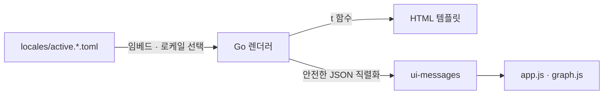

# 웹 UI 다국어(i18n) 설계

> 상태: **구현 완료** (전 템플릿 14개 + Go·클라이언트 표시 문자열, en·ko). 원칙: **UI chrome만
> 로케일별로 스왑, 데이터·동작은 불변.**
> 위키 페이지 *내용*(사용자 마크다운)은 절대 번역하지 않는다 — 앱의 UI 텍스트(nav·버튼·
> 카드·배너)만. 불변식·점검: [invariants.md](invariants.md) **M 섹션**.

이건 [i18n.md](i18n.md)(문서 파일 번역)와 다른 층이다: 그건 마크다운 *파일*의 번역·
staleness, 이건 `canopy serve`가 렌더하는 웹 UI *문자열*의 런타임 로케일 선택.

## 스택 — go-i18n/v2

`github.com/nicksnyder/go-i18n/v2`. 가장 대중적인 Go i18n 라이브러리이고, "로케일
파일 추가 = 언어 추가"가 가장 매끄럽다(active.\<lang\>.toml). CLDR 복수형 내장.
순증 의존성은 이 모듈 하나 — go-i18n이 쓰는 `x/text`·`BurntSushi/toml`은 이미 있던
것을 재사용한다(추가 transitive 0).

기본은 en·ko. 새 언어는 `active.<lang>.toml` 파일 하나를 넣으면 임베드 글로브가
자동 로드한다(코드 변경 0, 불변식 M4).

## 구조



메시지 ID는 snake_case 플랫(점 표기는 TOML에서 중첩 테이블이 되므로 피한다):

```toml
# active.ko.toml
nav_browse = "탐색"
nav_graph  = "그래프"

[home_read_progress]                       # 파라미터·복수형은 테이블 형태
other = "읽음 {{.Read}}/{{.Total}}"

[pages_count]
other = "{{.Count}} 페이지"                 # ko는 복수 무변화
```
```toml
# active.en.toml
nav_browse = "Browse"
[pages_count]
one   = "{{.Count}} page"
other = "{{.Count}} pages"
```

## 로케일 결정 (결정론 · 점검 가능)

`i18n.NewLocalizer(bundle, prefs…)`에 가장 선호하는 것부터 넘긴다:

1. **쿠키 `lang`** — 언어 선택 메뉴가 설정 (브라우저별 지속)
2. **`Accept-Language`** 헤더 — go-i18n이 bundle 언어와 매칭
3. **기본값** — bundle 기본 `ko` (현재 UI가 한국어이므로 아무 변화 없음)

영어 브라우저는 2번으로 자동 영어, 한국어 사용자는 그대로 한국어. 명시 선택은 1번.

## 렌더 — 로케일별 템플릿 셋

`html/template`은 파스 시점에 FuncMap을 묶으므로, **로케일마다 템플릿 셋을 한 번씩
파스해 캐시**한다(`s.tmpl[lang]`). 각 셋의 `t`는 그 로케일의 localizer에 묶인다.
요청 시 결정된 로케일의 셋을 고른다. 로케일 수가 적어 시작 시 N벌 파스는 저렴하다.

- **정적 라벨** — 템플릿에서 `{{t "nav_browse"}}`.
- **동적·보간 문자열**(N일 전, discover 이유, history 라벨, 배너, resurface 설명 등)은
  데이터가 있는 **Go 핸들러에서 localizer로 번역**해 넘긴다 — 템플릿엔 완성된 문자열.
- `t`는 없는 ID·오류 시 **ID를 그대로 반환**(빈칸·panic 금지, M3). key parity(M2)가
  누락을 애초에 막는다.
- **클라이언트 문자열**(복사 결과·자동 읽음·그래프 툴팁)은 같은 카탈로그에서 읽어
  `ui-messages` JSON으로 전달한다. `html/template`이 script 문맥에 맞춰 이스케이프하므로
  번역 문자열이 HTML로 실행되지 않는다. JS는 전달된 메시지를 표시하고, 본문이나 검색
  결과를 번역하지 않는다 (M6).

## 그 하나의 설정 — 언어 선택 메뉴

헤더의 언어 선택 메뉴는 각 언어의 자칭 이름(한국어·English)을 표시한다.
`GET /setlang?lang=en&next=<현재경로와쿼리>`가 `lang` 쿠키를 설정하고 같은 페이지로
돌아간다. 검색어와 탐색 필터를 보존하며, 외부 주소로 향하는 `next`는 `/`로 대체한다
(M7). 언어 전환은 서버사이드이며 JS 없이도 동작한다.

## 기능 변화 없음 (보증)

로케일은 **오직 표시 문자열만** 바꾼다. `/api/search`·`/page`·그래프·읽기 추적·
검색 등 데이터와 동작은 로케일과 무관하게 동일(M5). 위키 페이지 본문은 사용자
마크다운 그대로 렌더된다 — 번역 대상이 아니다.

## 불변식 (invariants M)

- **M1** 템플릿에 하드코딩된 UI-언어 리터럴이 없다 (추출 완료 증명).
- **M2** 모든 로케일이 같은 메시지 ID 집합을 정의한다 (누락 번역 = i18n 최대 버그).
- **M3** 안전한 폴백 — 모르는 Accept-Language→기본, 없는 ID→ID 반환(빈칸·크래시 금지).
- **M4** 로케일 파일 추가 = 언어 추가 (코드 변경 0, 임베드 글로브가 로드).
- **M5** 로케일은 데이터를 바꾸지 않는다 (같은 검색/페이지 결과, chrome만 다름).
- **M6** 클라이언트가 추가하는 UI도 현재 로케일을 따른다.
- **M7** 언어 변경은 쿼리를 보존하고 같은 사이트 안으로 돌아간다.

Go 테스트가 카탈로그·메시지 전달·언어 전환을 확인한다 (`make test`).
클라이언트의 상호작용과 실패 처리는 Node 내장 테스트 러너로 확인한다 (`make test-ui`,
npm 의존성 없음). Node는 개발·CI에서만 사용하며 웹 UI는 기존처럼 Go 바이너리에 내장된다.

## 비-목표

- **페이지 본문 번역** — 위키 내용은 사용자 언어 그대로. i18n은 chrome 한정.
- **RTL·복잡한 서식** — 지금은 en·ko(둘 다 LTR). 필요해지면 확장.
- **config 파일 기본 로케일** — 쿠키+Accept-Language+ko 기본으로 충분. 위키별 기본이
  필요해지면 `canopy.toml`에 `[web] locale` 추가는 작은 확장.
